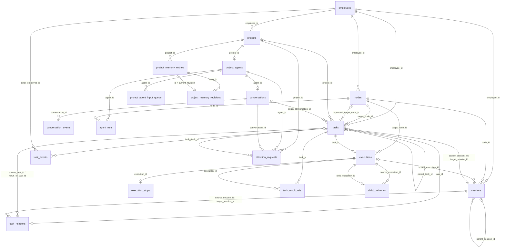

# Baton 技术设计

Status: approved
Owner: 待指定
Date: 2026-10-19
Approved: 2026-10-17 首版；2026-10-19 用户批准 Coordinator 内置 Gateway
Basis: [行为规格](PRODUCT.md)，R-01 至 R-40。

Coordinator 内置 Gateway 的实现与验收由 [PS-171](https://linear.app/kakenhe/issue/PS-171) 跟踪。实施基线为 PS-170 的合并提交 `daaaa19effc47bfb6fd74a6299a1de1781a6918e`；已在原路径兼容验证后移除独立 Relay 及跨进程控制协议。历史实现记录保留原验证环境与版本，最新路径的实际证据见本工单。

## 现状与设计约束

任务需要从 Ubuntu Agent 发到员工 PC，经过北京中转，但北京不能主动访问节点。任务被接受后，中心需要留下可查询记录；完整 Session 历史仍在节点。PC 断线或操作回执丢失时，系统必须核实原执行，不能靠重启 Agent 来恢复任务。

本机已完成 Pi/Codex 的无模型协议探测，以及 Cursor/Kiro 的受控真实接口调查。结论限定到具体版本、系统和观测路径，不代表 Baton 已完成相应适配。

| 对象 | 实际证据 | 可以据此设计的部分 | 尚不能承诺的部分 |
|---|---|---|---|
| Pi 1.3.0 | RPC/事件/Session 文档及无模型控制往返；用户 fa125f9、Darwin 27.2 arm64 / gemini-3.1-flash-lite 真实实测 | 启动、输入、结构化结果、委托、原生历史确认、恢复、缺失历史拒绝与目录隔离支持 | 中止：等当前工具结束后生效，不能中断运行中的工具；Worker 延迟确认修复待本机复跑，其他模型与三系统组合不外推 |
| Codex CLI 0.162.1 | 本机帮助、官方命令导出的协议 Schema；app-server initialize 通过 | thread/turn 映射、结构化输出与分页查询的候选接口 | app-server 标为 experimental；该协议路径的任务执行、审批、中止和恢复仍需验证 |
| Cursor Agent 2026.10.16-e3cb207，macOS arm64 | 真实 print、stream-json、显式 resume、SIGINT 与 ACP 样本；2026.10.01-e373342 仍只有帮助证据 | 单轮 result 完成事件、原生会话标识、带新模型回合的续跑；本次只读续跑没有重跑夹具 | print 活动输入未被接受；SIGINT 后独立 shell 可存活；ACP 的 xhigh fast 选择未跑通，high 变体不能替代；未覆盖其他系统 |
| Kiro CLI 2.32.0，macOS 27.2 arm64 | ACP V3 创建、输出、空闲输入、前台取消与存在会话加载的真实事件和夹具计数 | 显式选择 V3；等待 prompt 响应；原生标识、回放与本轮无重放证据 | 活动 prompt 会打断前回合；缺失 ID 的 load 会新建会话；前台取消样本不覆盖已结束回合的后台进程；无跨系统支持证明 |

Pi/Codex 的上述协议探测未发送 Pi prompt 或 Codex turn/start。Codex 原生 CLI 已用于账号实现的独立审查和验证，这不代替 app-server 接口测试。Cursor/Kiro 的真实探测也仅证明表内所列行为，不代表完整 Agent 适配已经通过。

Pi 的一手资料来自已安装包 `@earendil-works/pi-coding-agent` 的 `docs/rpc.md`、`rpc-commands.md`、`json.md`、`session-format.md`、`security.md` 及相关引用。Codex 使用 `codex app-server generate-json-schema` 导出的 ClientRequest、ServerNotification 和 thread/turn 参数定义。安装版本升级后需重新做兼容性验证。

### 技术选择

| 位置 | 选用技术 | 理由与代价 |
|---|---|---|
| Coordinator（含 Gateway）、batond、Session Worker、CLI | Go；初始工具链基线为 Go 1.27 | 可发布原生可执行文件，节点不需要额外 Node.js 来运行 Baton；代价是需要实现和维护各 Agent 的进程协议适配 |
| Project Agent Runtime | Node.js 程序 `baton-project-runtime`，基于 `@earendil-works/pi-agent-core` 与 `pi-ai` | 由 batond 作为独立进程启动；只有承载 Project Agent 的节点需要安装 Node.js（2026-10-18 修订） |
| 中心记录 | PostgreSQL 16+，pgx，版本化 SQL migration | 延用原始需求的 PostgreSQL；任务、事件和 outbox 可在一次事务提交，不先引入消息队列 |
| 节点执行账本 | SQLite，WAL 与 FULL 同步，拟用纯 Go 驱动 | 支持断电后的去重和待补报记录，便于跨系统发布；需要验证驱动、锁与磁盘故障行为 |
| Web UI | TypeScript、React、Vite | `node tools/build.mjs` 按锁文件安装依赖、生成前端静态文件后编译 Go；`internal/webui/dist` 不提交到 Git，页面嵌入 Coordinator 二进制，部署时无需独立前端服务 |
| 节点与中心通信 | TLS WebSocket，版本化 JSON 信封 | batond 主动连接内置 Gateway；按消息类型限制路由，业务权限和持久化由 Coordinator 业务处理器负责 |
| 浏览器实时通知 | 同源 WebSocket；普通操作用 HTTP JSON API | 统一账号会话与权限检查；需要处理输出限流、断流和浏览器重连 |

不嵌入 Agent SDK，也不解析终端 ANSI 画面来判断任务完成。Pi 和 Codex 优先使用结构化双向接口；只有存在证据且经过验证的能力才进入支持矩阵。这样减少对 Agent 内部代码的绑定，但不能消除外部协议升级风险。

Project Agent Runtime 使用 pi-agent-core 的 SDK，但它运行在独立的 Node.js 进程里，Go 进程仍不嵌入任何 Agent SDK。选型理由见 Project Agent TECH 第 1 节（2026-10-18 修订）。

## 进程与职责

### 控制与执行路径

```text
浏览器 ── HTTPS / WebSocket ── Coordinator API
                                      │
                                业务处理器 ── PostgreSQL
                                      │
                              Gateway（进程内）
                                ╱           ╲
                         出站 WSS         出站 WSS
                            ╱               ╲
                       batond             batond
                          │                  │
                    Session Worker     Session Worker
                          │                  │
                     本地 Agent         本地 Agent
```

API、Gateway 与业务处理器运行在一个 Coordinator 进程内。节点消息经过认证身份注入与明确类型分派，再由业务处理器验证和记录；节点不能直接向其他节点转发任意正文。Gateway 的 Go 包边界限制依赖关系，进程故障和内存耗尽仍会影响整个 Coordinator（R-03、R-40）。

| 进程 | 拥有的状态与职责 | 不负责的内容 | 对应行为 |
|---|---|---|---|
| Gateway（Coordinator 内部模块） | 活动连接、认证入口、连接代次、心跳、限流、有界队列、消息收发 | 任务队列、Session 语义、业务持久化、执行重试、签名私钥 | R-03、R-04、R-24、R-29、R-40 |
| Coordinator | 员工、节点归属、默认节点、任务状态、委托关系、执行记录、调度、API、Plane 集成；Project、主对话、输入队列、项目记忆、Project Agent 的放置与租约、事项与浏览器通知（2026-10-18 修订） | 原始 Session 历史、模型调用、设备 SSH | R-01、R-05～R-06、R-12～R-25、R-27、R-33～R-38 |
| batond | 节点身份、本机注册、中心连接、能力汇总、本地 RPC、Worker 发现与启动；Project Runtime 的启动、停止和续租（2026-10-18 修订） | 不依靠自身内存保存唯一执行事实 | R-02～R-03、R-07～R-11、R-26 |
| Session Worker | 一个 Session 的 Agent 进程、输入顺序、启动和交付账本、结果、事件及本地历史访问 | 无权签发中心身份、改派任务或创建第二次同任务执行 | R-09～R-11、R-14、R-21～R-23、R-26、R-28～R-29 |
| baton CLI | 员工操作入口、Agent 提交委托与查询结果、提交结构化任务结果 | 不持有中心管理员或签名密钥 | R-12～R-15、R-19 |
| Project Runtime | 一次 Project Agent 运行：模型推理、对话事件上报、压缩（2026-10-18 修订） | 自身不执行命令或访问文件；不直接连接 Coordinator 或数据库；不持有订阅以外的凭据 | PA-01～PA-22 |

Session Worker 由 batond 使用同一可执行文件的内部子命令启动，不是另一个对外部署产品。Worker 与 batond 分开存活，batond 重启时可重新连接原 Worker。系统关机、Worker 崩溃或 Agent 自身退出仍可能中断执行，按 R-22 核实，不保证进程永远存活。

Worker 使用带认证的 Unix domain socket 或 Windows named pipe 与 batond 通信，不向局域网开放无认证控制端口。节点级文件锁防止两个 batond 同时使用同一数据目录；Session 级锁防止两个 Worker 同时接管一个 Session。

Project Runtime 由 batond 按 Coordinator 的 `project_run_start` 启动，经本地 IPC 与 batond 通信，请求经 Gateway 进入 Coordinator 业务处理器，和 Agent CLI 的委托请求走同一条路径。Runtime 进程不需要像 Worker 那样跨 batond 重启存活：它的状态全部在 Coordinator，batond 重启导致 Runtime 退出时，下一次运行会接着处理。中心不可用时继续遵守原有续租与停止规则。

POSIX 下 Worker 使用独立进程组；Windows 下由 Worker 持有 Agent 进程的 Job Object，避免 batond 退出连带结束 Worker。进程组、Job Object 和真实工具子进程的退出行为都需要目标系统验证，不能仅靠 detached 标志认定已经独立。

第一版中心按单个活动 Coordinator 设计，不引入多活调度。进程内可有多个任务处理器，但所有业务变更通过数据库事务和版本检查。扩展多实例之前需要补充 leader fencing，不能仅增加副本数。

### 拟建仓库结构

```text
cmd/coordinator/            Coordinator 与管理命令
cmd/batond/                 节点守护进程与内部 Worker 子命令
cmd/baton/                  员工与 Agent CLI
internal/gateway/           节点连接、认证入口、流量控制与收发
internal/control/           节点业务处理、任务分派与临时 RPC
internal/httpapi/           员工 HTTP API、会话与权限入口
internal/store/             业务事务与持久化
internal/node/              注册、能力、节点 RPC 和同步
internal/session/           Worker、输入账本和历史索引
internal/agent/             统一 Adapter、Pi/Codex/Kiro 原生协议适配
internal/protocol/          信封、事件、错误和版本
internal/plane/             Plane 触发、映射和回写
internal/projectagent/      Project、主对话、输入队列、放置与租约、Project Agent 工具（2026-10-18 修订）
runtimes/project-agent/     baton-project-runtime 的 TypeScript 源码（2026-10-18 修订）
migrations/                 PostgreSQL migration
web/                        Web UI
```

内部代码可以按实施规模调整，进程职责与持久化所有权的变化需要修订本设计。

## 核心数据结构

本节记录当前迁移与生产代码现状：`migrations/0001`～`0019` 共 19 个 SQL 文件、34 张业务表。以后新增核心表或改变关联时，同步更新本节。当前没有 `plane_links`、`plane_events` 表。

### PostgreSQL 关系

图画出账号、节点、执行与 Project 的主要外键；认证、投递和 Plane 等配套表逐张列在下表。连线标签是子表的外键列，同一对表的多列外键合并标注；联合外键中的 `employee_id` 省略，员工归属仍由表定义和入口检查保证。基数按数据库约束表示，业务上任务接受时会同时创建 Execution。



`project_agents` 的 `lease_run_id`、`lease_epoch`、`lease_until` 保存当前租约，`agent_runs` 保存历次运行；`lease_run_id` 没有外键，运行绑定由 `internal/store/project_runtime.go` 的 `validateProjectRun` 检查。`conversation_events.run_id`、输入队列的 `delivered_seq`、记忆修订的 `source_seq`、`task_events.execution_id`、`task_result_refs.node_id` 和 `request_tombstones.task_id` 也没有数据库外键，图不为这些列画外键线。记忆条目的当前修订外键延迟到事务提交时检查，事件与记忆修订由触发器限制为只追加。

表中 `store/` 指 `internal/store/`，其中的写入由 Coordinator 执行；`plane/` 指 `internal/plane/`，也是 Coordinator 内的组件；`inbox/` 指 `internal/inbox/`。迁移列标出建表文件的编号，事实栏采用后续迁移完成后的结构。

| 表 | 迁移 | 记录的事实与关联 | 写入组件及入口 | 主要读取组件及入口 |
|---|---|---|---|---|
| `employees` | 0001 | 员工身份、认证来源和密码摘要 | 账号：`store/store.go` 的 `InsertLocalEmployee`、`SetLocalPassword` | 认证：同文件 `FindLocalCredential`、`LookupSession` |
| `login_sessions` | 0001 | 员工的浏览器登录、Token/CSRF 摘要、到期和撤销 | 认证：`store/store.go` 的 `InsertSession`、`RevokeSession` | 认证：同文件 `LookupSession` |
| `nodes` | 0002 | 员工设备身份、注册序号、能力、默认 Agent；0015 删除 `role` | 注册/同步：`store/node.go` 的 `Register`、`store/presence.go` 的 `SyncNode` | 节点 API：`store/presence.go` 的 `ListNodes`；任务目标解析：`store/task.go` 的 `loadOwnedNode` |
| `node_credentials` | 0002 | 节点凭据 ID、版本、有效期与吊销；0003 删除 Token 摘要列 | 注册/吊销：`store/node.go` 的 `Register`、`store/revoke.go` 的 `RevokeNode` | Gateway：`store/connection.go` 的 `CheckNodeConnection` |
| `node_enrollments` | 0002 | 员工的一次性注册凭据摘要及使用时间 | 注册：`store/node.go` 的 `IssueEnrollment`、`Register` | 注册：同文件 `Register`、`explainEnrollment` |
| `employee_settings` | 0002 | 员工默认设备；0015 改为 `default_device_node_id`，联合外键指向本人节点 | 注册/设置：`store/node.go` 的 `Register`、`SetDefaultDevice` | 任务：`store/task.go` 的 `resolveDefaultDevice`；运行调度：`store/project_placement.go` 的 `scheduleProjectRun` |
| `node_presence` | 0003 | 节点当前连接、在线与同步状态、最后联系时间 | Gateway：`store/connection.go` 的 `ConnectNode`、`TouchNode`；`store/presence.go` 的 `UpsertPresence`、`MarkOffline` | 节点 API：`store/presence.go` 的 `ListNodes`；Gateway：`CheckNodeConnection` |
| `node_revocations` | 0004 | 节点、凭据、操作者及吊销请求/生效时间，分别引用节点、凭据、员工 | 吊销：`store/revoke.go` 的 `RevokeNode`、`MarkRevocationsApplied` | 吊销补发/查询：同文件 `PendingRevocationSet`、`NodeRevocation` |
| `tasks` | 0005 | 请求与解析后的目标、父任务、来源/目标 Session、状态和当前结果；0014 加产物要求，0017 加 Project/对话来源 | 任务：`store/task.go` 的 `insertAccepted`；结果：`store/result.go` 的 `applyResult` | API：`store/task_view.go` 的 `GetTaskView`；Agent：`store/agent.go` 的 `AgentTask` |
| `executions` | 0005 | `task_id` 唯一的执行身份、节点、存储代次、准备、许可、输入代次与开始时间 | 任务/控制：`store/task.go` 的 `insertAccepted`、`store/dispatch.go` 的 `SavePrepared`、`store/start.go` 的 `decideStart` | 控制/上报：`store/start.go` 的 `lockExec`、`store/result.go` 的 `lockExecution` |
| `task_events` | 0005 | 按任务版本保存状态变化；0009～0010 加执行和停止事实，0012 加人工核实与重新执行内容 | 任务/结果：`store/task.go` 的 `insertAccepted`、`store/result.go` 的 `insertReportEvent`；核实：`store/resolve.go` | API：`store/task.go` 的 `ListTaskEvents`；上报去重：`store/result.go` 的 `ApplyExecutionReport` |
| `dispatch_outbox` | 0005、0023 | Task、Execution、节点的 prepare 意图、投递租约、下一次尝试时间、可能发送事实与 ACK | 接受：`store/task.go` 的 `insertAccepted`；领取与回执：`store/dispatch.go` 的 `ClaimPrepares`、`SavePrepared`、`ackOutbox` | 非阻塞分派：`control/prepare.go`；无效意图退役：`RetirePrepares` |
| `request_tombstones` | 0005 | 员工与 request_id 唯一的请求摘要、原 task_id；保留去重身份 | 任务：`store/task.go` 的 `insertAccepted` | 重试：同文件 `loadTombstone` |
| `sessions` | 0006 | 员工节点上的执行 Session、原生 ID、父 Session、状态和当前绑定执行 | 准备/结果：`store/dispatch.go` 的 `upsertPreparedSession`、`store/result.go` 的 `applyResult` | API：`store/session.go` 的 `ListSessions`、`GetSession`；Agent：`store/agent.go` 的 `validateAgentSource` |
| `task_relations` | 0006 | 每个任务的来源任务/Session、目标 Session；0012 加 `rerun_of_task_id` | 任务/准备：`store/task.go` 的 `insertAccepted`、`store/dispatch.go` 的 `SavePrepared`；重跑：`store/resolve.go` 的 `RerunTask` | Agent：`store/agent.go` 的 `AgentTask`、`AgentRelations`；任务：`store/task.go` 的 `loadTask` |
| `task_result_refs` | 0008 | Task/Execution 的证据与产物位置、可访问状态；按任务、种类、位置唯一 | 结果：`store/result.go` 的 `replaceRefs`、`appendRefs` | 结果/API：同文件 `attachResults`；Plane：0019 的 `plane_snapshot_task` |
| `delivery_records` | 0008 | 结果事件已被中心收妥，引用 Task、Execution、来源 Session；状态固定 `delivered` | 结果：`store/result.go` 的 `insertDelivery` | Agent：`store/agent.go` 的 `AgentTaskView`；子结果领取：`store/child_delivery.go` 的 `ChildDeliveries` |
| `execution_stops` | 0010 | 每个 Execution 的停止请求、ACK、停止事实、副作用是否已知与未启动证据 | 控制：`store/stop.go` 的 `requestStop`、`applyStopReport` | Worker 心跳：同文件 `ExecutionControl`；任务展示：`store/task.go` 的 `loadTask` |
| `child_deliveries` | 0011 | 来源与子 Execution 之间的子结果交付，子执行唯一；含输入代次和交付状态 | 委托：`store/child_delivery.go` 的 `ChildDeliveries`、`RecordChildReceipt` | 委托：同文件 `ChildDeliveries`；API：`store/task_view.go` 的 `taskViews` |
| `plane_issues` | 0013 | 外部 Webhook、Plane Project、Issue 的联合身份 | Plane 接收：`plane/inbox.go` 的 `receive` | Plane 入站：同函数的插入冲突处理及 `plane_deliveries`、`plane_triggers` 的联合外键检查 |
| `plane_triggers` | 0013 | 外部工单执行轮次、操作者、员工、接受时输入及关联 Task；外键到 `plane_issues`、`employees`、`tasks` | Plane：`plane/service.go` 的 `decide`、`recoverAccepted` | Plane 恢复：同文件 `process`、`recoverAccepted`；回写：`plane/writeback.go` 的 `claimWriteback` |
| `plane_deliveries` | 0013 | Webhook 投递去重、白名单事件、处理/重试状态；外键到 `plane_issues`、`plane_triggers` | Plane：`plane/inbox.go` 的 `receive`、`finish`；`plane/service.go` 的 `process` | Plane：`plane/inbox.go` 的 `retryPending`、`plane/service.go` 的 `process` |
| `node_runtime_reports` | 0015 | 节点运行能力与订阅登录状态报告、报告版本和时间 | 节点上报：`store/runtime_report.go` 的 `SaveRuntimeReport` | Project 调度：`store/project_placement.go` 的 `scheduleProjectRun` |
| `projects` | 0016 | 员工的项目目标、状态与版本 | Project API：`store/project.go` 的 `CreateProject`、`PatchProject` | API/Runtime：同文件 `Project`、`ListProjects`；`store/project_runtime.go` 的 `bootstrapProjectRun` |
| `project_agents` | 0016 | 每项目唯一的 Agent、模型配置及当前运行租约 | 创建/配置：`store/project.go` 的 `CreateProject`、`PatchProject`；调度：`store/project_placement.go` 的 `scheduleProjectRun` | Runtime：`store/project_runtime.go` 的 `validateProjectRun`；调度：`scheduleProjectRun` |
| `conversations` | 0016 | 每个 Agent 唯一的主对话、事件序号、压缩位置、失败与重试状态 | 创建：`store/project.go` 的 `CreateProject`；输入/响应：`store/project_runtime.go` 的 `claimProjectInputs`、`appendProjectAssistant` | API：`store/project.go` 的 `Project`；Runtime：`store/project_runtime.go` 的 `validateProjectRun` |
| `conversation_events` | 0016 | 主对话中只追加的输入、助手响应与工具结果；主键为对话 ID 与 seq | Runtime：`store/project_runtime.go` 的 `claimProjectInputs`、`appendProjectAssistant`；`store/project_tools.go` 的 `callProjectTool` | API：`store/project.go` 的 `ProjectEvents`；Runtime：`store/project_runtime.go` 的 `readProjectRunEvents` |
| `project_agent_input_queue` | 0016、0024 | 输入、来源去重键、领取事件序号及逐条通知接收进度 | 用户：`store/project.go` 的 `AcceptProjectMessage`；通知：`store/project_inputs.go` 的 `insertProjectInput` | 领取：`claimProjectInputs`；提示与确认：`store/project_delivery.go` |
| `project_memory_entries` | 0016 | Project 的记忆条目标题与当前修订指针 | API/工具：`store/project_memory.go` 的 `writeProjectMemoryTx` | API：同文件 `ProjectMemory`、`ListProjectMemory`；工具：`store/project_tools.go` 的 `executeProjectTool` |
| `project_memory_revisions` | 0016 | 只追加的记忆正文修订、作者及来源事件序号 | API/工具：`store/project_memory.go` 的 `writeProjectMemoryTx` | API：同文件 `ProjectMemory`、`ListProjectMemory`；历史修订：`store/project_tools.go` 的 `executeProjectTool` |
| `agent_runs` | 0017、0024 | Runtime 运行、租约代次、模型快照、结束原因、停止意图和命令重试时间 | 放置：`store/project_placement.go`；命令领取：`store/project_delivery.go`；回执：`store/project_runtime.go` | 启动/停止独立到期索引；Runtime 请求继续验证有效租约 |
| `attention_requests` | 0018 | Project 的 Agent 提案或两种系统事项、状态和处理版本；可选任务引用保存原结果版本与快照 | 工具/系统状态：`inbox/requests.go` 的 `CreateAgent`、`CreateSystem`、`ResolveSystem`；处理/撤回/归档：同文件 `Process`、`Withdraw`、`Archive` | API：`store/inbox.go` 的 `Inbox`、`AttentionRequest`；工具：同文件 `executeInboxTool` |
| `task_acceptances` | 0019 | 员工对 Task 某版本的通过/拒绝和评论 | 验收 API：`store/acceptance.go` 的 `AcceptResult` | API：同文件 `ListAcceptances`；Plane 快照：0019 的 `plane_snapshot_task` |
| `plane_outbox` | 0019 | 外键关联触发轮次与 Task，保存任务版本快照、重试、领取和外部评论确认 | 数据库：0019 的 `plane_snapshot_task`，由 `plane_task_changed`、`plane_task_linked` 触发；Plane：`plane/writeback.go` 的 `retryWritebacks` | Plane：同文件 `claimWriteback`、`writeComment` |

0007、0009、0012、0014 只改列、约束或索引，变更分别归入 Execution 许可、任务/事件、重新执行关系和产物要求。0003、0006、0008、0010、0015、0017、0018、0019 的改表部分也包含在上表对应事实中。`internal/migrate/migrate.go` 创建的 `schema_migrations` 记录已应用文件名，由 `upFS`/`Check` 写读，属于迁移设施，排除在业务 ER 图之外。`node_registration_seq` 是序列。

### 节点本地 SQLite

batond 独占写节点 `node.db`：`internal/node/ledger.go` 的 `nodeSchema` 创建 `meta`（存储代次等）、`receipts`（Task/Execution 到 Session 的 prepare 接收映射）、`sessions`（本地绑定）、`workers`（进程索引）；`internal/node/agent.go` 的 `ensureAgentSchema` 创建 `agent_contexts`（本地委托凭据摘要与执行绑定）；`internal/node/project_runtime.go` 的 `newProjectRuntimeManager` 创建 `project_runtime_runs`（run_id 与 lease_epoch 的启动去重）。

`project_runtime_runs` 同时保存进程清理完成、中心确认及补送退避。进程树回收和本地收尾结束后，节点先保存事实再主动补送 `exited` / `stopped`；暂时写入失败时保留本机清理事实继续补写，发送失败则按账本到期时间重试。旧账本或重启后缺少清理证据的运行保持未确认，内存中没有运行实例不能单独证明已经清理。

这些 ID 分别对应中心 Task、Execution、Session 和 `agent_runs`，跨库关联由协议检查，中心收到准备事实后通过 `SavePrepared` 记录存储代次与 Session。

每个 Session 的 Worker 独占写另一份 SQLite：`internal/session/ledger.go` 的 `createWorkerSchema` 创建 `meta`（执行、许可、输入意图和代次）、`writes`（追加记录）、`execution_log`（本地输入/结果记录）、`outbox`（待中心确认的事件）；`internal/session/child_delivery.go` 的 `ensureChildSchema` 创建 `child_deliveries`（子结果与本地交付状态）、`native_delivery_checks`（原生历史核查标记）；`internal/session/browser.go` 的 `browserInputLocked` 按需创建 `browser_inputs`（补充输入操作 ID、摘要和状态）。`outbox.event_id` 对应中心 `task_events.id`，结果上报还生成同 ID 的 `delivery_records`；中心提交 ACK 后，`workerDB.Ack` 才确认本地交付。两端 `child_deliveries` 通过 delivery_id 对应，中心 `RecordChildReceipt` 接收本地交付事实。`sqlite_sequence` 是 SQLite 为自增列维护的内部表。完整原生 Agent 历史仍由 Agent 保存在节点文件中。

### 问题清单

以下是现有结构的职责或使用情况，供后续改动时核对；本节不提出删表或迁移方案。

1. 任务关系在 `tasks` 与 `task_relations` 双份保存。`tasks.parent_task_id/source_session_id/target_session_id` 对应关系表的 `source_task_id/source_session_id/target_session_id`。写入依据：`internal/store/task.go` 的 `insertAccepted` 同事务写两处，`internal/store/dispatch.go` 的 `SavePrepared` 同事务更新两处目标 Session。读取依据：`internal/store/task.go` 的 `loadTask` 和 `internal/store/child_delivery.go` 的 `ChildDeliveries` 读任务列；`internal/store/agent.go` 的 `AgentTask`、`AgentRelations` 读关系表。两套读取都在使用，后续变更关系时需同时维护；`rerun_of_task_id` 另有独立用途。
2. 两张交付表使用了相近的状态名，记录的交付阶段不同。写入依据：`internal/store/result.go` 的 `applyResult`、`retainLateResult` 调 `insertDelivery`，在中心接受结果时写 `delivery_records.status='delivered'`；`internal/store/child_delivery.go` 的 `RecordChildReceipt` 根据来源 Worker 的回执更新 `child_deliveries.status`。读取依据：`internal/store/agent.go` 的 `AgentTaskView` 对来源任务检查前者，对子结果优先返回后者；`internal/store/task_view.go` 的 `taskViews` 展示子结果交付状态。`delivery_records` 的 `delivered` 只表示中心收妥结果，来源 Agent 的注入确认由 `child_deliveries` 保存。
3. `project_agent_input_queue.payload_hash` 有写入，生产代码尚未读取。写入依据：`internal/store/project.go` 的 `AcceptProjectMessage` 保存正文 SHA-256，`internal/store/project_inputs.go` 的 `insertProjectInput` 保存序列化 payload 的 SHA-256。读取依据：前者遇到去重冲突时直接读取 `payload->>'content'` 比较正文；`internal/store/project_runtime.go` 的 `claimProjectInputs` 读取 payload、大小和来源键。对 `internal/` 生产 Go 文件检索 `payload_hash` 只命中这两处 INSERT，未找到摘要校验或查询用途；两条写入路径计算摘要的对象也不同。

## 状态与持久化所有权

### 中心数据

PostgreSQL 不保存完整 Session 消息。应用层对可持久化事件采用字段白名单，不能直接把节点上报正文存为通用 JSON 日志。Project Agent 的主对话是例外：它的消息按 pi-ai 的消息格式保存在专用的 `conversation_events` 表，不进入 `task_events`（2026-10-18 修订）。

现有表、外键及读写组件见「核心数据结构」。

request_id 去重使用调用方提交的原始字段计算摘要，缺省字段保留“未指定”的语义。重试时先找旧请求，再解析默认节点和 Agent，避免修改默认值后把同一提交误判为不同请求。

任务接受、目标与默认 Agent 解析、execution 身份分配、初始事件和 outbox 写入必须同事务提交。`UNIQUE(employee_id, request_id)` 解决并发提交。任务状态更新同时检查当前版本和执行身份，失败后读取已有记录，不重新创建任务。

所有跨对象查询都附加 employee_id 条件并检查引用归属。数据库可追加行级策略作为防误用措施，但不代替应用授权。浏览器、节点和 Plane 的调用身份在入口派生，不信任正文传来的 employee_id。

迁移 `0015_equal_nodes.sql` 删除节点角色并将默认值列改为 `default_device_node_id`。已有默认引用保持原值；仅为空或没有设置行的员工按注册序号补选最早的有效节点。注册与同步接受但忽略旧 `role`；注册响应固定返回 `role: "pc"`，以便旧版 batond 校验身份。节点列表与详情不返回该字段。默认设备设置响应同时提供 `default_device_node_id` 和旧 `default_pc_node_id`；节点列表和吊销响应同时提供 `default_device` 和旧 `default_pc`。

### 节点与 Worker 数据

节点数据保存在员工自己的应用数据目录，不放进代码仓库。Linux 使用 XDG 对应目录，macOS 使用 Application Support，Windows 使用当前用户 LocalAppData。身份秘密优先进入系统凭据存储；文件回退必须限制到当前用户，并明确报告使用了回退。

身份文件、Coordinator 的 Ed25519 签名私钥、Agent CLI 上下文及文件形式的注册凭据统一按秘密文件处理。Linux/macOS 拒绝组或其他用户权限位，写入使用 `0600`，节点数据目录使用 `0700`。Windows 使用 `golang.org/x/sys/windows`：所有者为当前进程用户 SID，DACL 受保护且只显式授予该 SID 完全控制，不额外授予 SYSTEM 或 Administrators；数据目录不接受祖先的继承权限，但将当前用户授权以 `OI/CI` 传递给子项，避免保护目录时撤掉已有子目录的访问权限。秘密临时文件在创建时即设置独立安全描述符，写入同步后再替换目标。读取从实际打开的句柄校验所有者、非空受保护 DACL，拒绝继承 ACE、其他主体的允许 ACE 及无法识别的 ACE 类型。Windows 路径还拒绝文件及祖先目录中的符号链接、junction 和其他 reparse point。Coordinator 加载外部提供的私钥时也执行相同校验，不能依赖默认继承 ACL；程序保存私钥使用 `Signer.WriteFile`。这些限制不改变本机管理员可通过系统特权接管文件的操作系统边界。

| 数据 | 唯一写入者 | 处理方式 |
|---|---|---|
| 节点配置、身份、存储代次、Worker 索引 | batond | 节点 SQLite 与本地配置；新建存储代次不能自动继承旧任务启动资格 |
| task_id 到 execution_id 的接收记录 | batond | 先持久化再通知 Worker，重复 prepare 返回同一映射 |
| Session 输入、启动、取消及结果交付账本 | 对应 Worker | 独立 SQLite；关键状态提交需完成同步后才操作 Agent |
| 原生 Agent Session 历史 | Agent | 保留原生标识和路径，不搬到北京 |
| 规范化输出与历史索引 | Worker | 节点本地分段文件及索引，供分页、断流补取和缺口标记 |
| 未确认送达的事件与结果 | 事件拥有者 | 本地 outbox；中心持久化 ACK 后才能清理 |
| Project Agent 的 `run_id` 去重记录 | batond | 节点 SQLite；同一 run 不启动第二个 Runtime 进程（2026-10-18 修订） |
| Project Runtime 的订阅凭据 | pi-ai | Runtime 自己的数据目录，按秘密文件处理；不上传（2026-10-18 修订） |
| 「允许 Project Agent 执行命令」开关和 shell | 员工，经 batond 配置 | 默认关闭；Worker 执行 `shell` 任务前再读一次（2026-10-18 修订） |

Worker 直接向自己的账本提交执行事实，batond 只转发并代收中心 ACK。这样 batond 崩溃不会丢掉唯一的“是否已向 Agent 发送输入”记录。磁盘写失败时不能报告持久化成功，也不能在缺少启动账本时继续提交新任务。

共享一个大 SQLite 由所有 Agent 进程写入会使锁和清理相互影响。本设计按节点和 Session 分库，增加了文件数量与迁移工作，但让每个关键账本只有一个写入者。


## 任务从接受到执行

### 协议身份与去重

每个任务只有一个 task_id 和 execution_id。运输重试可以产生多次发送，但不能产生第二份执行身份。一次人工重新执行按 R-20 新建 task_id，并关联原任务。

中心命令包含 message_id、task_id、execution_id、目标节点及其存储代次、任务版本和有效期限。节点持久化接收映射后，重复 prepare 只报告现有状态。

### 启动流程

1. Coordinator 在事务中接受任务并保存 outbox，返回已接受。
2. 调度器经 Gateway 发送 prepare。prepare 只能绑定目标 Worker、被动检查能力与工作目录，不能把任务输入交给模型，也不能启动可能执行扩展或启动钩子的 Agent。已有空闲 Agent 可以保持原进程。
3. 节点保存 prepared，返回对应 execution_id、Session 和存储代次；Coordinator 保存准备事实。
4. Worker 准备实际提交输入时，请求短时启动许可。Coordinator 在事务中重新检查任务状态、取消标记、目标身份、排队期限和执行身份。
5. 事务保存 start_authorized 后，Coordinator 签发绑定 execution_id、请求摘要与有效期的许可。数据库提交失败则不签发。
6. Worker 校验许可，在 Session 互斥区内检查期限和取消，再同步提交 start_intent。需要新 Agent 进程时，此时才启动；随后只向 Agent 发送一次任务输入。
7. 适配器观察到有效启动事实后记录 started，并持续补报；Coordinator 将任务表示为执行中。

prepare 和启动许可都是内部执行阶段，不增加 PRODUCT 中的对外任务状态。中心若只知道授权已经发出，就必须承认“可能已经启动”，不能把缺少 started 回执解释为从未执行。

启动许可约束第一次可能执行代码的动作：新会话为启动 Agent 进程，既有会话为提交任务输入。执行计时从该边界开始，不能等到模型首次输出才计时。显式指定的 Session 忙碌时返回忙碌，不把该 Session 改成隐式任务队列。

启动许可初始有效期拟为 5 秒，且不能晚于排队到期时间。Worker 从许可请求的往返耗时计算保守的本地单调时钟预算，并扣除安全余量；无法建立正预算就拒绝启动。不能直接信任用户可修改的本机墙上时钟。精确算法、暂停唤醒和异常时钟必须经过故障测试。

过期许可不通过新 Session 或新 execution_id 自动续跑。只有能证明尚未发送输入、且任务仍在等待期限内，才能对同一执行重新准备；已经存在不确定 start_intent 时进入核实。

### 崩溃位置与恢复

| 崩溃或断线位置 | 已知事实 | 恢复动作 |
|---|---|---|
| 接受事务提交前 | 中心没有接受记录 | 相同 request_id 重试；无投递 |
| 接受事务提交后、响应丢失 | 任务已存在 | 返回原任务，不重新解析默认值 |
| prepare 前或重复 prepare | 尚无启动资格 | 重发同一准备命令 |
| prepared 后、启动许可前 | 该 Worker 尚未发送任务输入 | 重新核对中心状态和期限，不凭 prepared 启动 |
| 许可发出、节点未确认接收 | 中心只能判断可能已启动 | 查询原执行，不另发第二份执行身份 |
| start_intent 已同步、尚未写入 Agent 或写入结果丢失 | 无法安全区分输入未发送和已经被接收 | 检查原进程、原生会话及输入标识；证据不足则待核实，不重发 |
| Agent 已运行、batond 重启 | Worker 可能仍在 | 重连 Worker，继续原执行 |
| Worker 退出但 Agent 状态不明 | Agent 可能仍有动作 | 待核实；不能仅用 PID 存在当作同一任务仍运行的证明 |
| 结果本地保存、中心 ACK 丢失 | 同一结果可以重复上报 | 按 event_id 与 execution_id 去重，补 ACK |

这套方案接受“可能一次也未执行但需要人工核实”的代价，以保证不为了追求自动恢复而重复执行设备操作。它不声称跨数据库、进程和交换机实现无条件的 exactly-once。

### 状态处理与人工核实

Coordinator 负责对外任务状态；Worker 负责上报实际执行证据。Coordinator 不能覆盖节点事实，也不能根据中心自身的重启推断任务需要重跑。

节点事件携带稳定 event_id 和 execution_id。事务保存事件、更新状态及创建后续通知后才返回持久化 ACK。乱序结果通过执行身份、事件序号和已有事实归并；终态冲突保存为补充证据，不静默改写结论。

待核实任务仍可查询同一执行。人工核实提交 expected_version、结论、理由与证据，冲突时先返回最新版本。人工结论保留原事实与操作者，不删除失败、取消或不确定的经过。

### 取消与超时

取消请求先在中心事务中保存，再创建取消命令。若尚未发出启动许可且没有可能启动的投递，中心可以直接取消；许可已经发出或状态不确定时，等 Worker 的证据，不能立即宣称取消完成。

Worker 对启动、输入和取消使用同一 Session 串行队列。启动前收到取消，则保存未发送事实并拒绝启动；发送后收到取消，则调用适配器的中止接口。中止 ACK 仅说明接口处理结果，是否还有子进程或外部动作需结合适配器证据。

Pi 中止先 clear_queue，再 abort，并观察是否真的 settled。Codex 使用 threadId、turnId 绑定的 turn/interrupt；不能把其方法返回直接等同于所有 shell 子进程都已停止。Cursor 的 SIGINT 样本中 CLI 已退出但独立 shell 仍运行。Kiro ACP V3 的活动前台 Python 在 session/cancel 后退出；该样本不覆盖回合已结束、通过 shell 后台启动的进程。适配器按具体执行身份和外部动作证据判断，不扩大取消保证。

执行期限由 Worker 的本地单调计时器与中心期限扫描共同监测。Worker 离线时仍能执行已知中止要求。中心无法确认停止，就保存中止标记并按 R-17、R-22 转待核实。到期不发第二次任务输入。

取消父任务时在同一业务操作中找出未结束子委托，分别创建取消请求。界面展示子任务的独立确认情况，不把父任务已停止表示为整个委托链已停止。

## Agent 适配与委托入口

### 适配接口

内部适配器至少定义 Probe、CreateSession、Attach、StartTask、SendInput、Interrupt、ReadHistory、Events、Close。每个实现分别声明能力，不能用空实现假装支持。

会话级互斥由 Worker 控制。启动命令使用参数数组与明确的工作目录，不拼接含员工输入的 shell 命令。`shell` 执行器是唯一的例外：它的用途就是执行一条命令，命令文本作为单个参数交给 shell（例如 `zsh -lc <command>`），不再拼接其他内容（2026-10-18 修订）。模型认证由原 Agent 管理，节点连接凭据与中心签名密钥不传给 Agent。

| Agent | 拟采用路径 | 完成判据与风险 |
|---|---|---|
| Pi | pi --mode rpc；显式 Session 目录和原生会话标识 | 先匹配 prompt 响应，持续消费至 agent_settled；不能只看 agent_end 或进程退出。关闭 Agent 自动重试；正常的工具循环不是重放 |
| Codex | app-server stdio；Session 对应 thread，执行输入对应 turn | 用 turn/completed 及结构化输出核对结果；clientUserMessageId 只作关联，未验证前不作为幂等保障。固定并检查协议版本 |
| Cursor Agent | 基于 print + stream-json + 显式 resume 的已观测单轮路径评估适配 | 以 result 事件结束单轮；resume 是新模型回合，不能自动重发不确定输入。活动输入、停止独立 shell 和指定模型 ACP 仍有缺口，不按完整双向适配宣传 |
| Kiro | 基于 kiro-cli acp --agent-engine=v3 的已观测接口评估适配 | 未完成 prompt 由 Worker 串行；恢复前核对 ID 已存在；取消结合 prompt 响应与本次前台进程证据，保留后台进程未知，不降低首版目标 |
| shell | Worker 内置执行器，用节点上报的 shell 执行 Project Agent 的一条命令 | 退出码 0 为完成，否则失败；输出保留开头和结尾各 16 KiB；取消和超时终止整个进程组；完成记录可恢复并补送，缺少可靠证据时待核实；细节见 Project Agent TECH 第 10 节 |

Pi 与 Codex 的 Baton 无设备全流程验证仍待实施。Cursor 和 Kiro 已有本机接口调查作为适配输入；调查顺序不改变四类 Agent 和三类 PC 的首版范围。

恢复时先核对本地历史存在、原生标识与 Session 映射一致，再调用适配器。Pi 的 --session-id 和本次 Kiro 的 session/load 都可能在 ID 不存在时新建会话，调用成功不能单独证明恢复成功。历史或已知会话缺失时必须返回缺失，不能自动创建空会话。

各系统最低版本、CPU 架构和实际 Agent 组合仍属 PRODUCT D1。Go 交叉编译成功只能证明二进制可构建；Windows named pipe、进程树中止、用户登录环境和真实 Agent 必须在目标系统验证。

### Agent 发起委托

首版提供本地 CLI 契约，不要求所有 Agent 使用相同的 MCP 实现。不同 Agent 的 Skill 或说明调用同一 CLI；后续可以增加薄 MCP 包装，不能形成另一套任务语义。

拟提供以下命令，JSON 字段沿用 PRODUCT R-12 和 R-19。

| 命令 | 行为 |
|---|---|
| baton delegate --request-file FILE --json | 提交或查询同一 request_id 的委托，返回接受记录 |
| baton task get TASK_ID --json | 查询状态与交付状态 |
| baton task wait TASK_ID --timeout 30s --json | 有限等待状态变化；到期返回仍在等待，不创建新任务 |
| baton task result TASK_ID --json | 读取已保存结果；查询不重跑执行 |
| baton task cancel TASK_ID --json | 提交取消并返回确认情况 |
| baton result submit --file FILE --json | 为当前绑定任务提交候选结构化结果 |

所有命令通过当前用户的本地 IPC 联系 batond。Agent 使用的临时上下文只允许以绑定的来源任务和 Session 发起操作，不允许自己在正文里指定另一个员工身份。上下文由环境变量指向受限本地文件，不把 bearer token 放到命令行或任务说明中。

delegate 成功返回 task_id。Skill 指导调用者用有限 wait 查询，避免工具默认超时被误认为委托失败。CLI 本身的等待中断不取消已接受委托，也不生成新 request_id。

子结果通知先进入来源 Worker 的本地交付账本。来源仍在执行工具时，由当前工具查询取得；Agent 已空闲但原任务明确等待该委托时，可串行提交一次结果输入，继续同一任务，不重发原始任务说明。来源 Session 已停止时只保留可查询结果。

自动结果输入使用 delivery_id：发送前同步提交 delivery_intent，确认进入原生历史后记录 delivered。Worker 在意图与实际发送之间崩溃时，显示交付待核实，不自动再次注入。任务执行结果状态不因此改变。

Project Agent 不使用 baton CLI。它的派发通过 `tasks.dispatch` 工具，由 Coordinator 在同一个事务里接受任务并写入工具结果；任务结束时结果进入它的输入队列，不经过上面的来源 Worker 交付账本（2026-10-18 修订，见 Project Agent TECH 第 7、9 节）。

### 结构化结果

优先使用已验证的原生 output schema 能力。没有该能力时，Agent 可以调用 baton result submit，或按约定在最终回复中交付 JSON。Worker 校验结构，并由自身填入可信 task_id、execution_id、node_id 和 Session 关联。

提交候选结果不直接完成任务。每次任务输入与结果交付都有 input_generation，候选结果绑定对应代次；后续输入使旧候选失效。只有最新代次的 Agent 已停止自动工作、当前候选有效且没有未处理子委托，才能提交完成。

校验失败不会自动提示模型重做整项任务：有副作用不确定性则待核实，否则记录结果格式错误。

结果摘要、证据和引用可以保存北京，完整原生消息与工具输出不进入中心 task_events。任何“上传全部事件再在中心筛选”的实现都不符合这个边界。

## 通信、认证与输出隔离

### Gateway 与业务接口

沿用节点协议版本 1，信封包含 version、message_id、route、priority、correlation_id 和 body。Gateway 验证协议、消息类型、大小和路由，业务正文的语义与权限由对应处理器验证（R-01、R-03、R-23、R-40）。

Gateway 根据认证结果构造 `employee_id`、`node_id`、`credential_id`，附加 `incarnation` 与 `conn_id`。客户端自报来源、节点到节点路由、未知协议版本和未允许的消息类型均拒绝。优先级由已校验的消息类型确定，节点不能把普通输出声明为任务控制来绕过限流。业务处理器继续核对员工、任务、Execution、Session 与来源的关联。

`internal/control` 中的 prepare、start、result、agent、session、files 等业务处理器保留，移除其 `*websocket.Conn` 参数和控制链路状态依赖。接口的最小职责如下，具体 Go 名称可随实现统一。

| 接口 | 输入与结果 | 约束 |
|---|---|---|
| Authenticator | 连接凭据 → 已验证节点身份 | 验签、受众、有效期与吊销状态；Gateway 不持有完整 Store 或签名私钥 |
| NodeHandler.Connected / Disconnected | 已认证身份、incarnation、conn_id | 保存上下线事实；以 conn_id 条件更新，旧连接退出不能覆盖新连接 |
| NodeHandler.Handle | 已认证连接上下文、受限信封 | 身份不从 body 读取；类型白名单与业务授权；分派前复核连接和吊销状态 |
| NodeSender.Send | 目标节点、可选的期望 conn_id、信封 | 回复必须绑定原连接；主动投递选择当前有效连接；离线或满队列返回明确错误 |
| DisconnectCredential / Close | 凭据或进程生命周期 | 关闭连接、取消等待与释放队列，不能修改任务执行结论 |

本次固定保护上限：握手并发 32、业务并发 16、活动连接槽位 128。每节点控制入站每秒 64 条，输出每秒 128 条，突发额度相同；输出优先级由服务端允许类型和已登记的 Session RPC 动作决定。输入确认和原 operation_id 查询走控制队列，未知关联的 Session 响应走输出队列。同步另有 2 条队列，未同步节点的旧报告等到同步完成再分派；心跳合并为一个待处理标志。业务处理最长 5 秒，临时数据库失败通过断线触发兼容客户端退避。吊销后台每 200ms 恢复，认证和来源授权查询数据库权威事实。

上述接口不暴露 WebSocket。socket 读循环只做有界读取、校验和入队，数据库操作由有并发上限的业务分派执行；回复和主动投递统一使用 NodeSender。Gateway 不注册任意业务路由，不为消息提供通用数据库操作入口。

`Send` 成功只表示进入有界发送队列。持久化命令仍由中心或节点保存后返回业务 ACK；数据库事务、dispatch_outbox、稳定 message_id/event_id、节点与 Worker 账本及终态保护均保留。消息入队、网络发送、节点接收和实际执行分别处理。临时历史、输出和输入 RPC 不进入持久业务 outbox；补充输入确认丢失时查询原 operation_id，不自动补发正文。

删除 Relay 与 Coordinator 之间的控制拨号、控制 Token、快照传输与 ACK、在线会话快照传输及对应重连。进程内连接事件替代这些同步协议；启动清理旧 presence、加载吊销状态和业务 ACK 仍然保留。删除范围以跨进程用途为准，不能整删 internal/control 或所有确认消息。

持久化派发、期限维护和 Project 放置分别运行。prepare 每 200ms 最多领取 32 条，每节点一个未过期投递租约；start、stop、wake 每秒分别领取，每类最多 32 条、每节点最多两条。节点额度在全局 LIMIT 前应用，旧停止记录不会占用新启动或其他节点的全部额度。领取事务先保存下一次尝试时间，提交后入队，不等待回包；prepare 回包按持久化关联 ID 保存，迟到回包也能幂等处理。后台数据库调用默认最多 1 秒，并发最多 4 个且不超过连接池的一半（最小 1）；发送不占数据库名额。各期限扫描独立且不重叠，Coordinator 退出时取消并等待循环结束。字段、退避和故障不变量见[控制面调度设计](../control-dispatch-reliability/TECH.md)。

新增消息类型（2026-10-18 修订）：节点上行的 `ProjectRuntimeRequest`，携带 `run_id` 和 `lease_epoch`，处理方式与 `AgentRequest` 相同；中心下行的 `project_run_start`、`project_run_wake`、`project_run_stop`。旧版本 batond 不认识这些类型时明确拒绝，Coordinator 不会把 Project Agent 放到这样的节点上。

### 跨版本消息字段（R-41）

Coordinator、batond 和 Project Runtime 之间的消息允许新增可选字段；已有字段不删除、不改类型、不改含义。接收方忽略未知字段，包括已知对象中的未知字段，并继续验证必填字段、字段类型、取值、身份、关联标识和容量限制。未知消息类型沿用各入口现有的处理方式。版本上报、拒绝旧版本和本地数据迁移规则留到第一个版本之后。

| 输入 | 未知字段规则 |
|---|---|
| 节点与 Coordinator 的控制消息、准备与启动、任务输入与报告、文件与 Session RPC、Agent 委托、子任务交付和 Project Runtime 请求/回复 | 忽略 |
| 节点能力报告、Project Runtime 能力探测回复 | 忽略；持久化报告仍只序列化已知字段 |
| batond 与 Project Runtime 的本地 IPC、stdio 帧及请求/回复 | 忽略；保留认证、运行身份绑定、并发和单帧限制 |
| 浏览器 HTTP API、执行 Agent 结果候选、模型工具参数、回放工具、Plane 配置 | 保持严格检查 |
| 本地节点配置、目录授权配置、`project-exec.json`、Agent CLI 本地请求及上下文文件 | 保持原有检查 |

`runtimes/project-agent/src/tools.ts` 定义模型工具参数，继续限制额外参数。Runtime 接收对端消息的入口是 `src/protocol.ts` 与 `runtimes/shared/stdio.ts`。能力报告使用 `DecodeRuntimeMessage`，本地命令配置继续使用严格的 `DecodeRuntimeJSON`。

### 节点凭据与吊销

保留 Ed25519 签名 JWT，绑定节点、员工、credential_id、签发方、受众与有效期。Authenticator 取得所需验证能力，签名私钥由 Coordinator 的签发服务持有。节点连接凭据继续使用 baton-node 受众，启动许可使用 baton-start，两者不能互相代用。升级保留签名身份与有效凭据，不强制节点重新注册（R-04、R-40）。

Coordinator 启动时先检查数据库版本、清理前一进程遗留的在线状态并恢复权威吊销状态，再开放节点认证。状态无法取得时保持未就绪并拒绝新连接；运行中数据库不可用时拒绝需要持久化或新授权的操作，不伪造业务 ACK。已启动 Worker 沿用 R-25 的本地执行与补报规则。

吊销顺序为：PostgreSQL 提交决定 → 本地认证与分派拒绝该凭据 → 关闭活动连接 → 保存已应用事实。API 保留 pending/effective 区分，只有完成本地禁止接入与断开后才返回 effective；保存已应用事实失败时保持 pending 并恢复处理。认证完成到注册连接之间再次检查吊销，排队消息在业务授权前再次检查。业务事务继续以数据库吊销事实为准，不能仅靠关闭 socket 或缓存拒绝集合；已经取得授权的执行按原有取消规则处理。

节点上线附带每次 batond 启动生成的 incarnation。已有不同 incarnation 活动时拒绝身份接管；相同进程的重连可替换其旧连接。节点重装或本地账本丢失必须经过重新注册或显式身份恢复，不能只恢复旧 token 就继续接收旧执行。

每次连接生成独立 conn_id。新连接认证并保存上线事实后仍须完成 node.sync，才能标为 executable。上下线、同步、迟到回复和队列分派都核对当前连接代次；旧连接退出与迟到操作不能污染新连接状态。

### 有界队列与消息限制

首组配置如下，作为待验证预算。控制消息和输出各有队列，控制消息优先，历史与预览按小段发送。

上行和下行均按节点设置独立的有界控制、输出队列，跨节点轮转调度，控制优先但为输出保留有限处理机会。单节点的队列、并发或输出限额耗尽时只限制该节点，不挤占其他节点的控制额度。另设全局消息处理与握手并发上限；具体初值、可配置范围与过载错误在实现中登记并通过负载测试验证。输出缓存总量包含排队、分派中及待写片段，不能靠复制到下一层绕过上限。

| 配置 | 初始值 | 超限处理 |
|---|---|---|
| 单条传输消息 | 256 KiB | 拒绝并返回超限原因；禁止借分片上传整份大文件 |
| 输出片段与历史页的目标大小 | 16 KiB | 分段并携带游标；超大单条内容给出截断和本地引用 |
| 单次文本文件预览 | 64 KiB | 返回截断标志与剩余内容引用 |
| 单连接控制队列 | 最多 32 条且最多 1 MiB | 转发失败，由业务 outbox 稍后重试；不丢失已持久化意图 |
| 单节点输出待发送量 | 256 KiB | 输出超限返回缺口或限流原因，不占控制队列 |
| 单输出订阅待发送量 | 256 KiB | 断开该订阅或丢弃输出并发送 gap，不阻塞 Agent |
| 每个中心进程的输出缓存总量 | 32 MiB | 拒绝新订阅或让慢订阅重连，不影响任务控制 |
| 心跳间隔与离线判断 | 10 秒；30 秒未联系判离线 | 只更新连接状态，不直接宣布任务失败或取消 |
| 连接恢复等待 | 带抖动的指数退避，1 至 30 秒 | 认证失效不无限重试注册，显示需重新认证 |
| Project Agent 单条对话事件 | 192 KiB；单个工具输出 32 KiB | 事件超限拒绝写入；工具输出截断并说明如何继续读取（2026-10-18 修订） |
| Worker 账本连续读取失败上限 | 每个 Session 连续 3 次心跳补报检查；计数保存在节点账本，跨重连和重启保留 | `os.Stat` 权限错误与 SQLite 打开、IO、锁忙失败统一计数，阈值前读成或连回原 Worker 后清零；达到上限即上报 `uncertain_history`，停止离线账本读取与 Worker 自动重建，未获中心确认时按同一事件补报；仍接收原 Worker 的有效证据，不新开执行 |

这些限制不能证明 4 核 8 GB 足够。容量测试需加入真实订阅数与输出速率；200 条控制消息/秒不能代替输出流负载。

Worker 持续读取 Agent stdout 与 stderr，避免 pipe 反压阻塞 Agent。完整内容只落本地，中央发送缓存不足时可以丢输出并报告 gap，不能丢状态持久化 ACK 的语义。

Agent 协议帧与传输消息使用不同上限。Pi 可能一次返回大量 get_entries 数据，需在本地拆页或用本地历史索引，不能把全量 RPC 响应直接透传。JSONL 按字节流中的 LF 分帧，正确处理 UTF-8、CRLF、U+2028/U+2029 和跨读取边界。

## API、浏览器与文件

### 中心 API

接口统一使用 /api/v1。浏览器使用 Secure、HttpOnly、SameSite Cookie，写操作检查 CSRF 与 Origin，WebSocket 升级也检查同源和登录状态。初始账号方案见账号方案章节。

| 接口 | 用途及关键限制 |
|---|---|
| POST /login、POST /logout、GET /me | 员工会话；服务端存 token 摘要，不在 localStorage 保存长期 bearer |
| POST /me/password | 校验当前口令、Origin 和当前会话 CSRF 后更换口令，注销本人全部旧会话 |
| GET /employees/{id} | 当前实现仅返回本人资料，非本人 ID 返回拒绝，不查询和泄露对方资料 |
| POST /node-enrollments | 本人签发一次性注册凭据 |
| POST /nodes/register | 以注册凭据换取节点身份；不接受正文任意绑定员工 |
| GET /nodes、POST /nodes/{id}/revoke | 查询本人节点；吊销返回处理状态 |
| PUT /me/default-device | 修改本人默认设备，返回实际保存值；`PUT /me/default-pc` 保留为别名（2026-10-18 修订） |
| POST /tasks | R-12 提交；request_id 唯一；事务提交后返回接受记录 |
| GET /tasks、GET /tasks/{id}、GET /tasks/{id}/events | 本人执行记录、版本与变更，不包含全量 Session 历史 |
| POST /tasks/{id}/cancel、POST /tasks/{id}/resolve | 取消或人工核实，记录操作者及版本 |
| POST /tasks/{id}/rerun | 明确创建新执行，关联原任务，不复用原 task_id |
| GET /sessions、POST /sessions/{id}/input、POST /sessions/{id}/resume | 本人 Session 操作，受 Agent 能力及原任务状态约束 |
| GET /sessions/{id}/history | 按游标查询节点本地历史，节点离线与历史缺失分别返回 |
| GET /nodes/{id}/files | 受限列目录或文本预览，不能传入任意绝对路径 |
| POST /projects、GET /projects、GET /projects/{id}、PATCH /projects/{id} | 创建、列出、查看、修改 Project 的标题、目标、状态（active / paused / archived），以及 Project Agent 使用的订阅和模型；拒绝设备或目录字段（2026-10-18 修订） |
| POST /projects/{id}/stop | 停止 Project Agent 当前的运行，不取消已派出的任务（2026-10-18 修订） |
| POST /projects/{id}/messages | 发送消息，带客户端 `client_message_id`，正文超过 64 KiB 时返回 413；所有节点离线时也接受（2026-10-18 修订） |
| GET /projects/{id}/events | 按 `after_seq` 分页读取主对话，返回最后保存的序号（2026-10-18 修订） |
| GET /projects/{id}/runs、GET /projects/{id}/input-queue | 运行记录（节点、开始结束时间、结束原因）、待处理输入和等待原因（2026-10-18 修订） |
| POST /projects/{id}/retry | 对话处于需要处理状态时，确认重试（2026-10-18 修订） |
| GET /projects/{id}/memory、PUT /projects/{id}/memory/{entry_id} | 查看和修改项目记忆，修改带 `expected_revision`（2026-10-18 修订） |
| /events | 浏览器同源 WebSocket，订阅本人任务与 Session 的通知或受限输出；也推送 Project Agent 的流式片段和已保存事件（2026-10-18 修订） |

URL 均相对于 /api/v1。错误对象包含 code、message、request_id、可选 task_id 和 details，details 不回传凭据或任意完整工具输出。错误 code 区分 PRODUCT R-13 的类别；查询状态的客户端失败不能隐式调用 rerun。

任务 Web 查询（PS-126）：`GET /tasks` 支持 `include_shell=true`、`request_id`、`parent_task_id` 和 `cursor`；未知、重复或空参数被拒绝。按创建时间及 ID 倒序，每页最多 100 条，响应包含 `tasks` 与可选 `next_cursor`。shell 筛选先于分页；按请求标识或来源任务查询包含命令任务。请求查询严格限定员工，游标和来源任务也需归属本人。

Web 任务视图在同一只读快照中读取任务、结果引用、`updated_at` 及 `delivery_status`。直接任务的交付显示 `not_ready` 或 `stored`；子委托采用 `child_deliveries` 的 `pending/available/delivered/uncertain/source_stopped`，没有交付记录时根据已有结果显示等待状态。交付待核实不改变执行结论。

任务页面每 5 秒刷新可见页面；列表和子委托按页替换，查询错误保留最近读取的记录。浏览器标签页按员工保存未确认操作的请求标识与原任务 ID，任务正文只在内存中保留。重发遭遇登录失效仍保留原标识。核实表单固定打开时的版本，409 后关闭旧表单并读取最新记录。`root:` 证据及产物通过现有文件接口预览，正文按文本渲染，其他存储引用只展示字段。引用内容变化时清除预览及错误提示，旧请求的响应不能写回当前预览；引用内容相同的轮询保留预览。

`TaskComposer`、`TasksPage`、`TaskActions` 与 `TaskReferences` 提供共用的任务页面；Session 页面复用任务提交表单。Agent Inbox 后续在同一详情页补充相关事项，Project Agent 发起来源随 PA-W07 的真实字段接入；本工单不产生这些字段或运行逻辑。

Project API 的请求和响应约定：

- `POST /projects` 接受 `title`、可选的 `goal`、`provider` 和 `model`；只提供标题即可创建。返回 201，包含 Project 属性、`agent: {id, provider, model}` 和 `conversation: {id, state, last_seq}`。`PATCH` 接受同名字段及 `status`，省略的字段保持原值。标题 1～200 字符且不含控制字符，目标最多 64 KiB。所有未知字段均拒绝，因此设备、目录、仓库与员工身份无法通过请求注入。
- `GET /projects` 与 `GET /projects/{id}/memory` 使用 `after_id`、`limit`（默认 50，上限 100）按稳定 ID 分页，分别返回 `projects` 或 `entries`；满页时提供 `next_after_id`，客户端读到空页或无游标时结束。
- `POST /projects/{id}/messages` 接受 `client_message_id`（1～128 个可见 ASCII 字符）和 `content`。首次接受与相同内容重试均返回 202 及原始 `{id, client_message_id, content, created_at}`；正文不同返回 `409 message_conflict`。正文按 UTF-8 字节计数，超过 64 KiB 返回 413；转义后 jsonb 规范文本超过队列 72 KiB 容量时也返回 413。消息在队列中等待，领取前不出现在事件页。
- `GET /projects/{id}/events` 接受非负 `after_seq` 与 `limit`（默认 50，上限 100）。返回 `events`、本次读取开始时已保存的 `last_seq`、本页 `next_after_seq` 和 `has_more`。事件按序号递增、保留原始 payload；每页编码后的事件合计以 192 KiB 为预算，至少返回一条合法事件，单条因 HTML 转义超过预算时单独返回。后续请求使用 `next_after_seq`。
- `PUT /projects/{id}/memory/{entry_id}` 接受 `title`、`content`、必填 `expected_revision`；客户端生成 UUID，版本 0 创建记忆，之后每次写入提供已读版本。正文最多 64 KiB。返回当前记忆 `{id, title, content, revision, author, source_seq, updated_at}`；冲突返回 `409 revision_conflict`、`current_revision` 与 `current`，尚不存在时为版本 0 和 null。`GET /projects/{id}/memory/{entry_id}` 可重新读取单条记忆。来源作者由服务端决定。

这些接口复用员工 Cookie 登录、写请求 Origin 与 CSRF 检查；跨员工访问与读取不存在的记录统一返回 404。记忆写入时，已读版本对应的条目不存在按上述版本冲突处理。日志只记录请求标识、受控路径和结果，不记录消息、目标或记忆正文。

历史、实时输出和当前任务补充输入使用临时节点 RPC，不进入中心持久化业务 outbox。需要中心留下审计时只保存操作 ID、对象、时间和交付情况；初始任务说明与授权变化按 R-27 保存。临时 RPC 失败后，通过相同 operation_id 向 Worker 查询，不能盲目重发输入。

### Web UI

页面至少包括节点列表与默认设备设置、Session 树、Session 内容与输入、任务及委托详情、受限文件浏览，以及 Project 列表、主对话、项目记忆和 Project Agent 的运行状态（2026-10-18 修订）。主对话的消息按 pi-ai 消息结构渲染：文本、思考摘要和工具调用分别显示。

节点在线、Session 状态、任务状态和结果交付状态分别显示。显示“最后报告于”与离线标记，避免把中心旧快照展示为当前事实。取消按钮提交后显示请求中，收到事实后才显示取消。

浏览器输出按结构化数据或经过清理的 Markdown 渲染，禁止执行原始 HTML、终端控制序列或任意脚本。链接只允许安全协议，证据链接的访问仍需通过当前员工权限检查。

### 目录与产物

节点本地定义可浏览 root_id 与真实路径，浏览器只提交 root_id 和相对路径。实现需在实际打开目标时验证边界，防止检查之后路径被替换；符号链接、Windows junction 和 reparse point 都纳入测试。

大文件引用只描述位置和访问状态。Coordinator 不代取任意用户 URL，避免形成公网或内网任意代理。实际传输通道由项目配置，下载与刷机前在目标节点核对权限、存在性及可用性。

本设计不提供制品服务。完整 Session 文件导出、固件、抓包和原始日志下载不能通过把它们包装成输出片段绕过 R-32。

Baton 不实现 worktree、clone 等目录准备逻辑。Project Agent 需要新目录时，先用 `nodes.exec` 在目标节点上创建，再把它作为 `working_directory` 派发任务。`nodes.exec` 的工作目录必须位于该节点登记的目录内（2026-10-18 修订）。

## Plane、账号与保留策略

### Plane 接入

Plane 适配器隔离其部署版本、认证方式和 API 差异。Webhook 先验证来源，按已配置的员工映射确定操作身份，再获取当前工单状态，核对触发条件与审批事实。

每个执行触发使用可追踪的 trigger_id，绑定工单与执行轮次。重复事件命中同一触发记录；乱序事件根据当前工单事实拒绝过期触发。回写附 Baton 来源标记，不能形成新的同轮次触发。

任务变化与 plane_outbox 同事务提交。Plane 写入失败只保留待回写，不重跑 Agent。评论或状态写入成功但响应丢失时，先按事件标记查询已有回写，再决定补写，不能假定外部服务提供恰好一次语义。

Baton 链接仍受本人权限限制。Plane 工单本身的可见性由其项目控制，回写只包含已授权摘要，不附完整 Session 或敏感工具输出。

首版使用 Plane 社区版 1.4.2，Webhook 验证、事件标识、当前事实读取、回写和按标记查询以 [PLANE.md](PLANE.md) 的实测为准。升级或更换部署后，重新验证签名、失败重试和回写标记。未在该版本确认的端点不进入适配器。

以下配置于 2026-10-18 批准：

- 设计已批准用项目标签 `design-approved` 表示，执行触发用状态组 `started`。两者都在执行前重新读取工单确认，不按单条 Webhook 快照放行。Done 等其他状态只表达 Plane 工作流。
- 员工映射是显式的 Plane 用户 ID 到 Baton 员工的配置表，并用 `activity.actor.email` 核对。未映射的操作者拒绝执行；集成 token 产生的回写不代表任何员工发起新执行。
- 回写使用评论，不改写工单描述。评论的 `access` 为 `INTERNAL`，`external_source` 固定为 `baton`，`external_id` 为 Baton 回写记录 ID；正文只含固定前缀、Baton 任务链接、状态、短结果和证据引用，不含 Session 原文、命令输出或凭据。

文件通道与固件规模仍未调查。

### 账号方案

当前已实现部署管理员分配的本地员工账号与一次性初始口令，采用 Argon2id 和服务端登录会话。管理员通过 Coordinator 命令创建或重置账号，不开放公网自主注册，账号初始化不发送外部通知。员工通过改密 API 更换口令。口令替换与会话签发按员工行锁串行，替换提交后旧摘要不能再签发有效会话；改密和重置同时注销既有会话。

认证模块保留外部身份映射接口。如果公司已有统一认证且要求首版使用，改为接入相应协议；该选择需要负责人确认，当前不假定某个身份系统已经存在。

注册凭据拟默认 10 分钟、单次使用；节点连接凭据拟默认 30 天，可在有效连接中轮换，吊销仍按 credential_id 生效。轮换不得产生新节点身份，秘密不能进入 URL、命令行或浏览器日志。

### 保存与空间不足

中心已结束任务明细拟默认保留 180 天。未结束、待核实、仍有活跃引用或待回写的记录不自动清理。去重墓碑独立于明细保留，不能因为清理明细而允许相同 request_id 创建新任务。

Session 原生历史不由 Baton 默认自动删除，员工在节点本地管理。未确认送达的执行结果不按时间静默丢弃。本地节点账本与待补报区拟设 1 GiB 可配置预算，达到预警水位后停止接受新任务并提示清理或扩容；清理不能删除仍需去重或核实的记录。

中心墓碑和本地账本均需要容量监控。没有安全的标识回收设计前，不自动移除去重事实；空间不足时拒绝新执行，不能靠删除去重记录维持运行。原始历史与规范化输出的配额应单独监控，磁盘错误记录为保存失败。

180 天、凭据期限与空间预算是 PRODUCT D2、D4、D6 采用的初始值，允许配置；实际交付需展示生效值，不代表当前已在部署中配置。

Project Agent 的对话事件和项目记忆修订不随 180 天明细清理删除，也没有业务删除接口。中心空间不足时拒绝新消息并显示原因，已保存的事件不删除。Project Agent 派发的任务仍按上面的规则清理明细，但被对话引用的任务 ID 在查询时如实显示「明细已清理」（2026-10-18 修订）。

## 部署、兼容与变更

北京或 Railway 部署 Coordinator 与 PostgreSQL。静态 Web UI、HTTP API、浏览器事件和节点 WSS 入口均由 Coordinator 提供；部署入口终止外部 TLS，并将 WebSocket 升级转发到相应路径。节点沿用现有协议入口路径，长连接不继承普通 API 请求的总读写超时。Gateway 不单独监听 Relay 控制端口，不需要控制 Token。

Coordinator 保持单个活动实例，升级顺序为停止旧实例、按需迁移、启动新实例。重启会断开节点，batond 退避重连并同步后恢复业务；不承诺跨 Coordinator 重启保持 socket。停机时先停止接入与新分派，再有界清理活动连接和临时 RPC。持久 outbox 与节点账本负责恢复，关闭连接不能改变已保存的执行事实。多副本连接归属、leader fencing 与无中断滚动升级另行设计。

兼容验证使用调查基线的原版 batond 二进制、原有身份和账本，只调整连接地址。节点凭据、incarnation/conn_id、消息字段、业务 ACK、Session 操作 ID 及能力拒绝行为保持兼容。部署可将原节点域名转发到 Coordinator，也可更新节点地址；不得依赖 WSS 重定向承载认证。保留现有签名密钥与节点数据，升级不重建任务或 Session。

先接通内置 Gateway 并验证兼容，再删除 cmd/relay、独立 Relay 部署、控制连接配置和专用协议。原 internal/relay 中的业务进程测试按能力迁移，保留恢复与故障注入覆盖；相应调整 CI 分组、诊断采集、README 和关联规格的路径说明。业务模型不因进程合并改变，不预设数据库迁移；需要迁移时只增加版本，不修改已应用迁移。

本次不实现 iroh。认证后的连接上下文与发送接口独立于 WebSocket，为后续传输适配保留边界。iroh 的端点身份绑定、消息分帧和授权需要届时验证；节点之间直接派发任务属于新的业务设计，不能绕过中心记账。

Windows 节点拟使用当前员工身份的登录启动任务，macOS 使用 LaunchAgent，Linux 使用 systemd --user 或显式前台运行。默认不以 LocalSystem 或 root 运行。员工退出、系统睡眠及虚拟机暂停按离线处理，不将其当作无人值守执行承诺。

协议含主版本和能力协商。未知主版本拒绝连接；兼容新增字段可忽略，但未知执行动作不能当成功。数据库 migration 先检查版本，破坏性迁移需要单独计划；升级时已有 Worker 继续持有自己的执行身份，不通过升级重跑任务。

承载 Project Agent 的节点另外安装 Node.js 与 `baton-project-runtime`，并在节点上执行 `baton-project-runtime login <provider>` 登录订阅。batond 通过 `baton-project-runtime probe` 读取版本和登录状态写进能力报告，probe 不发送推理请求（2026-10-18 修订）。

Agent 版本按验证过的范围登记，发现未知版本时标为未验证并限制有风险能力。不能自动升级 Agent 后仍沿用旧版本支持结论。发布包包含 Baton、前端资源和协议版本，模型凭据与设备配置不打进包中。

## 验证计划

### 已执行调查

2026-10-19 在 d1bf7f95b32f6c7ab3e675e515a6c8033646cb86 核查了 internal/relay/relay.go 的控制重连、认证、来源注入和队列，internal/control 的业务分派、outbox 与临时 RPC，以及 internal/node/session.go 的重连同步与未确认报告补报。当前上行是共享控制/输出队列，尚无完整的每节点公平调度。这段记录对应原独立 Relay 的调查；Gateway 的新路径验证见 PS-171。

| 项目 | 设置与观察 | 结果 | 证据范围 |
|---|---|---|---|
| Pi 控制命令 | 临时 Agent 目录、offline、关闭扩展及 MCP、无持久 Session | passed | get_state、clear_queue、abort、关闭自动重试，未执行模型任务 |
| Pi JSONL 分帧 | 请求 ID 含实际 U+2028，按 LF 读取响应并核对 ID | passed | 证明本次控制往返，不覆盖任意大型事件 |
| Codex 协议结构 | 官方命令导出 Schema，核对 thread/turn 方法与参数 | inspected | 接口定义可用，不代表方法已运行 |
| Codex 初始化 | 临时且已创建的 CODEX_HOME，stdio initialize/initialized | passed | 仅初始化，不覆盖执行和恢复 |
| Cursor 单轮与恢复 | 2026.10.16-e3cb207、指定 xhigh fast；print、stream-json、显式 resume、SIGINT | observed | result、会话关联和只读续跑有证据；活动输入未被接受；SIGINT 后 shell 可存活 |
| Cursor ACP 与配置 | ACP high 变体、xhigh 选择失败及历史样本只读复核 | observed | 不计为 xhigh 支持；旧探测曾写回全局配置，当前模型字段可核对，原始字节完整恢复未证实，旧脚本不能直接复用 |
| Kiro ACP V3 | 2.32.0、macOS arm64；写入计数、加载、活动输入和前台取消 | observed | 原会话加载后计数仍为 1；缺失 ID 会新建；活动第二 prompt 打断旧工具；前台取消不代表后台动作停止 |
| 本地账号 API | PostgreSQL 17.6、完整测试、race、真实 Coordinator TLS 路径与日志检查 | passed | T01 范围通过；并发改密残留会话与配置错误口令泄漏均有失败到通过回归，不含节点与 Web UI 验收 |

### 实施时必须验证

| 要求 | 设置与观察 | 失败条件 | 环境 | 状态 |
|---|---|---|---|---|
| R-01～R-04、R-37 | 两员工、注册过期、吊销、伪造来源、克隆身份；检查活连接与日志 | 越权投递、吊销已生效后仍能通信、秘密泄露 | 集成与安全测试 | planned |
| R-05～R-06 | 并发注册和修改默认值、默认节点离线或吊销、重试原 request_id | 目标随重试变化、已有任务迁移、自动改派 | PostgreSQL 集成 | planned |
| R-07～R-11 | 各目标系统运行真实 Agent；输入、并发忙碌、中止与本地历史恢复 | 宣称未支持能力、混合任务上下文、恢复触发重放 | Windows、macOS、Linux | planned |
| R-12～R-15、R-19 | Ubuntu 到 PC 的真实委托，结构化结果、授权与来源校验 | 无中心记录即执行、结果不可关联、授权被扩大 | 两节点端到端 | planned |
| R-13、R-16、R-23 | 接受与 prepare 各边界断网，重投 100 次，排队过期后延迟送达 | 同一任务多次提交 Agent、过期启动、重复产生任务 | 状态机与集成故障注入 | planned |
| R-17～R-18、R-20～R-22 | start_intent 同步前后、写 pipe 前后、取消与完成竞态；记录实际外部调用次数 | 无法确认时重发输入、把中止请求当停止、丢核实事实 | Worker 子进程故障注入 | planned |
| R-14、R-23 | 子结果重复、来源停止、交付意图保存后崩溃 | 重复注入来源、自动复活已停止 Session | 两 Worker 集成 | planned |
| R-24～R-26 | 分别重启 Coordinator、batond、Worker，短时停止 PostgreSQL | 重复执行、唯一执行事实丢失、未落库却 ACK、未同步节点被标可执行 | 容器与本地进程 | planned（Gateway 路径） |
| R-27～R-30 | 从 Web UI 查看委托树并干预任务，执行后断开节点；搜索数据库、日志及输出缓存；慢浏览器与历史补取 | UI 状态或操作反馈不实、中心出现执行 Session 的完整历史、缺口被隐藏、内存无界增长 | Web UI 集成与隐私检查 | planned |
| PA-01～PA-22 | 见 Project Agent TECH 的验证表 | 同左 | 进程测试、真实 Runtime 与订阅、三系统 | planned（2026-10-18 修订） |
| R-31～R-32 | 路径替换、符号链接、junction、越界路径、缺失固件、超大日志 | 越界读取、绕过文件通道、产物不可用仍刷机 | 三系统与文件通道 | planned |
| R-33～R-36 | 实际 Plane 项目，重复乱序 Webhook、审批未通过、回写 ACK 丢失、人工验收 | 多次执行、绕过门槛、回写循环、Agent 自动验收 | Plane 测试项目 | planned |
| R-38～R-39 | 约定负载下运行 24 小时并故障注入，观测队列、延迟与恢复 | 超过评审确认的预算或发生重复执行与隐私违规 | 压测环境 | planned |

故障注入需要一个记录调用次数的无副作用执行器，逐个覆盖意图提交和实际输入之间的崩溃窗口。模型执行、设备操作和真实网络路径再分层验证；模拟通过不能代替真实 Agent、交换机或跨系统结果。

当前本机只能直接覆盖 macOS arm64。Windows、Linux、实际北京网络和 Plane 测试项目需要对应环境，缺少环境时明确保留未验证状态，不使用交叉编译结果代替。

### Gateway 重构验收

本机 macOS / PostgreSQL 17.11 验证：原版 batond 来自 PS-170 合并基线，只改连接地址；全量分组和相关 race 通过。Gateway 的数据库恢复、认证/吊销竞争、旧 conn_id、重复结果和两节点输出洪泛均有新路径证据。真实 Pi 1.3.0 / `openai/gpt-6.1-sol` / Chromium 验证了补充输入确认响应丢失后查询原操作、恶意文本、浏览器断线、Worker 退出后的原生 Session 恢复与第二个任务。Linux/Windows 原生结果以本工单同一 PR 的 CI 为准；24 小时容量验证仍由独立工单承担。

验收证据记录在 PS-171 与同一 PR；独立 Relay 的既有通过记录只用于覆盖映射。

| 要求 | 设置与观察 | 失败条件 |
|---|---|---|
| R-03、R-40 | Coordinator + 隔离 PostgreSQL 17，原版 batond 仅调整地址；验证同步、任务、文件、Session 历史/输出/输入/恢复 | 仍需 Relay/control Token、要求重建身份/账本、原协议失败或长连接被 API 超时关闭 |
| R-01、R-03、R-04 | 两员工、伪造 Source、任意目标、未知类型/版本、超大消息与伪装控制优先级；吊销与握手/入队/连接替换并发 | 越权、吊销提交后仍取得新业务授权、旧连接退出误标新连接、重启放行已吊销凭据 |
| R-23～R-26 | 真实 Coordinator/batond/Worker，控制执行器计数；执行中重启中心，丢 ACK、重复 prepare/report、短停数据库 | 第二次任务输入或结果记账、连接成功即标可执行、无持久化即 ACK、旧执行身份被替换 |
| R-29、R-38 | A 持续超额输出并配慢浏览器，B 接收 prepare、取消与结果 ACK；观测所有队列、并发、内存、处理延迟与缺口 | B 因 A 的输出占额被拒绝或饿死、超过配置上限、静默丢控制消息、Worker 输出读取被阻塞 |
| R-22、R-28～R-30 | 真实 Pi/Worker/浏览器运行一次任务；补充输入响应丢失后查询原 operation_id，断线后补历史与恢复 | 重发输入、隐瞒缺口、中心保存完整执行历史、恢复创建替代执行 |
| R-40 | 映射并迁移原 Relay 进程测试；Linux/macOS/Windows 原生全量及相关 race，检查 CI 分组与失败材料 | 漏测、只有交叉编译证据、失去 PS-170 的分组或 Coordinator/Worker/PostgreSQL 诊断 |

跨节点背压测试记录配置值、负载与基线对照，并断言控制处理在有界时间内持续取得进展。具体延迟阈值随测试环境固定并公开；本项通过不等于 R-39 的 24 小时容量验收通过。

## 评审决定与验证缺口

| 编号 | 事项 | 本设计给出的方案或缺口 | 负责确认 | 阻塞范围 |
|---|---|---|---|---|
| Q1 | 技术方案 | 已批准采用 Go、PostgreSQL、节点与 Session SQLite、独立 Worker、启动许可、JSON 协议及 React UI | 用户已确认 | 不再阻塞任务拆分与相应实施 |
| Q2 | 账号与部署参数 | 随本设计批准采用本地分配账号、注册 10 分钟、节点凭据 30 天、明细 180 天及所列初始预算 | 用户已确认 | 按方案实施并验证；将来接入公司身份体系另行确认 |
| Q3 | Agent 和系统实证 | Cursor/Kiro 本机接口调查已完成；Pi/Codex 的 Baton 全流程、Cursor 输入与停止缺口、Kiro 忙碌和恢复边界，以及跨系统组合仍需适配验证 | 实施者与目标环境提供者 | 对应适配器与发布支持矩阵，不能因此缩小批准范围 |
| Q4 | 外部系统事实 | Plane 社区版 1.4.2 的 Webhook 验证、投递标识、可读字段和回写标记已实测，见 [PLANE.md](PLANE.md)。版本、审批字段、员工映射和回写摘要已于 2026-10-18 批准，见「Plane 接入」。已有文件通道与固件规模仍未调查 | 项目及环境负责人 | Plane 集成与真实文件、刷机验收 |
| Q5 | 性能验收阈值 | 本设计给出初始传输预算；API 延迟、恢复时限和可接受积压需在代表性负载后定值 | 实施者与项目负责人 | 容量达标声明，不阻塞基本协议与状态机实现 |
| Q6 | Pi 中止超时后的强制终止策略（待决定） | Pi 1.3.0 abort 不能打断运行中的工具；本轮只持续观察 settled 并补报，不加入等待超时后的强杀。是否强制结束 Pi 进程树、等待多久、如何界定三系统进程树及后台子进程的停止证据需另行决定；即使强杀也不能推定外部副作用已知 | 用户与实施者 | 不阻塞延迟停止确认修复；阻塞任何“超时必然终止整个进程树”的保证 |
| Q7 | Project Agent 的未定参数 | Runtime 的发布方式（npm 全局安装或单文件可执行）与压缩阈值，见 Project Agent TECH 的 Open questions | 实施者与用户 | 安装说明和压缩调优，不阻塞其余实现（2026-10-18 修订） |

实施任务按节点与身份、执行账本、跨节点委托、Agent 适配、Web UI、Plane、可靠性与跨系统验收组织，任务清单和进度由 Linear 工单管理。这个顺序用于分配实施和验证依赖，首版行为仍以 PRODUCT 为准。


## Session 历史读取（PS-127）

`GET /api/v1/sessions/{id}/history?cursor=...&limit=16` 校验员工归属、节点状态与登录，再通过 Coordinator Gateway 发起临时 `session.request`。查询完成后再次检查登录和节点吊销。响应设置 `Cache-Control: no-store`；正文不进入 PostgreSQL、业务 outbox、task_events 或诊断日志。成功响应的 `history` 包含 `entries`、`cursor`、`has_more`、`gap` 和可选 `code`。每页最多 16 条，序列化历史页最多 14 KiB，单条显示最多 4 KiB（含 JSON 转义和元数据）；超过上限的条目保留截断标记、原始字节数与 `pi:<Session ID>:<字节偏移>` 或 `codex:<原生 thread ID>:<字节偏移>` 的节点引用。引用通过节点保存的原生映射定位文件，不作为下载链接。

Pi 只读 `baton-pi.json` 指向的原生 JSONL；Codex 保存固定 CLI 0.162.1 返回的原生文件路径及根目录，读取时核对原生头部的 thread ID、cwd 和 CLI 版本。两者都用 `os.OpenRoot` 限制文件边界。文件读取固定本次长度，每行只保留 8 KiB 前缀，头部校验最多读取 256 KiB；完整行以流式方式参与摘要，超大正文不会整体载入内存。Pi 保留消息、分支摘要及其他原生条目，父条目 ID 单独展示。Codex 保留 session_meta 与原生事件，超大头部同样显示引用和截断。

历史读取只接受实际句柄指向的普通文件；Unix 非阻塞打开避免 FIFO 占住查询额度。原生映射使用受限快照读取，Windows 保留句柄的 DACL 校验，并通过 `os.Root.Rename` 的目录内重命名替换状态文件，旧快照保持可读，查询不阻碍 Worker 保存执行状态。

游标包含已读条目数和 SHA-256 前缀摘要，并绑定原生 Session 与头部。每次查询从头流式校验前缀，成本随已读字节数增加；新增内容可以继续补取，前缀删除、改写或重排返回 `history_changed`。空页仍返回末尾游标。未写完的末行不推进游标，返回 `history_incomplete`；损坏记录返回 `history_invalid` 并保留已读取页。离线返回 `node_offline`，文件或映射缺失返回 `history_missing`；磁盘、协议或超时错误返回不可用，不推断为删除。单节点同时最多处理 2 次历史查询，超额返回 `history_busy`；历史响应使用输出队列，不占任务控制消息队列。

历史查询不依赖 Worker 存活，不创建任务、恢复 Session 或重发输入。旧 Codex 映射未保存文件位置时，独立 app-server 只调用 initialize、thread/read 定位文件；源版本不提供路径时才在该独立连接上按单条调用 thread/items/list。独立查询失败不会关闭执行连接。该兼容路径仍受原生 8 MiB 帧上限限制；超限时保留不可读缺口。对没有文件位置且无法读取元数据的旧记录，无法确定删除与读取失败时返回不可用。

浏览器使用独立历史组件，只保留当前页和最多 64 个返回游标。选择 Session、实时通道重连或首次收到输出缺口时读取一页原生历史，后续页由员工继续读取。查询失败后的补取沿用失败请求的游标和返回位置。原生历史与实时增量分别显示；输出游标与历史游标不互换。截断、查询失败和历史变化的缺口保持可见；读到本次文件末尾不声明整个 Session 已完整。切换 Session 或新请求到达后，迟到响应不能覆盖当前页面；所有内容都通过文本节点显示。

验证记录：Pi 的 1,000 条分支样本含一条超过 32 MiB 的内容，共 63 页；固定 Codex 0.162.1 的隔离无模型探针创建原生历史，再追加 1,000 条样本（含 12 MiB 单条），验证 64 页、原连接退出后读取和删除反馈。真实 Pi 1.3.0、Worker、浏览器验证断流补取、Worker 退出后的只读访问、截断引用、文件删除和离线反馈；仅出现在原生输出中的随机标记在全部中心业务表和中心/节点/Worker 诊断日志中均未检出。Codex 探针验证原生持久化与读取，不代表模型任务验收；其他平台的真实模型行为沿用各自适配器验收范围。
