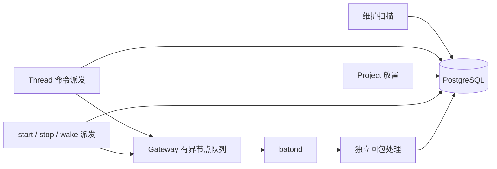

# 控制面调度与可靠通知

Status: approved
Owner: Baton
Basis: [Baton R-14、R-16、R-19、R-24、R-25](../baton/PRODUCT.md)；[Project Agent PA-05、PA-08～PA-10](../project-agent/PRODUCT.md)；[Baton TECH](../baton/TECH.md)「下行投递」。start、stop、wake 部分已实现；Thread 命令部分随 Baton TECH 实施步骤 2 落地。

## 1. 方案

Coordinator 使用短事务领取待发送工作，保存下一次重试时间，提交后调用 Gateway 入队，随即处理下一项。节点回包独立保存，不在派发循环内等待。维护扫描、Thread 命令派发、Project 放置分别运行；Project 的 start、stop、wake 使用独立发送额度。

Thread 命令保存在 thread_outbox；start 和 stop 的投递进度保存在 agent_runs；wake 的接收进度保存在输入队列原行。统一重试函数、批次限制和幂等规则，保留这些表各自的业务约束。系统只运行一个活动 Coordinator，不增加外部消息服务或通用 Workflow 引擎。



正常运行时，慢节点只延迟自己的确认。网络重复投递由稳定业务身份去重；数据库中的待处理记录负责崩溃恢复。没有可靠停止证据时，界面继续区分租约失效与进程清理完成。

## 2. 现有依据与借鉴

Thread 命令派发（`internal/control/thread.go`）只执行有界派发，`internal/store/thread_outbox.go` 从各节点到期候选中领取记录；回包按持久化关联 ID 独立保存。吊销补偿独立运行。

[Project 命令领取](../../internal/store/project_delivery.go) 分别处理 start、stop 和 wake，按节点应用额度并跳过被锁定的候选。业务结束保存停止意图，进程清理完成由节点确认。输入的通知接收进度与业务认领进度分别保存。

| 上游机制 | 本方案采用的部分 |
|---|---|
| Kubernetes workqueue 的 dirty / processing、延迟重试 | 同一对象合并、短处理、失败项到期后重新参与调度 |
| Argo 独立 Workflow / archive worker 与清理条件 | 业务运行和清理分开，重试清理不占用新启动额度 |
| Temporal 分组调度与 rescheduler | 有限发送额度、按下一次调度时间领取、不能提交时延后重试 |
| RabbitMQ 的重投递循环经验 | 接收确认与业务消费分开，限制重发速度，接收端保持幂等 |

源码依据：[Kubernetes queue](https://github.com/kubernetes/client-go/blob/773f53e238e0bada352e8a36f595f0d2d2eb88d0/util/workqueue/queue.go#L230)、[rate limiter](https://github.com/kubernetes/client-go/blob/773f53e238e0bada352e8a36f595f0d2d2eb88d0/util/workqueue/default_rate_limiters.go#L48)、[Argo controller](https://github.com/argoproj/argo-workflows/blob/00850865d409d8f22d69db21c3c98d57e4441d8e/workflow/controller/controller.go#L483)、[Argo 完成与清理条件](https://github.com/argoproj/argo-workflows/blob/00850865d409d8f22d69db21c3c98d57e4441d8e/workflow/controller/controller.go#L1115)、[Temporal scheduler](https://github.com/temporalio/temporal/blob/b7bc978d1040afe2dcbc68ecfe8b228ae198e0b6/service/history/queues/scheduler.go#L95)、[rescheduler](https://github.com/temporalio/temporal/blob/b7bc978d1040afe2dcbc68ecfe8b228ae198e0b6/service/history/queues/rescheduler.go#L208)、[RabbitMQ 重投递循环](https://www.rabbitmq.com/docs/confirms#consumer-nacks-requeue)。这些依据来自源码和文档核查，没有运行上游系统。

## 3. 调度规则

| 工作 | 默认节奏与上限 | 隔离边界 |
|---|---|---|
| 吊销补偿 | 固定循环，每 200ms；最多一个调用在途 | 变慢不挡住派发 |
| Thread 命令 | 每 200ms；每轮最多 32 条，轮内单节点最多 4 条，同一 Thread 最多 1 条 | 不等待回包；同一 Thread 前一条未确认时不发下一条 |
| Project 放置与租约回收 | 每秒最多 32 个候选，每个 Agent 独立有界事务；健康有效租约不占候选额度 | 不执行命令发送，忙碌 Agent 跳过，分页继续前进 |
| start / stop / wake | 每秒分别领取，每类每轮最多 32 条，每节点每类最多 2 条 | 三类独立额度，轮换处理次序 |
| batond 清理确认补送 | 一个固定循环，按本地到期记录领取 | 不持有 Runtime 管理锁，不阻塞续租和启动 |

数字是实施初值，需通过本地容量测试确认，不是已经测得的延迟承诺。start、stop、wake 各自按节点的最早到期工作排序，节点内按 `(next_attempt_at, id)` 领取最多两条，再以流式 LIMIT 累计至全局 32 条；不同节点的记录不承诺严格的全局逐条 FIFO。这个顺序让每类 Run / Agent 行锁最多 32 个，同时允许跳过被锁定的队首。每次领取把下一次尝试推迟到退避到期时，后续对象因此有机会进入批次。

按节点限制在领取阶段应用，不能先取出全局最早 32 条再丢掉超额节点，否则会挡住后页节点。查询从在线且同步的节点出发，利用节点到期索引取得少量候选，不对一个节点的全部历史积压做窗口排序。

后台 Store 操作共用有界并发门，默认最多 4 个；数据库连接池较小时，门限不超过 `max(1, MaxConns/2)`。等待门和数据库操作都受上下文限制，单次数据库调用默认最多 1 秒。每个循环不重叠执行，不为每个待确认对象创建 goroutine。Gateway 入队失败立即返回，继续处理其他节点。

所有领取、身份校验和状态更新都在短事务完成；网络调用、等待和退避不持有事务或业务行锁。数据库整体故障时不能承诺正常派发延迟，但循环、连接等待与内存仍有界。

### 3.1 统一重试

下一次尝试时间在发送前持久化。Thread 命令、start、stop、wake 都从 1 秒开始，依次采用 2、4、8、16、30 秒级别。使用有界抖动，中心重试间隔封顶 30 秒。节点清理补送另为 RPC 预留 5 秒，再加同一退避，下一次尝试最晚为 35 秒后。

发送前保存进度覆盖“入队后立刻崩溃”的窗口。发送后不通过普通 UPDATE 重新打开对象或覆盖重试时间，迟到的发送错误不能撤销已经保存的确认。明确业务拒绝按现有规则终结，传输超时、断线或队列满只触发重试。

时间由数据库时钟计算，随机源通过接口注入测试。重试不延长 Turn 的执行时限或 Project 租约。设备离线时 Thread 命令一直保留，没有排队期限。

## 4. Thread 命令：领取后即返回

### 4.1 持久化字段

`thread_outbox` 每行一条命令：

| 字段 | 含义 |
|---|---|
| `id bigserial` | 投递顺序；同一 Thread 内按它发送 |
| `employee_id`、`thread_id`、`node_id` | 归属与目标 |
| `message_id uuid` | 稳定消息 ID，重试不变 |
| `action` | open / message / withdraw / stop |
| `payload jsonb` | 命令内容；message 只带 `client_message_id`，正文在发送时从 `thread_messages` 读取 |
| `attempts`、`next_attempt_at` | 已持久化的尝试次数、下一次可领取时刻 |
| `acked_at` | 设备持久化回执的时间 |

未确认记录建 `(node_id, next_attempt_at, id)` 节点到期索引和 `(thread_id, id)` 顺序索引。领取时每个 Thread 只取 `id` 最小的未确认行，节点内按 Outbox → Thread 跳过被锁定的记录。

### 4.2 发送和回包

1. 事务内确认 Thread 未归档或命令仍需要（stop、withdraw 在归档后仍发送）、节点在线且同步，构造消息并检查编码上限。
2. 保存 attempts 和 next_attempt_at，提交事务。
3. 调用 Gateway 入队，无论成功、满队列还是断线都结束本次尝试，不等待节点。
4. `thread.command_result` 由入站处理根据 `message_id` 查找 outbox，校验节点、员工和 Thread 绑定后保存 `acked_at`。未知关联和错误来源不能写业务事实。

设备对每条命令按 `message_id` 和 `client_message_id` 幂等处理，重复投递只返回原回执。确认先提交、旧发送路径随后报错时，确认保持有效。

## 5. start / stop：业务结束与清理完成分别确认

### 5.1 中心记录

agent_runs 增加：

| 字段 | 含义 |
|---|---|
| `stop_requested_at timestamptz` | 仍需节点清理确认的持久意图 |
| `command_next_at timestamptz NOT NULL` | 当前启动或停止命令的下一次尝试时间 |
| `command_attempts integer NOT NULL DEFAULT 0` | 当前命令的尝试次数，start 转 stop 时归零 |

start 和 stop 对同一个 run 互斥，复用一套重试字段。调度创建 starting run 时，启动立即到期；释放租约时，同事务写终态、停止意图和停止重试时间。自然 finish / report_failure 给 2 秒清理确认宽限；用户停止、Project 暂停、吊销和租约回收立即使 stop 到期。宽限由调用路径决定，不解析自由填写的 reason 字符串。

分别查询 start 和 stop：

- start 只查询当前租约有效、Project active、`state=starting` 且尚无停止意图的 run。
- stop 只查询有停止意图、`stop_acked_at IS NULL` 的到期 run。
- started 确认后不再有 start 工作；stopped 确认后不再有 stop 工作。保留历史时间，清理工作不再从所有历史终态推导。

分别建立 `(node_id, command_next_at, id)` 的 start 和 stop 到期部分索引；stop 的索引条件为 `stop_requested_at IS NOT NULL AND stop_acked_at IS NULL`，start 的条件为 `state='starting' AND stop_requested_at IS NULL`。既有已确认终态不参加扫描。

领取只锁定 run 及更新它的重试字段，不在取得 Run 锁后再锁 Agent。业务状态迁移继续按 Agent → Conversation（如需）→ Run 的既有方向完成。领取后的租约可能被撤销，batond 仍须执行既有启动前续租验证；迟到 start 不能越过租约检查启动新进程。

### 5.2 节点主动确认清理

batond 在 Runtime 进程树回收及本地收尾完成后，先在现有 project_runtime_runs 账本保存清理事实，再异步补送：

1. 尝试已有 exited 报告，让仍有效的运行结束；已经终结的运行可能返回 lease_lost。
2. 发送已有 stopped 确认。只有中心明确 OK，才标记本地清理确认已交付。
3. 暂时失败保留本地记录，按到期时间重试；重连后继续补送。

本地行增加 `cleanup_complete`、`cleanup_acked`、`cleanup_next_at`、`cleanup_attempts`。补送调用有 5 秒期限，领取时先为这 5 秒调用及后续退避预留时间，失败项不会因调用耗时而立即重新占据队首。一个固定补送循环即可，不在 m.mu 或本地事务内等待 RPC。共享 WebSocket writer 通过可取消的串行入口等待写入，RPC 的期限包含排队时间，关闭 manager 可取消两个回执 worker。

清理事实写入失败时，已结束实例保留在管理器中，与活动实例共用 4-run 上限，由固定循环继续补写。持久化成功后才释放名额；本地账本操作限时 1 秒。再次崩溃且未落盘时，仍按缺少清理证据处理。

这样，自然结束通常在宽限期内收到清理确认，不需要 Coordinator 额外发送 stop。确认丢失后，中心重发 stop，节点也主动补送；两条路径最终确认同一份事实。

未启动的 run 收到 stop 时，节点保存不可再次启动该 run 的本地终止记录，再确认；有运行实例时，完成现有进程树停止后确认。重复 start / stop 不创建第二个进程，也不改变既有终态。

确认边界沿用 sidecar.Process.Wait 所代表的进程树回收完成，不能只根据模型 finish、根进程退出或修改本地 state 字段判断。batond 重启后的旧记录没有清理证据时，不能仅因为内存 map 为空就自动确认；保持清理未确认，按现有平台进程管理机制核实。无法核实的记录保留低频重试和可见状态，不阻塞新的 Thread 命令。该平台边界必须由恢复测试验证，方案不额外建立进程守护服务。

stopped 继续只确认指定 run 的清理事实，要求其原节点、员工、epoch 和当前认证连接有效；允许确认历史终态，不要求该 run 仍持有 Agent 租约。认证行按 Node → Credential → Presence 加共享锁，再锁目标 Run，全部锁取得后重新核对数据库当前时刻下的凭据期限。吊销和连接替换不能穿过这段确认事务，等待 Run 锁跨过凭据期限则拒绝确认。不得修改新 run、恢复旧租约或改变已经保存的 finished / failed / lost 及结束原因。

## 6. wake：接收确认独立于输入认领

### 6.1 在原队列行保存通知进度

project_agent_input_queue 增加：

| 字段 | 含义 |
|---|---|
| `wake_required boolean NOT NULL DEFAULT false` | 此输入还需向当前 run 提示 |
| `wake_next_at timestamptz NOT NULL` | 下一次可发送时刻 |
| `wake_attempts integer NOT NULL DEFAULT 0` | 通知尝试次数 |

新的主动输入与业务变化同事务插入，设置 wake_required=true；同一来源键去重不重新打开通知。被动输入不单独触发 wake。插入路径不锁 Agent，保留 Thread 报告路径的锁顺序。

新 run 创建时，在已有 Agent 锁下，把尚未认领的主动输入重新设为需要提示，重置通知退避。并发稍晚提交的输入自己携带 wake_required=true，因此不会遗漏。旧 run 的迟到确认必须被 run / epoch 校验拒绝。

为 `delivered_seq IS NULL AND wake_required` 建立 `(agent_id, wake_next_at, id)` 部分索引。wake 只面向有效 running run。每条命令最多携带 32 个输入 ID，从这些输入构造 thread_updates，继续限制编码容量。发送前在短事务内保存这些行的重试进度。

### 6.2 协议

project_run_wake 增加可选 `input_ids: int64[]`，每条最多 32 个正数 ID。同一个 Thread 的 thread_updates 按版本合并，每 run 最多 64 个绑定。

batond 确认 run 和 epoch 后，将通用 wake 合并到已有容量为 1 的通道，并把 Thread 版本交给等待缓存。确认消息放入固定容量 64 的发送队列，由一个固定协程执行以下节点管理请求；队列满时不确认，等待中心重发。WebSocket 读循环和 Runtime 管理锁内不等待确认 RPC。

```json
{
  "operation": "wake_received",
  "run_id": "<run-id>",
  "lease_epoch": 7,
  "payload": {"input_ids": [101, 104]}
}
```

wake_received 是节点管理操作，Runtime IPC 白名单不允许 Agent 调用。中心在 Agent 锁下验证当前 run、epoch、节点和连接，只将列出的本 Agent 输入设为 wake_required=false，重复确认成功；已认领行无需再更新。更新与 delivered_seq 无关，不追加对话事件，不续租。

**接收确认表示 batond 已更新本机唤醒标记，输入仍等待 Runtime 认领。** Runtime 处理当前轮次时，新的消息可以长期保留 delivered_seq=NULL，同时停止每秒网络重发。新输入有新队列行，可以再次触发通知。

只确认本条消息携带的输入 ID，不能把 `MAX(id)` 当成“此前均已通知”的水位。PostgreSQL sequence 分配顺序与事务提交顺序不同，较小 ID 的输入可能稍后才提交。待确认行自己的到期时间保证后页输入获得机会，通知领取不使用内存轮转游标。

Runtime 照常在轮次结束时领取输入、闲置时有界等待；nodes.exec 的 Thread 通知丢失后仍由最多 25 秒的本地等待补读。通知不能直接生成工具结果，也不能代替输入认领事务。

### 6.3 重启与丢失

wake 不需要在 batond 再复制一份输入持久队列。batond 存活时通道和版本缓存保存提示；batond 或 Runtime 退出后，旧 run 不会重启，新 run 会重新提示全部未认领主动输入。普通重连保留当前 Runtime 及内存通知。

接收确认丢失时，中心重发，节点继续合并；中心重启时，未确认输入按持久化到期时间继续发送。输入已认领后，不再需要任何提示。被动结果仍随下一批主动输入交付。

## 7. 事务与故障不变量

| 边界 | 恢复行为 |
|---|---|
| 领取提交后、Gateway 入队前 Coordinator 崩溃 | 下次到期重发同一业务对象；不当作明确未发送 |
| 入队成功、回包丢失或晚到 | 重试保持身份，回包无内存 waiter 也能幂等保存 |
| 确认先提交、旧发送路径随后报错 | 无发送后重新打开记录的更新，确认保持有效 |
| Thread 已归档，旧 message 命令回来 | 设备按 `client_message_id` 去重；归档后不再领取新的 message 命令 |
| 100 条旧 stop 未确认 | stop 自己退避；start 和 wake 仍各有独立额度 |
| 同节点积压大量旧命令 | 每节点配额在候选领取阶段生效，其他节点仍能进入批次 |
| 新 run 与旧 wake 确认竞争 | Agent 锁串行化；旧 run 不能清除新 run 的通知需求 |
| 先分配的输入 ID 后提交 | 按行确认，后来可见的输入仍需要提示 |
| 进程已清理，但 stopped 回复丢失 | 本地清理记录继续补送，中心确认幂等 |
| 进程清理无法核实 | 保留未确认状态，降频重试，不占满新工作批次 |

Project 状态迁移、输入领取和 wake_received 按 Agent → Conversation（如需）→ Run / Input Queue 的方向取得锁；只处理回执或领取命令的事务不得反向加锁。Thread 报告 → Input Queue 写入不取 Agent 锁。Thread 命令领取按 Outbox → Thread 的顺序，Thread 状态变化先锁 Thread 再插入 Outbox，两者只在 Thread 锁上相遇，不形成环。

## 8. 模块范围

| 模块 | 职责 |
|---|---|
| internal/control/thread.go、background.go | Thread 命令的非阻塞发送、直接回包处理、独立维护循环及数据库并发门 |
| internal/store/thread_outbox.go | Thread 命令到期领取、同 Thread 顺序、幂等确认 |
| internal/control/project_runtime.go | start、stop、wake 三类发送额度，不等待回包 |
| internal/store/project_placement.go、project_delivery.go | 放置、停止意图、三类独立到期领取及通知确认 |
| internal/store/project_runtime.go | stopped 和 wake_received 的身份校验、确认事务 |
| internal/store/project_inputs.go、project.go | 原子设置主动通知需求，保留去重与锁方向 |
| internal/node/project_runtime.go | 接收通知确认、主动清理补送、本地幂等记录 |

started / renew 返回的数据带 `control_receipts:1`，batond 看到后才发送 wake_received。

## 9. 验证

| 依据 | 设置与观察 | 失败条件 | 位置 | 状态 |
|---|---|---|---|---|
| 慢节点隔离，R-16 | A 不回 Thread 命令，B 同轮获得投递 | 派发等待 A 的回包；B 被延迟 | `control/thread_reliability_test.go` | planned |
| 同 Thread 顺序，R-08 | 同一 Thread 连续 open、3 条 message、withdraw，第 2 条回包丢失 | 第 3 条先于第 2 条送达；重发产生第二条消息 | Store / Control 回归 | planned |
| 跳锁公平性 | 同节点和跨节点分别锁住 Outbox、Thread | 后续可用记录无法领取 | `store/thread_outbox_test.go` | planned |
| 模糊发送，R-19 | 领取失败全部回滚；确认后发送报错 | 确认被撤销；未保存进度就入队 | Store / Control 回归 | planned |
| 晚到回包 | 无 waiter 的合法回包；错误节点、员工、连接和过期凭据 | 合法回包丢失；非法回包写入 | `control/thread_reliability_test.go` | planned |
| 维护隔离 | 慢维护项运行期间派发继续；取消释放数据库名额 | 维护挡住派发 | `control/background_test.go` | passed |
| 分类和节点额度，PA-08 | 单节点 1000 条旧 stop，其他节点及新 start / wake 仍可领取 | 其他工作被饿死；已确认记录重开 | `store/project_delivery_test.go` | passed |
| 跳锁与锁数量 | 三类命令跳过节点队首锁；Run / Agent 行锁不超过 32 个 | 超过额度或锁数 | `store/project_delivery_concurrency_test.go` | passed |
| 清理确认，PA-08 | 自然退出、stop、未启动终止记录、回执丢失、重启 | 重复启动；伪造清理证据 | Node cleanup / receipt replay 回归 | passed |
| 本地存储故障 | SQLite 拒绝保存清理事实，之后恢复 | 名额泄漏；恢复后未补送 | `node/project_runtime_cleanup_test.go` | passed |
| wake 接收与认领 | 接收确认清除通知需求，`delivered_seq` 仍为空；新输入再次提示 | 确认被当作认领；重复来源重新打开 | Store / Node wake receipt 回归 | passed |
| 提交顺序 | 低 ID 输入晚于高 ID 提交并确认 | 低 ID 输入不再提示 | `TestProjectWakeReceiptDoesNotCoverLowerIDCommittedLater` | passed |
| 运行更换，PA-12 | 旧 run 确认与新 run 竞争 | 旧 run 清除新 run 的通知 | Store / Node 并发回归 | passed |
| 停止确认身份 | 吊销和连接替换与确认并发 | 已吊销凭据确认成功 | `store/project_delivery_concurrency_test.go` | passed |
| 协议兼容，R-25 | 未知字段、缺失能力标记、连接切换 | 未知字段导致拒绝；能力未重置 | 协议与兼容夹具 | passed |
| 核心主链路 | 真实进程验证 wake 确认先于认领、重连不重启、finish 后主动清理确认 | 任一顺序被破坏 | `TestProjectRuntimeRealProcessesPlacementPagingAndWake` | passed |

R-24 的容量负载仍待压测；Windows / Linux 的原生进程树和崩溃恢复测试需要在对应系统上运行。
