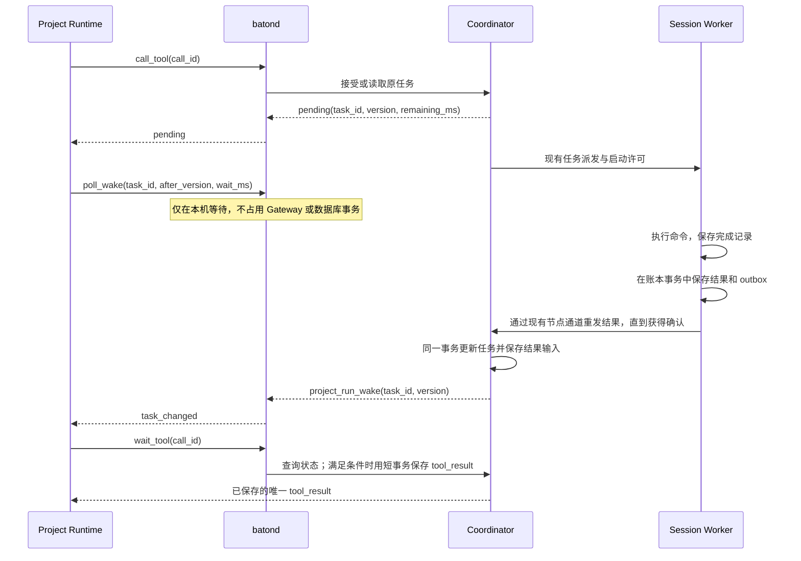

# 命令执行、等待与结果恢复

Status: implemented
Basis: [Project Agent PA-22](../project-agent/PRODUCT.md)、[Baton R-22](../baton/PRODUCT.md)；Baton 调查基线 `b51ac3d8a9cb883c453998dbb25bc8a8fbddea3f`。外部源码版本固定在第 2 节。

## 1. 方案与范围

命令继续作为现有 Task 执行，沿用启动许可、Session Worker、进程树管理、结果 outbox 和中心任务状态。Runtime 通过 batond 在本机等待有版本的通知，Coordinator 通过短请求查询状态或提交最终工具结果。Worker 根据持久化完成记录恢复结果，在账本提交成功前保留待交付输出。

执行、等待和交付分别有独立生命周期：等待期限到达只结束本次工具等待；命令执行期限到达触发停止；通信超时表示本次通信没有获得确认。Runtime 的运行期限、节点租约和用户取消仍按现有规则处理。

本文描述当前实现，验证范围见第 9 节。



方案覆盖进程重启、连接中断、通知丢失、重复请求、结果保存失败和取消竞争。执行过程中 Worker 崩溃、缺少可靠完成证据时，保留待核实状态。执行记录不会使已经失去监督的命令自动续跑，也不自动重发命令输入。

## 2. 开源源码依据

调研通过 GitHub 获取以下 commit 的源码，读取了表中实现。没有运行这些项目，也没有据此宣称验证其所有恢复保证。下面的机制用于指导 Baton 设计，平台和依赖条件仍由各项目决定。

| 项目与固定版本 | 已检查的实现 | 源码事实与适用方式 |
|---|---|---|
| Jenkins durable-task `9e8b7472c5b030100817309d9608ba4eae1c0490` | [BourneShellScript.scriptLauncherCmd](https://github.com/jenkinsci/durable-task-plugin/blob/9e8b7472c5b030100817309d9608ba4eae1c0490/src/main/java/org/jenkinsci/plugins/durabletask/BourneShellScript.java#L218)；[FileMonitoringTask.Watcher](https://github.com/jenkinsci/durable-task-plugin/blob/9e8b7472c5b030100817309d9608ba4eae1c0490/src/main/java/org/jenkinsci/plugins/durabletask/FileMonitoringTask.java#L587) | shell 包装器写退出码临时文件后重命名；watch 在执行侧每 100ms 检查文件，向 Controller 回调输出和退出状态。采用其完成记录和本地观察机制；Baton 保留现有随 Worker 停止的进程树策略。 |
| Ansible `8cb65a623a9e03d38fb7cf7a0bbc418e1fed990d` | [async_wrapper.jwrite](https://github.com/ansible/ansible/blob/8cb65a623a9e03d38fb7cf7a0bbc418e1fed990d/lib/ansible/modules/async_wrapper.py#L119)；[async_status.main](https://github.com/ansible/ansible/blob/8cb65a623a9e03d38fb7cf7a0bbc418e1fed990d/lib/ansible/modules/async_status.py#L133)；[TaskExecutor._poll_async_result](https://github.com/ansible/ansible/blob/8cb65a623a9e03d38fb7cf7a0bbc418e1fed990d/lib/ansible/executor/task_executor.py#L657) | 作业按 ID 保存 JSON 状态，状态读取和清理独立；Controller 仍按配置间隔轮询。采用执行身份和结果文件；不照搬其将部分文件解析异常视为运行中的处理。 |
| Celery `d6d754e21e353629c22803edfc2093f3deeffe9d` | [SyncBackendMixin.wait_for](https://github.com/celery/celery/blob/d6d754e21e353629c22803edfc2093f3deeffe9d/celery/backends/base.py#L1100)；[Redis ResultConsumer](https://github.com/celery/celery/blob/d6d754e21e353629c22803edfc2093f3deeffe9d/celery/backends/redis.py#L149)；[Request.on_failure](https://github.com/celery/celery/blob/d6d754e21e353629c22803edfc2093f3deeffe9d/celery/worker/request.py#L717) | 同步结果后端循环读取状态；Redis 后端消费通知，重连时补读已订阅任务的结果。Worker 丢失后的重新入队受确认和重试配置影响。采用通知加补读；任意 shell 副作用继续遵守 Baton 的不自动重跑规则。 |
| Temporal `b7bc978d1040afe2dcbc68ecfe8b228ae198e0b6` | [GetOrPollWorkflowMutableState](https://github.com/temporalio/temporal/blob/b7bc978d1040afe2dcbc68ecfe8b228ae198e0b6/service/history/api/get_workflow_util.go#L28)；[事件订阅器](https://github.com/temporalio/temporal/blob/b7bc978d1040afe2dcbc68ecfe8b228ae198e0b6/service/history/events/notifier.go#L128)；[Activity 完成](https://github.com/temporalio/temporal/blob/b7bc978d1040afe2dcbc68ecfe8b228ae198e0b6/service/history/api/respondactivitytaskcompleted/api.go#L114)；[Activity 重试](https://github.com/temporalio/temporal/blob/b7bc978d1040afe2dcbc68ecfe8b228ae198e0b6/service/history/api/respondactivitytaskfailed/api.go#L108) | 读状态后注册订阅，再次读状态，随后等待通知或期限；读取状态的函数返回前释放 Workflow lease。订阅按 Workflow 身份管理，通道有界。完成事件进入状态更新；失败处理显式经过 RetryActivity。采用订阅与复查、版本过滤和有界等待，不引入其完整 Workflow 引擎。 |
| Argo Workflows `00850865d409d8f22d69db21c3c98d57e4441d8e` | [emissary.Wait](https://github.com/argoproj/argo-workflows/blob/00850865d409d8f22d69db21c3c98d57e4441d8e/workflow/executor/emissary/emissary.go#L117)；[WatchFile](https://github.com/argoproj/argo-workflows/blob/00850865d409d8f22d69db21c3c98d57e4441d8e/util/file/watch.go#L46)；[Workflow informer](https://github.com/argoproj/argo-workflows/blob/00850865d409d8f22d69db21c3c98d57e4441d8e/workflow/controller/controller.go#L1282) | 执行器等待退出码文件；文件监听先安装目录 watcher，再检查文件是否存在，资源不足时降为 2 秒轮询。Controller 对相同 resourceVersion 跳过重复更新。采用先准备观察再检查状态、版本去重、通知失效后查询恢复。 |

这些实现支持的共同结构是：执行有稳定身份，完成证据保存在执行进程的内存之外，通知触发后续处理，读取持久化状态恢复事实。具体检查方式可以是本地轮询、文件监听或消息订阅。

Temporal 和 Celery 的重试处理同时说明：任务身份与可靠投递不能单独保证任意外部动作恰好执行一次。Baton 对同一调用禁止自动重跑；不确定执行保留待核实，用户明确发起的新执行有新身份。

## 3. 模块职责

| 位置 | 当前机制 |
|---|---|
| [runtime.ts](../../runtimes/project-agent/src/runtime.ts) `execute` | 初始短核对后在本机有界等待任务版本，再发短状态请求；旧协议继续兼容 |
| [project_runtime.go](../../internal/store/project_runtime.go) `ProjectRuntime` | wait_tool 的 pending 探测使用短只读事务，不取得显式行锁；最终提交重新完整校验 |
| [project_exec.go](../../internal/store/project_exec.go) `waitProjectTool` | 锁定 Conversation 和 Task 后重读状态，原子保存工具结果并确认对应输入 |
| [gateway.go](../../internal/gateway/gateway.go) `dispatch` | 单节点串行处理，单次处理上下文为 5 秒；本机等待不进入处理槽位 |
| [project_placement.go](../../internal/store/project_placement.go) `ProjectRunCommands` | 每秒扫描持久化待处理输入，有界轮换重发任务版本提示 |
| [shell/adapter.go](../../internal/agent/shell/adapter.go) `Start` / 完成维护 | 保存完成记录，重试文件错误，恢复只读结果而不重发命令 |
| [session/adapter.go](../../internal/session/adapter.go) `pollAdapterLocked` | 保留待提交的 Drain 批次，逐项事务提交后移除 |
| [session/ledger.go](../../internal/session/ledger.go) `recordExecution` / `Ack` | 正常结果按执行与代次去重，结果和 outbox 同事务保存，中心确认后标记交付 |

[Project Agent TECH 第 10 节](../project-agent/TECH.md) 定义命令执行协议，PA-A12 区分有完成记录与缺少可靠证据的重启行为。

## 4. 状态与不变量

沿用现有数据库状态。下表中的阶段描述执行事实，不新增另一套数据库任务状态机。

| 可证明的执行事实 | 恢复行为 |
|---|---|
| 未记录输入提交意图，现有许可和期限仍允许首次提交 | 按既有 Worker 启动规则处理 |
| 输入提交意图已提交，没有完成记录和已保存结果 | 待核实；不重新提交命令 |
| 有身份匹配、完整有效的完成记录，账本中尚无该代结果 | 读取记录并保存结果与 outbox |
| 账本中已有该代结果，中心尚未确认 | 重发原 outbox 记录 |
| 中心已确认 | 展示已保存结果，不产生新执行或新报告 |
| 已取消或超时，恢复出命令输出 | 通过既有停止报告交付输出；用户操作与停止语义仍由中心裁决 |

不变量如下：

1. `(conversation_id, tool_call_id)` 仍唯一绑定原 Task；同一执行的命令输入最多提交一次。
2. 正常完成必须有可靠证据；进程不存在、RPC 返回、通知到达都不能单独作为完成证据。
3. 结果投递允许重试，重复投递复用原持久化 event_id。Worker 每个 `(execution_id, input_generation)` 只保存一个正常结果；停止报告继续按现有规则允许补充停止事实和输出。
4. 完成记录到 outbox 的衔接采用可重复读取：完成记录保留到已有 Session 清理流程回收，不能在 Drain 或发送后删除。
5. 同一工具调用只写一个 `tool_result`。同步返回某个任务版本时，对应结果输入的 `delivered_seq` 与该事件在同一事务提交。
6. 查询和通知不改变任务、对话序号或租约；保存工具结果仍校验当前节点连接、凭据、租约 epoch、期限、资源归属和最后序号。
7. 所有等待均可由节点停止、租约丢失或期限到达终止。等待期间不持有数据库事务、Gateway 槽位或 Worker 数据库互斥锁。

## 5. 等待与通知协议

### 5.1 接受任务与短状态请求

`call_tool` 仍在现有事务内接受或返回原 Task。`pending` 增加以下字段，`wait_tool` 返回 pending 时使用相同结构：

```json
{
  "pending": true,
  "task_id": "UUID",
  "task_version": 7,
  "wait_remaining_ms": 28400,
  "wait_protocol": 1
}
```

`task_version` 来自本次数据库快照。`wait_remaining_ms` 按数据库时钟和已保存的 `exec_wait_until` 计算，最低为 0；重发与恢复不得延长 `exec_wait_until`。batond 在转交响应前记录该响应的任务绑定和接收时刻。

`wait_tool` 在进入 `ProjectRuntime` 的通用写事务之前分流：用一个查询快照读取当前来源、运行租约、Project、Conversation、工具结果和原 Task。这个查询不使用 `FOR UPDATE`、`FOR SHARE` 或 `FOR NO KEY UPDATE`，也不更新租约。权限和绑定校验必须与当前写路径等价，不能仅凭 task_id 查询。

先校验来源与运行身份；已有工具结果直接按现有重放规则返回。没有结果时，检查 `last_seq` 与原任务绑定。任务仍未结束、没有待核实、等待尚未到期且未指定 `finish_wait` 时，直接返回 pending。其他情况退出读取路径，进入现有最终提交事务，在锁就绪后重新读取所有决策条件。

最终提交事务继续使用 `project_agents → conversations → tasks → project_agent_input_queue` 的锁顺序。任务终态写入仍不反向取得 Agent 或 Conversation 锁。一次只读快照可以稍旧，因为它只决定是否多等待一轮；它没有写入权限，也不能代替提交前校验。

### 5.2 有版本的任务通知

继续使用 `project_run_wake`，增加可选字段：

```json
{
  "type": "project_run_wake",
  "run_id": "UUID",
  "lease_epoch": 12,
  "task_updates": [
    { "task_id": "UUID", "version": 8 }
  ]
}
```

任务进入 completed、failed、cancelled 或 needs_verification 等可以结束工具等待的状态时，在同一任务事务中写入现有 Project 输入队列。needs_verification 即使没有 `command_result` 也必须能够生成状态输入。

现有调度循环从已提交的待处理输入生成通知。每个输入携带既有 task_id 和任务 version；无需新增通知表。通知可重发，只有中心工具结果或输入领取事务才确认内容已交付。通知缺失不影响结果持久化。

每条 wake 最多携带 32 个不同任务的最新版本，按实际编码后容量再次限制；持续积压时轮换发送，不能让固定第一页阻塞后续任务的提示。每个运行只保留已接受工具调用的任务绑定和有界版本提示；未绑定任务提示可以丢弃，由状态查询兜底。调度仍是现有共享扫描，不按每条等待命令建立一个定时数据库查询。

不得把队列 `MAX(id)` 当作所有事务已经提交的全局游标：PostgreSQL sequence 的分配顺序不保证事务提交顺序。这里按任务版本过滤提示，输入交付继续使用逐条 `delivered_seq`。

### 5.3 本机等待

扩展已有 `poll_wake`。普通闲置等待沿用当前行为；任务等待携带以下 payload：

```json
{
  "task_id": "UUID",
  "after_version": 7,
  "wait_ms": 25000
}
```

batond 校验任务已由该 run 的中心响应绑定，`after_version` 是非负整数，`wait_ms` 为 1～25000。返回 `reason: task_changed | timeout`；变化时附带通知中的 version。运行已停止或租约丢失沿用现有错误处理。通知中的版本只是查询提示，不能直接生成工具结果。

同一 run 的版本缓存与等待者读取共用一个短互斥区：读取当前版本并取得本代广播通道，再释放锁进入等待；更新通知也在该互斥区内更新最大版本并关闭旧广播通道。这样通知发生在检查与等待之间时，等待者持有的通道已经关闭，能够立即继续。一个任务可以有多个订阅者；广播信号不会被另一个等待者取走。断开、超时和 run 结束释放本次等待对通道的引用。

本地等待只对目标 task_id 的更高版本响应，忽略通用用户输入 wake 和相同版本的重发。版本提示只保留已绑定任务的最大版本，完成工具等待后移除绑定；每个 run 最多保留 64 个任务绑定，超出时返回明确的本地容量错误，不能丢弃正在等待的绑定。当前 Runtime 顺序执行工具，正常同时等待数为 1。同一工具调用存在并发中心请求时，最终响应保留到该调用的全部在途响应处理完；迟到 pending 返回该最终响应，不能重新建立绑定。随后释放响应缓存，不积累完成调用的永久标记。版本缓存的存活范围为 run；新 run 从中心重新读取状态。旧 epoch 的通知无法唤醒新运行。

通知先于订阅到达时，版本缓存使等待立即返回。任务在 call_tool 响应前已经完成、且通知因尚未建立绑定而被忽略时，等待前的一次短 `wait_tool` 检查可以发现已提交结果；检查之后到订阅期间的通知由版本缓存覆盖。即使这些提示全部丢失，有界等待结束后的查询也会发现结果。

### 5.4 Runtime 执行循环与期限

Runtime 收到初始 pending 后先做一次短 `wait_tool` 核对，然后循环：

1. 按最后一次中心响应计算 `min(25 秒, 剩余工具等待预算, 剩余运行预算)`，通过本机 `poll_wake` 等待。
2. 因任务版本变化或本地期限醒来后，调用一次短 `wait_tool`，读取状态或取得已保存的工具结果。
3. 仍为 pending 时，用响应中的 version 和剩余预算继续等待；正常等待使用本地任务通知，预算耗尽时按下述规则退避。
4. 单次运行预算到期时，跳过本地等待，按既有 `finish_wait=true` 提交当前状态；节点租约丢失直接停止，不借此写对话。

batond 的预算计时复用已有包含休眠时间的单调时钟，从中心返回的剩余预算中保守扣除请求往返时间与本地经过时间。每次中心 pending 响应重新估算本地截止时间，修正早期请求延迟造成的低估；`exec_wait_until` 保持原值，本地 poll 请求不能修改它。本地估计已耗尽而中心仍 pending 时，Runtime 最多退避 250ms 再查询，并受剩余运行预算限制，避免形成立即查询循环。旧节点兼容路径保持 250ms 查询间隔。本机等待仅是优化，最终是否达到等待期限始终由 Coordinator 用数据库时钟裁决。时钟读取失败按既有租约策略停止。

本机 poll_wake 最大 25 秒，保持在现有 IPC 32 秒期限内；它不包含跨网查询，wait_tool 单独发出，继续受 Gateway 现有短请求上下文限制。通信失败可按原调用 ID 重试，且要重新获取中心状态；通信超时本身不等价于等待到期、执行失败或取消。

无通知且未结束的长等待，每 25 秒至多产生一次常规状态核对，另有初始核对和边界处理。正常结果由现有约 1 秒调度周期提前唤醒；积压、断线或丢通知时额外发现延迟以一个本地等待周期及通信时间为界。这里保留了明确的查询兜底，并未消除共享调度扫描。

## 6. 完成记录与 Worker 恢复

### 6.1 完成记录

沿用 shell 私有目录的 `output.json` 作为完成记录，写入带版本的信封：

```json
{
  "schema_version": 1,
  "session_id": "UUID",
  "execution_id": "UUID",
  "input_generation": 1,
  "completion_kind": "exited",
  "process_stopped": true,
  "result": { "status": "completed", "command_result": {} }
}
```

示例省略了完整候选结果字段。实际 `result` 必须通过现有 `task.ValidateCandidate`，包含既有输出、退出码、字节数和编码约束。`completion_kind` 为 exited、launch_failed 或 stopped；stopped 记录输出和停止事实，不能单独把取消后的任务恢复为 completed。执行器只有在已有进程树回收条件满足后才设置 process_stopped。

完成记录由执行器产生，模型输出不决定该信封的身份或停止事实。记录必须匹配账本和 `adapter_config` 中的 session、execution、generation。文件读取沿用 privatefile 的权限、普通文件和链接检查；大小设置硬上限 192 KiB，解码后要求 EOF、支持的 schema 和合法字段。

自然退出和启动失败都先保存完成记录，再暴露最终输出。保存采用同目录私有临时文件、完整写入、刷盘、原子替换。针对 POSIX 补足父目录同步；Windows 独立验证替换和刷盘语义。现有 privatefile 已实现文件 Sync 和原子替换，但尚不能据此宣称所有平台均已验证断电持久性。

写入失败保留内存结果，由非阻塞维护流程退避重试，记录具体错误和持续失败状态；不能忽略错误、重新启动命令或在 Worker 锁内循环等待磁盘。进程退出后保存成功才进入正常结果交付；在保存成功前再次崩溃，仍可能需要待核实。

### 6.2 从输出到 outbox

Worker 保留一批待提交输出。一次 Drain 返回的批次全部处理完成前，不再调用 Drain，避免按维护周期持续追加。单条输出继续遵守既有候选结果和原生消息大小限制。逐项处理时，只有对应账本事务已经提交，或读回确认同一结果已保存后，才能移除该项。数据库异常时保留当前项与后续项，下一次维护继续处理，不得先清空整批。原始事件日志与该项结果放入同一个输出事务，避免重试重复写审计事件。

结果去重检查放入 SQLite 结果事务内：按现有 execution 和 generation 检查已有正常结果。如果已有结果，复用原 event_id；没有时才创建并保存。查询失败必须返回错误，不能按“尚无结果”继续插入。事务提交状态不明时先读回确认。停止输出继续使用 `pendingStopOutput` 和现有停止报告路径。

每个输出项使用稳定 receipt 记录事务提交事实，`execution_log` 的部分索引支持按 receipt 查询，旧账本打开时补建该索引。输出事务固定使用一个连接；提交返回错误时，先丢弃故障连接，再从独立连接的已提交状态确认 receipt。SQLite 提交失败可能留下活动事务，不能在原连接上通过读回判断提交成功。确认过的项重试时不重复保存日志或结果；无法确认时继续保留待提交项。停止输出采用相同的提交确认规则。

可信的已退出或等待子任务输出在同一事务保存恢复依据，receipt 重放后据此重建内存状态并清除恢复不确定标志。尚在等待子任务的正常 Agent 不会因缺少终态结果被误判为待核实。

这项输出交接机制适用于统一 Worker 的所有 Adapter，不增加 Adapter 的确认方法。shell 的完成文件负责跨 Worker 崩溃恢复；内存缓冲负责 Worker 尚存活时的账本失败重试。其他 Adapter 的跨进程恢复仍依赖各自已有原生历史能力。

### 6.3 恢复顺序

恢复先读取 Worker 账本和已确认交付状态。已有结果时直接继续 outbox 交付，不能因 Adapter 启动失败降级该结果。历史浏览可独立恢复只读 Adapter。

尚无结果时，shell 的 `Start(Restore=true)` 读取并校验完成记录。有效记录恢复为只读、已提交输入的 Adapter：禁止再次 SubmitInput，通过正常 Drain 输出原结果，再由 Worker 保存到 outbox。取消或超时已写入账本时，恢复输出进入停止报告流程。成功保存正常完成结果后，清除 load 阶段推定的恢复不确定标志。

缺少记录、记录损坏、身份不匹配或执行结果没有可靠证据时，保留原 `uncertain_history` / 待核实流程。文件访问暂时失败与确定不存在分开记录，允许重试读取；重试始终不提交命令输入。

旧版本裸候选 JSON 的 output.json 仅在账本、持久化 adapter_config 与原 Session 私有目录匹配当前执行，且 generation=1 时导入，并先验证候选结果、权限和大小。这一兼容路径依赖 shell Session 只承载一次执行：中心拒绝把 shell Session 作为新任务的恢复目标，nodes.exec 总是创建新 Session。本地路径和 Config 不单独证明文件属于新的执行。不能证明归属时只允许按历史证据展示，保留待核实。新的信封通过 ReadHistory 返回 result 部分，保持历史输出形状。

完成记录保留到 Session 既有回收流程，且未确认的 outbox 不得被回收。中心确认丢失后重发原记录。原执行已经被用户核实或发起新执行时，迟到报告仍遵守现有 execution/version 校验，不覆盖用户决定。

### 6.4 保证边界

进程退出和完成记录刷盘之间存在不可消除的窗口；记录已保存和 outbox 提交之间的窗口由本方案恢复。Worker 执行中崩溃后，沿用现有进程守护停止进程树，没有证据的结果进入待核实。

若未来要求 Worker 崩溃后命令继续运行，需要独立执行进程持有输出、退出状态、取消和超时职责，那是执行存活要求的扩展。当前 PA-22 / R-22 允许待核实，本方案无需增加一个命令守护进程。文件和账本同时损毁、磁盘丢失或外部副作用无法观测时，系统不能凭任务 ID 推导执行结果。

## 7. 提交边界与故障处理

| 故障或竞争 | 行为与提交边界 |
|---|---|
| call_tool 事务提交但响应丢失 | 重发原调用，读取原 Task，不延长等待期限 |
| 完成通知发生在订阅前后 | 已绑定任务的版本缓存和注册后复查覆盖竞争；有界查询覆盖未缓存提示 |
| 通知重复或顺序颠倒 | 忽略同任务较小或相同版本；仍向中心读取真实状态 |
| 无关用户输入持续未领取 | 继续触发普通 wake；任务等待不响应这些 wake |
| 中心在任务事务提交后、通知前重启 | 队列与任务同事务保存，调度恢复后重发；本机期限触发补读 |
| 完成与等待到期同时发生 | 最终事务锁定任务后重读；已有终态优先返回终态，否则保存运行中结果，稍后通过输入交付完成版本 |
| 同步结果与任务输入重复 | 保存工具事件与确认对应版本输入在同一事务；之后的新任务版本仍可作为输入交付 |
| output.json 保存成功，outbox 尚未提交时 Worker 崩溃 | 从完成记录恢复，通过同一结果事务补送 |
| Drain 后账本写入失败 | 保留待提交项，重试时在事务内检查重复 |
| 中心结果已提交，确认响应丢失 | 重发原 outbox event_id，中心幂等接受，Worker 获得确认后标记交付 |
| 用户取消后恢复出正常退出文件 | 输出用于审计与停止报告，任务结论按既有用户操作规则处理 |
| 旧租约、旧节点连接或撤销凭据在等待中失效 | 本机停止或中心拒绝；最终事务不写入旧运行的工具结果 |
| Runtime 或 batond 重启 | 新运行重新读取中心调用和任务，不依赖旧 run 的内存通知缓存 |

## 8. 模块与兼容性

| 模块 | 职责 |
|---|---|
| `internal/store/project_exec.go`、`project_runtime.go` | pending 元数据、无显式行锁的状态读取、原最终事务复用 |
| `internal/store/project_inputs.go`、`project_placement.go` | 待核实状态通知、批量任务版本提示、编码容量和发送轮换 |
| `internal/protocol/project_runtime.go` | wake 可选任务提示字段；本机等待 payload/response 定义 |
| `internal/node/project_runtime.go` | 有界任务绑定与版本缓存、过滤订阅、包含休眠的预算、订阅清理 |
| `runtimes/project-agent/src/runtime.ts` | 初始核对、本机等待与短状态读取循环、预算校正与边界退避 |
| `internal/agent/shell/adapter.go` | 完成信封、保存错误处理、恢复与只读历史 |
| `internal/session/adapter.go`、`ledger.go` | 待提交缓冲、事务内去重、恢复优先级和取消输出处理 |
| `internal/privatefile` | 完成记录需要的持久化辅助函数与平台验证 |

本方案不增加 PostgreSQL 业务表或新的任务状态。结果去重利用现有单 Worker 互斥和 SQLite 事务，输出 receipt 的部分索引在打开旧账本时兼容创建。

pending 和 wake 字段为增量扩展。中心部署后旧 Runtime 仍可使用短 wait_tool；新等待能力通过 bundle 协议/能力检查启用。新 Runtime 必须确认 batond 支持任务过滤和版本等待，不能把旧节点忽略过滤参数后返回的通用 wake 当成任务变化。单纯升级 Coordinator 无法消除旧 Runtime 的 250ms 请求，需配套升级 Runtime 与 batond。

完成记录恢复、Worker 输出交接和版本等待各有独立的包内回归测试。现有 Project Agent TECH、协议说明及 PA-A12 同时约定运行中缺少证据与已有完成记录两种重启行为。

## 9. 验证

| 保证 | 回归覆盖 | 验证层级 | 状态 |
|---|---|---|---|
| 减少轮询 | 丢弃全部通知的 30 秒等待：1 次 call_tool、3 次 wait_tool、25 秒和 5 秒两次本地等待；首次 1 秒延迟后仍保持 3 次查询 | Runtime 注入时钟测试 | passed |
| 无显式行锁的探测 | 同时持有 Agent、Conversation、Task、节点、凭据和在线记录的更新行锁，pending 仍返回且不修改业务状态 | PostgreSQL 集成测试 | passed |
| 提交前重新验证 | 快照之后撤销凭据、更换 epoch 或暂停 Project，最终事务拒绝写入；锁后重新读取任务终态 | Store 并发测试 | passed |
| 通知竞争与过滤 | 订阅前后通知、多个等待者、重复和乱序版本、旧 epoch、无关输入；迟到 pending 不重建已完成绑定 | batond 单元测试与 race | passed |
| 通知丢失恢复 | 本地等待到期后补读中心状态，保留运行期限和停止语义 | Runtime 单元测试 | passed |
| 等待预算 | 请求延迟、机器休眠、单调时钟失败、预算耗尽退避及运行期限截断 | 节点 / Runtime 单元测试 | passed |
| 完成记录恢复 | 真实命令输出保存后恢复 Adapter，命令计数保持为 1；恢复结果经 Worker 保存并清除不确定状态 | Shell / Session 单元测试 | passed |
| 错误记录拒绝 | 缺失、超长、尾随 JSON、重复字段、错误身份、未知 schema 和非法候选结果均不触发重跑 | Shell 单元测试 | passed |
| 保存失败重试 | 文件保存失败后保留输出；Drain 批次写入失败后保留当前项和后续项，重试不重复审计日志 | 文件接口替身 / SQLite 触发器测试 | passed |
| 提交状态不明 | 已提交但响应丢失、提交后读取失败、SQLite 延迟约束导致提交失败且事务仍活动、回滚失败；独立连接核对持久化结果 | Session 故障注入测试 | passed |
| 可信等待状态恢复 | 原生恢复输出为等待子任务时，保存恢复依据，receipt 重放后继续接收子任务结果 | Session 单元测试 | passed |
| 取消与超时 | 停止事实与输出分别补报，按任务版本去重；恢复输出不覆盖用户操作；无取消账本的 stopped 记录仍保留输出并维持待核实 | Session / Store / 真实进程测试 | passed |
| 同步和异步交付 | 工具结果与对应输入同事务确认，重复请求重放原事件，后续版本仍可交付 | Store 集成测试 | passed |
| 同节点通知主链路 | 真实 Coordinator、batond、Worker 和 Runtime IPC：本机等待期间继续读取中心事件，命令完成后由高版本通知唤醒并获取输出 | 一个进程集成主链路 | passed |
| 平台边界 | macOS 执行、恢复、进程树停止及文件权限；Windows 和 Linux 交叉编译 | 包内与进程测试 / 编译 | macOS 通过；Windows、Linux 原生待验证 |

自动化验证在本地完成，通过接口和依赖注入制造故障。外部开源源码仅用于研究，不是构建或测试依赖。Windows、Linux 原生运行与平台断电耐久性需要单独验证。
