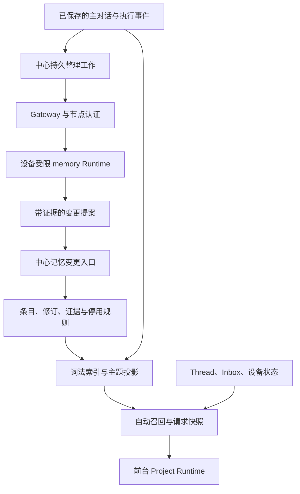

# Project 长期记忆技术设计

Status: draft
Owner: Asa
Basis: [行为规格 PM-01～20](PRODUCT.md)；代码基线 `35823e30cf0178be7d720fa9a70d079a52d5191c`。

## Context

本文描述待审阅设计，尚未实施。[Project Agent TECH](../project-agent/TECH.md) 记录当前主对话、租约、工具与压缩实现；本文约定实施后的记忆存储、检索与后台工作。

| 已核对的入口 | 可复用的机制 | 本次需要改变的部分 |
| --- | --- | --- |
| `apps/server/src/project/memory.ts` | PostgreSQL 修订、条目锁、冲突返回 | 来源证据、知识状态、有效时间、停用与统一变更入口 |
| `apps/server/src/project/events.ts` | 输入批次领取、assistant 保存、事件标识去重 | 最终回复事务内登记整理工作，关联请求上下文 |
| `apps/server/src/project/runtime.ts` | 节点身份、主租约、工具结果与副作用同事务 | 自动召回、知识代次检查；后台使用独立授权 |
| `runtimes/project-agent/src/context.ts`、`runtime.ts` | 确定性历史构造、模型预算、顺序工具、保存屏障 | 注入本次有效记忆，后台受限运行模式 |
| `apps/batond/src/project/{manager,runner,ledger}.ts` | 私有 stdio、凭据、进程登记、续租与回收 | 独立后台工作身份、容量与取消，不占用主 Agent 租约 |
| `packages/protocol/src/{project,node,http-api}.ts` | Effect Schema、WSS 与 HTTP 契约、容量约束 | 记忆 DTO、后台协议、请求上下文标识 |
| `web/src/app/ProjectMemory.tsx` | 编辑草稿、冲突反馈、修订历史 | 主题、来源、状态、停用/恢复和整理状态 |

默认使用加权 BM25 与文本规范化。生成式提取继续在设备上使用 Project 配置的 provider/model，中心不持有模型凭据，也不发起模型推理。主题、检索辅助词和索引可重建；规范结论与原始依据保存在 PostgreSQL。

## 架构与模块职责



| 模块 | 职责与接口边界 |
| --- | --- |
| `apps/server/src/project/memory/` | `read/list/recall/applyChange/prepareContext`，内部管理来源、版本、索引与抑制；调用方不组装知识有效性 SQL |
| 中心 `project/events.ts` | 识别批次最终回复并登记工作；保留事件保存与工具执行屏障 |
| 中心 `project/memory-jobs.ts` | 认领、派发、续租、重试、暂停与提交；不调用模型 |
| batond `project/` | 按执行种类管理主运行与后台尝试，覆盖进程身份并检查操作白名单 |
| Runtime `memory.ts` | 有界来源读取、提取/核验、查找相关条目、提交；不加载项目文件、Skill、扩展或 MCP |
| Runtime `context.ts` | 依据已保存的快照构造模型视图，不重新查询数据库决定旧请求看过什么 |
| `packages/protocol/src/project-memory.ts` | 领域 DTO 与约束；`node.ts`、`http-api.ts` 组合传输，不反向依赖传输层 |

上述为目标模块边界。现有 `memory.ts` 替换为目录入口并更新所有调用方，不保留旧内部入口兼容层。普通运行与后台共享 provider、凭据和进程回收实现，工具权限按模式固定。

## 数据与知识变更

### 规范记录

所有表带 `employee_id`、`project_id`，关联使用复合归属约束。外部 ID 使用 UUID，主对话来源仍用 `(conversation_id, seq)`；不同序号空间不可混用。

| 记录 | 主要字段与不变量 |
| --- | --- |
| `project_memory_state` | 每 Project 一行；`knowledge_epoch`、`search_generation`、提取策略版本；知识变更的串行锁 |
| `project_memory_items` | 稳定 `id`、当前修订、`kind`、主题、实体与可选语义键、状态、core 标记；保存当前投影 |
| `project_memory_revisions` | `(item_id, revision)`、标题、正文、条件、事实有效区间与时间精度、作者、修改操作；只追加 |
| `project_memory_sources` | 稳定来源键、原始记录定位、角色、来源种类、规范文本及 SHA-256；同一原始位置只登记一次 |
| `project_memory_evidence` | 条目修订、来源 ID、UTF-8 字节范围、证据关系；同一修订不重复引用同一来源范围 |
| `project_memory_changes` | `operation_id`、规范请求哈希、动作、前后条目/修订、依据与结果；重试返回原结果 |
| `project_memory_suppressions` | 停用或纠正所否定的断言、条目/替代链、语义键与值指纹、来源范围；区分 retired/retracted，恢复只解除指定停用记录 |
| `project_memory_jobs` | 来源批次与边界、处理游标、状态、重试、attempt/claim 身份、provider/model 与策略版本 |
| `project_memory_contexts` | 请求 ID、历史边界、知识代次、实际正文及引用、查询与算法版本、预算、有效截止时间、降级标记和内容哈希；不可变 |
| `project_memory_search_documents` | 条目修订或原始来源分片、字段文本/长度、词项频次和候选索引；属于可重建数据 |

主题视图由当前条目按主题确定性分组，携带条目 ID 与修订。首期不再维护可独立编辑、可与条目冲突的主题正文。需要压缩展示时只生成带引用的预览，预览不作为新证据。

`kind` 为 `preference | fact | decision | lesson`。`basis` 为 `explicit | observed | inferred`，与知识状态分开。条件保留可读文本、相关实体及必要的结构化限定，不把自由文本解释成权限策略。

`valid_from`、`valid_until` 表达事实时间，允许未知和范围，另存 `time_precision`。`created_at` 表达记录时间；修订在系统中被后续修订替代的时间由变更记录导出。相对时间以原始事件时间为基准，不按当前运行设备的时区重新解释；时区或精度不明时保留范围或未知。停用不宣称事实为假。事实时间查询不把已撤回断言重新判为曾经正确；显式历史修订接口仍可读取原文并显示撤回原因。

### 来源与回流控制（PM-04、05）

输入事件里的每个队列条目分别登记来源，保留 `source_type`、队列 ID 和包容它的主对话 `seq`。工具结果、Thread 反馈使用已有持久记录 ID；引用超出中心保留范围的设备全文时，必须先取得并保存实际证据片段，不能只登记一个可能过期的路径。

证据定位为 `{source_id, start_byte, end_byte, source_hash}`，边界须落在 UTF-8 字符边界。规范文本的生成规则带版本。提交时检查归属、哈希、范围、来源是否被抑制和是否位于本工作可读的范围。

来源角色由中心记录推导，模型不能改写。用户引用文章的语义归属、结论是否得到原文支持由提取/核验处理，角色校验不能代替语义判断。执行 Agent 总结标为 `agent_report`；只有具体命令结果等执行观察能支持相应的已核验结论。

`memory_context`、记忆工具返回、主题预览、系统提示词、后台整理输出和 compaction 均标记为派生内容，不作为独立事实来源。assistant 正文可供理解决定和上下文，但不能独自证明用户偏好或执行成功。用户认可某个提案时，可联合引用提案与用户确认。

原始片段重复投递只产生同一来源。相同文本在不同原始事件里不自动合并来源身份；是否构成独立证据取决于其原始来源链。召回频率不进入可信度，模型自报置信度不作为覆盖用户要求的依据。

### 状态与动作（PM-06～09）

| 动作 | 前置条件 | 原子结果 |
| --- | --- | --- |
| `add` | 来源合格且没有等价有效条目 | 新条目与首修订；普通推断标为 inferred 且不能进入核心要求 |
| `support` | 结论、条件与有效时间一致，存在新独立证据 | 关联证据并产生修订；已有证据或等价重放为 no-op |
| `correct` | 目标修订匹配，证据说明旧断言有误 | 同条目新修订；记录旧断言撤回及其证据抑制；保留已有 retired/superseded 状态，不隐式恢复 |
| `supersede` | 同一互斥属性、范围相同且有效区间相接或重叠 | 新后继条目，旧条目登记 superseded 关系并在后继生效时关闭适用区间；未来变更不提前移除现行值 |
| `dispute` | 相关断言矛盾且不足以选择有效值 | 标记 disputed，返回各方证据；不输出为确定事实 |
| `retire` | 用户明确停用，目标修订匹配 | 状态 retired、抑制记录、核心移除与索引失效同事务提交 |
| `restore` | 用户明确恢复，引用抑制记录，且不存在互斥的现行后继 | 解除相应 retired 抑制并产生新修订；存在后继时返回冲突，不自动撤销现行结论 |

未通过来源核验的提案保持 candidate 或被丢弃，不进入有效召回。条目状态为 `candidate | active | superseded | disputed | retired`；撤回关系保存在变更记录中，允许同一稳定条目在纠正后有新的 active 修订。superseded 同时表达替代关系，实际适用性还要检查事实时间；已登记但尚未生效的后继不影响前驱在当前区间内的使用。

纠正为被否定断言及其旧证据范围登记 retracted 抑制；用户停用登记 retired 抑制。后台 add/support/主题重建均检查这些记录以及完整替代链，不能仅因当前列表里不存在旧值就以新 ID 再新增。同一旧证据也不能经新的摘要或提案绕过检查。新独立用户信息可以再次改变结论，但须作为新的明确变更，不能让旧证据自行恢复有效性。

编辑 retired 条目仍保留停用状态和抑制，core 保持关闭；编辑 superseded 条目仍保留后继关系。restore 只解除指定 retired 抑制，不解除错误断言的 retracted 抑制。已有互斥后继时返回 `memory_restore_conflict` 及现行条目，用户可另行明确替代当前状态。

语义键包含实体、属性和范围，用于寻找冲突候选。键相同、正文相似、出现同名实体均不能单独决定覆盖。多值属性和条件不同的要求允许并存。没有可信事实时间时，不用处理时间伪造历史区间。

变更入口由 `actor` 决定允许的动作：员工可直接编辑/停用/恢复；前台运行须引用实际用户要求或执行证据；后台只能提案和整理，不能解除用户抑制或自行恢复停用知识。作者与执行者均由认证身份生成。

`revision` 继续做乐观并发检查，`operation_id` 做请求去重；两者不能互相替代。相同 ID、相同规范请求返回原结果；相同 ID、不同请求返回冲突。内容、状态和证据均未变时不增加修订或知识代次。

### 核心记忆

只有明确且稳定的用户要求可自动提议进入核心区；推断、外部指令和未验证总结不能进入。正文保留用户要求中的否定、例外和条件，来源及渲染信息另外保存。用户可显式维护 core 标记。

初始核心预算为 1,500 估算 token，相关召回为 3,500，完整快照上限 40 KiB。预算使用 Runtime 当前的字符估算方法，计入标题、条件、来源标识与消息开销；不宣称等于 provider 实际 token 数。默认值集中在协议支持的 Runtime 设置中，模型窗口与回答预留优先约束总预算。

超额加入核心区返回 `core_budget_exceeded`，已有内容不变；自动提案保留为普通有效条目并显示未进入核心的原因，不能静默删除旧要求腾位置。请求构造先为核心内容预留容量，再缩减普通历史与相关片段。核心仍无法容纳时，不基于缺失要求继续自动副作用操作，报告具体容量原因。

## 默认词法检索（PM-10～12）

### 文档与规范化

索引分为当前记忆和原始来源两类语料。记忆文档包含 title、search_terms、content、实体与主题；来源按完整段落或有明确字节边界的片段组织，保留父来源和邻接位置。

查询和文档采用同一版本的规范化：Unicode NFKC、大小写归一、英文 camelCase/snake_case/点号/连字符拆分，原技术标识符同时保留为精确项。中文首期采用连续汉字二元组，索引同时保留单字项供单汉字查询；多字查询只使用二元组，避免高频单字放大噪声。原文不被规范化结果覆盖，引用和命令仍返回原字符串。

标题、正文和辅助词分字段记录词频。辅助词由已有后台提取请求顺带生成，最多 16 项、每项最多 80 个字符，必须与正文主题有关。它们不进入证据或核心正文，也不自动改变事实有效性。初期不使用向量索引、pgvector、外部词库 API 或必经的模型查询改写。

### 候选、评分与合并

按员工、Project、查询模式及知识有效性过滤，再生成主题/实体精确匹配、记忆词项和来源词项三路候选。原始片段命中被替代、纠正或停用的知识时，返回状态与当前条目引用；默认自动上下文不得将其作为有效旧值注入。

PostgreSQL 的 GIN 词项索引用于候选定位。tsvector 由预处理后的 lexeme 构造；查询词按 OR 生成候选，不把整句转换成必须全部命中的条件。用户输入不作为 SQL 或 tsquery 语法执行，规范化词项通过受控构造和参数传入。query 最多 2 KiB，最多使用 128 个不同词项，截断明确返回。完整词频和字段长度另存，避免依赖 tsvector 位置截断来计算 BM25。`ts_rank` 可用于候选预选，不能当作 BM25 分数。

应用层使用分字段 BM25 的加权和：

```text
score(q,d) = Σfield weight(field) × Σterm∈q IDF(term)
             × tf(term,d,field) × (k1+1)
             / (tf(term,d,field) + k1 × (1-b+b×length(d,field)/avgLength(field)))
IDF(term) = ln(1 + (N-df(term)+0.5)/(df(term)+0.5))
```

起始 `k1=1.2`、`b=0.75`，title/search_terms/content 权重分别为 3/2/1，属于待验证默认值，不归因为 Zed 的实现。N、df 和平均长度按同一 Project 的相应可检索语料计算，记忆与原始来源分别统计。空字段长度不参与其平均值，重复查询词不增加权重。

单路候选初始上限 512、最终显式工具结果最多 20 条。超限时使用固定预选顺序并返回 `candidate_truncated=true`，不宣称得到全库精确前 20。前三路按 RRF 合并，常数初始为 60；同一条目/来源范围去重，等分按记录时间、稳定 ID 排序。普通 recall 在 repeatable-read 事务中获取词项统计、候选与状态；prepare_context 在 Project Agent 与 memory_state 锁保护下保存快照。返回候选的归属、状态与修订都在该一致边界内验证。

来源历史较大时不加载全部原文进入内存。先取匹配片段，再按预算读取相邻段落；来源通路的预算不挤掉核心要求。查询不匹配、候选被截断、来源受抑制和检索失败分别表示。

核心记忆按作用范围独立选取，不参与 BM25 淘汰。当前事实模式排除 retired 与撤回断言，并按有效区间选择 active 或仍在适用区间内的 superseded 前驱；未来后继尚未生效时仍返回前驱。历史模式同样按所问时间选择替代链，未知时间区间如实标识；显式 include_inactive 用于用户历史查看，不进入普通自动注入。

### 一致性与成本

知识变更和对应记忆搜索文档的失效/更新在同一事务完成；来源词项由保存事件时的确定性投影生成。整库重建按 generation 写临时集合，完整后切换，不影响前台读取旧的完整索引。旧索引候选仍通过规范记录校验，不能复活旧值。

索引辅助词、规范化规则或重建仅推进 `search_generation`；内容、来源有效性、条件、状态和核心要求的变化推进 `knowledge_epoch`。只有前者变化时无需丢弃在途模型输出。

自动召回不发模型请求。主 Agent 仍可在依据不足时改写查询或深查，这些请求计入原有前台预算。索引失败时保留核心要求及本批原始输入，返回显式降级标记；无法获取必需依据的操作等待补查，不能默认成功或编造知识。

## 前台请求上下文与压缩（PM-13～15）

`claim_inputs` 继续持久保存完整输入批次，新增 `input_seq` 作为该轮身份。每次模型请求前，Runtime 调用 `prepare_context`，携带稳定 `context_id`、当前 `last_seq`、`input_seq` 和预算。中心基于最新知识与最近目标自动召回，保存实际渲染正文及引用，再返回快照。

快照不作为新的主对话 input，也不参与原始经历提取。assistant payload 记录 `memory_context_id`，保留 provider 消息、签名和 reasoning 字段。渲染器在工具调用/结果已经配对的安全位置添加当前快照；旧请求的快照只用于解释当时依据，不把历次快照全部叠加进上下文。快照的 expires_at 为该 Project 下已知未来事实生效/失效边界的最近值；保存输出或提交操作时也核对此期限，防止知识代次不变但事实已经到期。

稳定系统提示词与工具声明保持固定。动态块明确标为有来源的历史资料和用户要求，其内容不获得高于真实用户消息的权限。本批最新用户输入优先。Thread、Inbox 与设备状态通过既有只读工具获得，快照中的观察必须带读取时间，不能代替执行前检查。

恢复先确认已保存 assistant、工具结果和持久业务登记。已登记的操作即使尚无最终 tool_result，也继续查询原执行。需要继续模型请求时，无知识变化且快照未到期可复用；代次或期限变化均创建新的 context_id，不修改已保存记录。

中心生成记忆工具结果时另存 `memory_refs`（条目/修订/来源范围、current/history 模式和可选 as_of）与 derived 标记。构造后续模型视图时重新验证引用的状态和事实时间；已纠正、替代、停用或自然到期的当前结果正文替换为状态说明和最新读取入口，保留 role、toolCallId、toolName 与配对。沿用已有旧工具结果清理的视图机制，不修改原始事件或 provider 签名字段。无法定位派生范围的旧记忆结果整体替换，不把原 active 标记继续注入。显式历史读取按其固定 as_of 返回原文及现时状态标注，不能被重新解释为当前事实。

知识变化会使旧 compaction 的记忆部分失效。新压缩不把快照、记忆工具输出重新提取为事实。摘要记录知识代次、依赖条目与有效截止时间；发生 correct、supersede、retire 或跨过事实生效/失效边界后，依赖被影响或无法证明不受影响的旧摘要不再自动注入。即使没有新写入、知识代次未变，自然到期也触发此检查。替代视图使用保留尾部、当前目标/状态、核心要求和原文读取入口，必要时从可用原始范围重新生成摘要。不能用字符串未匹配到旧值来证明摘要安全。旧摘要保留历史查看，不回写原事件。

### 在途输出与操作检查

1. 保存新 assistant 前核对 `memory_context_id` 的归属、历史边界、`knowledge_epoch` 和 expires_at；失效则拒绝该次新输出，返回 `memory_context_changed`，Runtime 刷新再请求。
2. assistant 已保存后，先按原工具调用 ID 查询结果或持久业务登记。有结果则返回原结果；已有 Thread/outbox/pending 执行则继续原等待和查询协议，无论知识代次或快照期限是否变化，都不能把已开始的操作关闭成上下文错误。
3. 仅在没有结果、没有任何已提交业务登记时检查快照。失效则保存无副作用的工具错误结果并关闭该调用，随后重新评估；不能让已保存的调用永久悬空。
4. 同一 assistant 的多项调用之间若记忆发生变化，后续尚未提交的调用同样检查。记忆写工具自身成功改变代次后，后续业务调用需经新的模型上下文决定。登记检查、快照验证与首次业务命令登记在同一数据库事务内确定先后。

特别地，nodes.exec 创建 shell Thread 后即视为已提交，即使仍在 wait_tool 且没有 tool_result。恢复时继续使用已有 client_thread_id 与 Thread；不能因记忆刷新生成新的调用身份来重发同一命令。

自然语言纠正能否被正确识别仍依赖模型。程序能保证已确认修改的版本检查与副作用顺序，无法以字符串规则保证理解所有自由文本纠正。连续上下文变化时有界重试，达到本次模型预算后保留原始输入及恢复位置，不用旧代次强行继续。

## 后台整理与节点运行（PM-02、17～19）

### 工作登记与边界

`appendAssistant` 在确认回复有效、没有工具调用且当前批次已解决后，在保存回复的同一事务插入工作。来源范围为该 input 事件至其最终 assistant；前置关联内容只作为只读上下文。唯一键为 `(conversation_id, input_seq, policy_version)`。失败、aborted 或尚有待执行工具的 assistant 不结束批次。

登记以持久最终回复为准，不等待 Runtime 的 `finish`，也不要求先完成一次提取才允许 compaction。主对话原始事件保持完整，后台直接从源记录读取。

每个工作保存不可变来源边界和可推进的分片游标。同一 Project 按 input_seq 顺序整理，不以模型完成顺序判断事实新旧；前序工作等待重试时，后序保留排队，直接用户修改与前台对话照常进行。初始单片规范文本最多 48 KiB，最多 16 个变更，结果 JSON 不超过 160 KiB。大事件可按文本边界分页，证据仍定位到原来源。片段必要的相邻内容标记为 context-only，不能因分片重叠增加独立证据。

| 工作状态 | 进入条件 | 后续处理 |
| --- | --- | --- |
| `pending` | 登记、抢占、失败重试或还有分片 | 保存 next_attempt_at、waiting_reason 与最近错误；到期且条件满足才认领 |
| `claimed` | 中心持久保存新 attempt 与 claim | 重发同一启动命令，直到节点确认或期限失效 |
| `running` | 节点确认已启动受限 Runtime | 续租、有界处理与分片提交 |
| `completed` | 最后一个分片原子提交，游标到达不可变结束边界 | 不再认领；仅接受同身份收尾/清理回执和已提交操作的幂等查询 |
| `cancelled` | Project 归档时尚未完成 | 保留原始经历与处理进度，不再推理 |

暂停、缺设备或明确缺认证保持 pending 并记录等待原因。claimed/running 被抢占、租约失效或达到预算后撤销尝试，工作回到 pending；已完成状态与进程实际回收分别记录，不能提前释放节点占用。

### 授权与协议

后台不使用前台 `lease_run_id`。Runtime probe 与设备报告声明 `memory_protocol=1`，中心仅向声明该协议的在线已同步节点派发，缺失时只影响后台整理并显示原因。中心为一个尝试保存 `job_id`、`attempt_id`、递增 `claim_epoch`、`node_id`、provider/model、`claim_until`，同一 Project 最多一个有效整理尝试。主运行与后台不能互相续租或代发提交。

| 传输 | 消息与操作 | 关键约束 |
| --- | --- | --- |
| 中心 → batond | `project_memory_start/stop`，带 job/attempt/claim 身份 | 以 attempt_id 为稳定命令标识，先保存投递进度再发送 |
| batond → 中心 | `project_memory.request`；`started/renew/exited` | 宿主生成管理请求，Runtime 无权续租 |
| 后台 Runtime → 宿主 → 中心 | `bootstrap/read_sources/lookup_items/commit_chunk/finish/report_failure` | 只可读取工作范围、相关知识与提交提案，宿主覆盖运行身份 |
| 中心 → 后台 | `{ok, code?, data?}` | 单帧不超过 192 KiB，正文分页，未知操作拒绝 |

`bootstrap` 返回来源边界、游标、策略、provider/model、预算及读取入口。`lookup_items` 只读本 Project，并返回目标当前修订。`commit_chunk` 包含稳定 `commit_id`、预期游标、已读来源哈希、变更列表与证据。模型不发送 SQL 或任意业务工具调用。

claim 期限与现有 Project 运行一致：中心 60 秒，batond 每 20 秒续租，58 秒未成功则停止进程，计入系统休眠。续租和写入均校验当前节点连接与归属。重认领生成新的 attempt_id 和 claim_epoch，旧尝试不可提交。可能重复发生模型计算，持久知识修改通过操作标识去重。

节点账本登记执行种类和 attempt_id。重复 start 不重复启动；stop-before-start 持久禁止迟到启动；节点重启核实并清理旧进程，不使用旧身份重新推理。源码与 SEA 都通过现有 Runtime 分派增加 `memory` 模式，复用私有目录、专用 stdio、watchdog 和平台回收。

### 整理流程与预算

后台读取尚未处理的分片，提取结论及证据，查询相关条目，生成变更提案。普通事实允许一次模型请求完成提取和对照；改动核心要求、矛盾或大范围替代时增加独立核验。响应结构、证据范围或容量无效时不提交，按预算重新生成。

初始每次尝试最多 8 次模型调用、5 分钟，沿用节点的输出上限；时长截止可中断正在进行的模型请求。每成功提交一个分片才推进游标；预算用尽但仍有未处理内容时释放尝试，工作回到 pending。有进展可继续认领，无进展的预算耗尽按失败退避，避免无休止地付费重算同一片段。失败按 1、5、15 分钟退避，此后上限 15 分钟；明确认证问题保持 pending 并设置等待原因，不计入模型错误重试。后台不修改前台 conversation 的 failure_count，不生成重复系统事项。

每节点后台并发初始为 1。`maxConcurrentProjects > 1` 时，后台与进程清理占用计入总名额，至少保留一个前台名额；存在前台排队时不启动后台。任意容量下，若新前台因正在运行的后台而缺少名额，均撤销该后台 claim、登记 stop 并在回收后优先交付前台；容量为 1 时只允许在前台无工作时运行后台。抢占和前台派发分两个短事务，不能持有前台 Project/节点锁等待另一个 Project 的后台锁或进程回收。回收未确认前保留实际占用并显示原因，不谎报前台已启动。共享 provider 的外部限流仍可能影响两类请求，不能宣称进程名额隔离等于订阅配额隔离。

Project 暂停或归档在 Agent 锁下撤销后台 claim 并登记 stop。暂停保留 pending 工作；归档拒绝所有新变更。前台单次 stop 不取消已闭合批次的工作。切换 provider/model 作废后台旧尝试，后续认领使用新配置，已提交分片保留。

### 提交、锁顺序与崩溃恢复

统一锁顺序为 Project Agent → 节点身份（涉及节点请求时）→ Conversation（仅追加主对话时）→ memory_state → 目标 item 按 ID 排序 → job/attempt。前台已持有 Agent/Conversation 时继续按此顺序；后台提交不在持有 job 后再请求 Agent。认领只锁 job/attempt，不同时获取 Agent；真正授权在启动与提交时重新核对。

`commit_chunk` 在短事务内依次核验 claim、Project 状态、抑制记录、预期游标、目标修订和证据，再写入变更、索引与游标。任一目标冲突使整个分片回滚，返回当前条目；后台重新读取。遇到新停用的来源时，中心重新提供过滤后的分片；整片均被抑制可提交空操作并推进到服务端确认的边界，不能让停用永久阻塞队列。模型等待、来源分页和索引整库重建不持有事务锁。

| 中断位置 | 恢复依据 |
| --- | --- |
| 最终回复事务提交前 | 原输入仍待完成，无半条工作 |
| 最终回复已提交但尚未派发 | 工作已持久保存，调度继续 |
| 分片提交前进程结束 | 游标不变，允许重复计算 |
| 分片已提交而回执丢失 | 同 commit_id 返回原结果，不重复变更 |
| 用户修改后后台迟到 | 修订冲突/抑制检查失败，不能覆盖用户 |
| claim 过期或 Project 已暂停/归档 | 旧提交拒绝，已提交知识保留 |

## HTTP、工具与错误契约

### 员工 API

沿用 `/api/v1/projects/:projectId/memory` 与员工认证、Origin、CSRF、强制改密和资源隔离。HTTP DTO 在同一 Effect HttpApi 声明中生成路由与 OpenAPI。归档只读检查放入公共变更入口。

| 路径 | 请求/响应要点 |
| --- | --- |
| `GET /memory` | 按主题与状态列条目，`after_id/limit` 分页；默认当前知识 |
| `GET /memory/:id`、`GET /memory/:id/revisions` | 当前详情、证据及变更；历史分页显示是否已纠正/替代/停用 |
| `GET /memory/sources/:sourceId` | 授权来源片段，按 UTF-8 字节 offset/max_bytes 分页；显式历史读取保留抑制状态标识 |
| `PUT /memory/:id` | `operation_id, expected_revision, title, content, kind, topic, conditions, core`；新建 revision=0，已有条目编辑按纠正保存 |
| `POST /memory/:id/changes` | `operation_id, expected_revision, action, reason?`；supersede 另带后继内容和明确有效时间，retire/restore 无后继正文 |
| `POST /memory/recall` | `query, mode=current\|history, as_of?, include_inactive?, max_results?, max_bytes?`；返回条目/来源、状态、得分、截断与降级标记；只读操作仍按 POST 校验 CSRF |
| `GET /memory/topics` | 按当前条目生成主题目录与预览 |
| `GET /memory/status` | 待处理批次、处理进度、运行设备、等待原因、最近错误 |

员工保存的来源是同事务生成的用户编辑记录，不能自行指定 author、job 身份、可信来源或替代其他员工记录。请求正文不接受任意权限字段。as_of 使用带时区的 RFC 3339 时间；current 不接收 as_of 或 include_inactive，history 未指定时点时返回带有效区间的历史候选。记忆正文沿用 64 KiB 上限，自动提案每条最多 8 KiB，标题沿用 200 字符；操作整体仍受帧及 JSON 转义后的容量限制。

### 前台工具与 Runtime 操作

| 接口 | 契约 |
| --- | --- |
| `memory.recall` | 与员工 recall 相同的查询、时间模式及预算；返回有来源候选及缺口，不强制调用综合模型 |
| `memory.read` | item_id 或 source_id，二者选一；可选 revision 或来源字节分页；返回内容、状态、条件与来源 |
| `memory.remember` | 新知识、类型、条件、证据引用；服务端寻找等价条目，返回新增/合并/no-op |
| `memory.correct` | item_id、expected_revision、correction/state_change、内容、证据与可选事实时间；区分纠正与后继状态 |
| `memory.retire` | item_id、expected_revision、用户请求证据；自动整理不具有该权限 |
| `memory.restore` | item_id、expected_revision、待解除抑制记录及用户明确恢复证据；仅前台或员工入口可用 |
| `prepare_context` | context_id、last_seq、input_seq、预算；返回已保存的快照，超大内容通过分页读取 |

恢复停用条目只由员工 API 或带用户明确恢复依据的前台操作执行；后台协议没有 restore。现有 memory.search/write 工具及 DTO 直接替换，更新工具名映射、provider 回放和 UI 调用，不维护旧开发协议别名。history.search/read 保留，并复用来源索引与抑制状态，权限和序号边界保持原约束。

| 错误码 | 结果与调用方处理 |
| --- | --- |
| `not_found` | 404；含其他员工/Project 对象，不泄露存在性 |
| `memory_conflict` / `memory_restore_conflict` | 409，附当前条目/修订或互斥后继；保留草稿，重新整合或明确替代 |
| `operation_conflict` / `job_cursor_conflict` | 409，同操作标识不同请求或分片游标不符；后者返回当前已提交游标 |
| `memory_context_changed` | 新 assistant 拒绝或工具无副作用结果；刷新上下文 |
| `claim_lost` | 后台授权失效，停止该尝试 |
| `source_suppressed` / `invalid_evidence` | 不提交分片，不能通过更换提案 ID 绕过 |
| `core_budget_exceeded` | 422，附容量信息；已有核心要求不变 |
| `project_archived` | 409，拒绝写入 |
| `too_large` / `invalid` | 413/422；精简或修正请求，无部分提交 |
| `memory_unavailable` | 明确检索/后台降级；不返回伪造空成功 |

## 可见性与实施边界

记忆界面列出当前条目正文，需要时按主题分组；版本、来源、时间和类型不在列表显示，来源对话和修订历史从编辑弹窗按需打开。编辑弹窗提供保存和停用，停用条目进入「不再使用」分组并可恢复。修改冲突保留当前草稿并显示最新正文。整理等待、处理中和失败只写入诊断，界面只提示需要用户处理的持续故障。具体文案遵循现有 design/WRITING.md，界面设计资产在实现阶段同步。

追踪沿用 `packages/telemetry`，记录工作/尝试/批次 ID、策略版本、知识与索引代次、候选数量、截断、耗时、token 用量及错误码。默认追踪不包含记忆正文、原始证据、查询全文或凭据。来源正文只在授权 API 返回，日志不能成为额外副本。

实施时直接调整当前 schema 基线，不提供旧实验数据升级与双写兼容。淘汰资产包括旧 memory.search/write 定义、单字段笔记 DTO、仅标题的压缩记忆索引、旧编辑视图和验证其旧格式的专属用例。原始历史、通用权限/事务/进程辅助设施保留；新实现按本文验收，不以复现旧检索排序或旧笔记格式为目标。

批准后的实现还需原地同步 Project Agent PA-05、14～17 的记忆相关规则、TECH 第 3/6/7/11 节及 Runtime/中心 README，移除被替换描述。本文仍为 draft 时，这些文档继续描述当前实现。

## Testing and validation

| 需求 | 设置与观察 | 失败条件 | 位置 | Status |
| --- | --- | --- | --- | --- |
| PM-01、04、08 | 跨员工/Project 读取、伪造证据、停用后重提取 | 越权、来源升级、旧值复活 | 中心 PostgreSQL 集成 | planned |
| PM-02、05 | 回复/工作登记事务中断；分片回执丢失、重试 | 缺工作、重复知识或半提交 | 中心事务故障注入 | planned |
| PM-06～09 | 时间变化、原始错误、条件并存、并发编辑 | 错误历史被视为事实，静默覆盖或自动恢复 | 变更单元测试 + 数据库集成 | planned |
| PM-10～12 | 固定中英语料、标识符、同义表达、候选截断 | 无排序、失效内容混入或未报告缺口 | 纯检索单测与固定语料 | planned |
| PM-13～15 | 核心超额、多次压缩、事实自然到期、旧摘要/工具结果和请求恢复 | 要求丢失、派生内容再提取、过期副作用或重复执行 | Runtime 本地模型替身 + 中心集成 | planned |
| PM-17～19 | 断线、超时、认证失败、前台抢占和进程回收 | 前台饿死、旧 claim 可提交、占用虚报 | batond 包内进程替身 | planned |
| PM-02、10、15、18 | HTTP→中心→WSS→后台 Runtime→知识→新前台 Runtime | 形成/读取链路断裂，恢复重复副作用 | 一条跨 app 本地 E2E | planned |
| PM-16、17 | 按需来源与历史、冲突草稿、停用/恢复、持续故障提示 | 列表混入修订或元信息；后台状态打扰前台 | Web 组件测试 | planned |
| PM-18、19 | 搬迁 SEA、空 PATH 与临时 HOME 下调用 memory 模式，检查启动、取消与私有文件 | 依赖源码路径、缺失分派或进程未回收 | 现有安装包检查 | planned |
| PM-20 | 固定模型与历史，比较原始检索、词法召回、后台整理 | 使用过时知识、来源不支持或成本无记录 | 显式手动质量评估 | planned |

已有诊断原型用六份仓库文档的 295 个段落、八条人工查询验证分字段 BM25 和中文二元组可生成相关候选。它没有独立保留集或向量对照；未证明真实记忆质量，不作为上述验收通过证据。正式夹具需入库、注明来源，并将开发调参样本与保留评估样本分开。

质量报告分别记录有效事实命中、历史时间正确、过时信息误用、无依据断言、纠正后的实际动作及额外 token/延迟。固定同一模型、历史与预算比较各阶段，先取得基线再制定质量阈值。CI 只使用本地替身和固定录制；真实在线模型评估显式手动运行，不作为合入或功能开放前提。

文档检查运行格式、链接及需求/验收编号核对；实施阶段按 AGENTS.md 运行受影响包检查、Runtime 测试和所需集成验证。源代码、打包与进程行为尚未实施，不能在本阶段报告通过。

## 资料依据与取舍

| 来源 | 采用的机制 | 适用边界 |
| --- | --- | --- |
| [Zed MCP 工具搜索原帖](https://x.com/zeddotdev/status/2112588120558338261) | 加权 BM25、文本规范化、检索不依赖模型或 API | 工具发现的工程先例；原帖未公开分数、权重和可复现基准，不推定记忆检索优于向量 |
| [Grok Build Memory](https://x.ai/news/grok-build-memory) | 轮次结束后台记录、主题整理、当前要求优先 | 文件组织方式不作为 Baton 的跨设备规范存储 |
| [Cloudflare Agent Memory](https://blog.cloudflare.com/introducing-agent-memory/) | 来源核验、替代、原消息补查、排名合并 | 不照搬每次查询的 HyDE 与综合模型成本 |
| [OpenClaw Memory Architecture](https://docs.openclaw.ai/concepts/memory-architecture) | 来源分层、写入控制、召回回流排除 | Baton 的执行结果仍可作为有身份的观察证据 |
| [Hindsight](https://arxiv.org/abs/2512.12818) | 形成/检索/整合流程，事实、经历与推断分离 | 不引入完整人格信念参数或自我观点强化 |
| [Graphiti / Zep](https://arxiv.org/abs/2501.13956) | 事实有效时间与记录时间分离，来源与失效关系 | 关系模型可在现有 PostgreSQL 实现 |
| [Letta MemFS](https://docs.letta.com/concepts/memfs) 与[生产评测](https://www.letta.com/blog/evaluating-memory-in-production-agents/) | 可查看知识、后台整理；分别评估生成和使用 | 默认文件检索与其他带向量的实验须区分 |
| [Memora](https://aclanthology.org/2026.findings-acl.1337/) | 对失效知识误用单独扣分、连续变化场景 | 需补充 Baton 的执行行为与状态证据场景 |
| [Compaction Cliff](https://arxiv.org/abs/2608.22752) | 重要要求独立保留、按内容类型设置损失预算 | 分类与范围识别仍会出错，文本保留不能保证模型行为 |
| [Microsoft 记忆架构论文](https://arxiv.org/abs/2605.08538) | 去重及存储/精度的对照评估 | 97.2% 是事件保留精确率，不是聊天准确率；成熟/再巩固没有充分可区分证据 |
| [Anthropic 长任务 harness](https://www.anthropic.com/engineering/effective-harnesses-for-long-running-agents) | 结构化进度、恢复前核对环境和结果 | 当前任务状态使用真实业务记录 |
