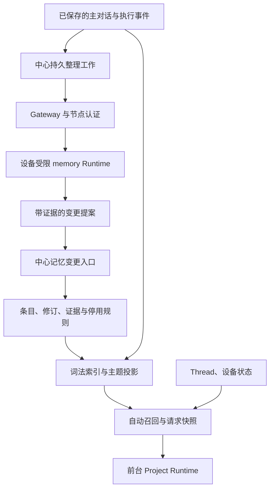

# Project 长期记忆技术设计

Status: partially implemented
Owner: Asa
Basis: [行为规格 PM-01～23](PRODUCT.md)；代码基线 `35823e30cf0178be7d720fa9a70d079a52d5191c`。

## Context

条目、修订、来源、证据、操作去重与抑制记录已由 `project/memory/` 实现，员工 API、前台工具和后台整理共享事务内的 `planChange`/`executeChange`。词法查询使用 PostgreSQL 有界候选与 Orama 3.1.18，支持状态和事实时间过滤。请求前自动保存核心要求与相关片段的不可变快照，新 assistant 和首次工具执行检查快照仍然有效。可选 Embedding 的中心配置、设备 SDK、pending/ready 记录、查询绑定和 pgvector 向量排序已实现。最终回复事务登记整理工作，受限 memory Runtime 在空闲设备处理来源分片与待生成向量；设置界面已提供公开配置。请求快照按读取集合校验：只有快照读到的条目版本、记忆工具结果读到的条目版本、核心集合或时间边界变化时才失效；摘要不包含记忆内容，记忆变化后继续有效。[Project Agent TECH](../project-agent/TECH.md) 记录当前主对话、租约、工具与压缩实现。

| 已核对的入口 | 可复用的机制 | 本次需要改变的部分 |
| --- | --- | --- |
| `apps/server/src/project/memory/` | 统一变更入口、修订/操作去重、来源证据、事实时间、停用与恢复 | 词法检索、自动召回、请求快照、可选向量记录/排序与后台生成 |
| `apps/server/src/project/events.ts` | 输入批次领取、assistant 保存、事件标识去重 | 最终回复事务内登记整理工作，关联请求上下文 |
| `apps/server/src/project/runtime.ts` | 节点身份、主租约、工具结果与副作用同事务 | 自动召回、快照有效性检查；后台使用独立授权 |
| `runtimes/project-agent/src/context.ts`、`runtime.ts` | 确定性历史构造、模型预算、顺序工具、保存屏障 | 注入本次有效记忆，后台受限运行模式 |
| `apps/batond/src/project/{manager,runner,ledger}.ts` | 私有 stdio、凭据、进程登记、续租与回收 | 独立后台工作身份、容量与取消，不占用主 Agent 租约 |
| `packages/protocol/src/{project,node,http-api}.ts` | Effect Schema、WSS 与 HTTP 契约、容量约束 | 记忆 DTO、后台协议、请求上下文标识 |
| `web/src/app/ProjectMemory.tsx` | 编辑草稿、冲突反馈、修订历史 | 主题、来源、状态、停用/恢复和整理状态 |

默认使用 Orama 的 BM25 与文本规范化；用户可为 Project 选配 Embedding，启用后由 PostgreSQL pgvector 按余弦距离排序，再与词法候选融合。生成式提取和 Embedding 调用都在设备进行，中心不持有模型凭据，也不发起模型推理。主题、检索辅助词和索引可重建；规范结论与原始依据保存在 PostgreSQL。

## 架构与模块职责

| 模块 | 职责与接口边界 |
| --- | --- |
| `apps/server/src/project/memory/` | `read/list/recall/planChange/executeChange/prepareContext`，内部管理来源、版本、索引与抑制；调用方不组装知识有效性 SQL |
| 中心 `project/events.ts` | 识别批次最终回复并登记工作；保留事件保存与工具执行屏障 |
| 中心 `project/memory-jobs.ts` | 认领、派发、续租、重试、暂停与提交；不调用模型 |
| batond `project/` | 按执行种类管理主运行与后台尝试，覆盖进程身份并检查操作白名单 |
| Runtime `memory.ts` | 有界来源读取、提取/核验、查找相关条目、提交；不加载项目文件、Skill、扩展或 MCP |
| Runtime `context.ts` | 依据已保存的快照构造模型视图，不重新查询数据库决定旧请求看过什么 |
| `packages/protocol/src/project-memory.ts` | 领域 DTO 与约束；`node.ts`、`http-api.ts` 组合传输，不反向依赖传输层 |

`project/memory/index.ts` 统一导出变更、读取、召回、请求快照和 Embedding 入口。`change.ts` 分为两步：`planChange` 锁定状态行并完成全部校验，不写记忆数据；`executeChange` 写入修订、证据、检索投影与向量工作。`applyChange` 在同一事务内依次调用两者。`sources.ts` 登记原始来源并生成片段，`read.ts` 统一状态与事实时间过滤。`projection.ts` 保存词项，`recall.ts` 组织 Orama 排序、RRF 和预算，`vectors.ts` 用 pgvector 在数据库内排序并只返回前 20 个命中。`context.ts` 提供 embeddingQuery、prepareContext 与 checkMemoryContext；`embeddings.ts` 提供配置、待生成记录、提交和有限退避。新摘要的 memory_index 为空，当前记忆由每次请求的快照提供。摘要生成时不读取记忆快照和记忆工具结果；模型视图只替换读到的条目版本已不是当前版本的记忆工具结果，原始事件与读取入口保留。后台复用普通运行的 provider、凭据、agent_runs 和进程回收实现，工具权限按 memory 模式固定。

## 数据与知识变更

### 规范记录

所有表带 `employee_id`、`project_id`，关联使用复合归属约束。外部 ID 使用 UUID，主对话来源仍用 `(conversation_id, seq)`；不同序号空间不可混用。

| 记录 | 主要字段与不变量 |
| --- | --- |
| `project_memory_state` | 每 Project 一行；`knowledge_epoch`、`core_epoch`、`search_generation`、提取策略版本；知识变更的串行锁 |
| `project_memory_items` | 稳定 `id`、当前修订、`kind`、主题、实体与可选语义键、状态、core 标记；保存当前投影 |
| `project_memory_revisions` | `(item_id, revision)`、标题、正文、条件、事实有效区间与时间精度、作者、修改操作；只追加 |
| `project_memory_sources` | 稳定来源键、原始记录定位、角色、来源种类、规范文本及 SHA-256；同一原始位置只登记一次 |
| `project_memory_evidence` | 条目修订、来源 ID、UTF-8 字节范围、证据关系；同一修订不重复引用同一来源范围 |
| `project_memory_changes` | `operation_id`、规范请求哈希、动作、前后条目/修订、依据与结果；重试返回原结果 |
| `project_memory_suppressions` | 停用或纠正所否定的断言、条目/替代链、语义键与值指纹、来源范围；区分 retired/retracted，恢复只解除指定停用记录及同次停用期间编辑派生的抑制组 |
| `project_memory_jobs` | 整理或向量生成的工作种类、来源批次/条目修订、处理游标、状态、重试、attempt/claim 身份、provider/model 与策略版本 |
| `project_memory_chunks` | 分片身份 `(job_id, cursor)`、提交该分片的 `attempt_id`、请求哈希与回执（含逐条提案结果或跳过原因）；重试返回原回执 |
| `project_memory_contexts` | 请求 ID、历史边界、核心代次、实际正文、条目引用与记忆工具读取集合、查询与算法版本、预算、有效截止时间、降级标记和内容哈希；不可变 |
| `project_memory_search_documents` | 条目修订或原始来源分片、检索字段文本与候选词项索引；属于可重建数据 |
| `project_memory_embeddings` | 条目修订、Embedding 配置身份、文本哈希、状态、维度与 pgvector `vector` 列；ready 时向量维度须等于 dimensions，只读当前有效组合 |

现有表包含 state、items、revisions、sources、evidence、changes、suppressions、contexts、search_documents、embeddings、jobs 和 chunks。知识变更推进 knowledge_epoch，变更前或变更后属于核心要求时同时推进 core_epoch；词项投影、配置或向量变化推进 search_generation。修订响应统一使用 updated_at 表示该次修订的记录时间；effective 表示该修订是否为当前有效知识，retracted 标明被纠正的断言。来源文本、修订、证据与操作结果只追加，停用组用 retirement_id 关联；显式恢复只解除该组的 retired 抑制，不解除 retracted 抑制。

主题视图由当前条目按主题确定性分组，携带条目 ID 与修订。首期不再维护可独立编辑、可与条目冲突的主题正文。需要压缩展示时只生成带引用的预览，预览不作为新证据。

`kind` 为 `preference | fact | decision | lesson`。`basis` 为 `explicit | observed | inferred`，与知识状态分开。条件保留可读文本、相关实体及必要的结构化限定，不把自由文本解释成权限策略。

`valid_from`、`valid_until` 表达事实时间，允许未知和范围，另存 `time_precision`。`created_at` 表达记录时间；修订在系统中被后续修订替代的时间由变更记录导出。相对时间以原始事件时间为基准，不按当前运行设备的时区重新解释；时区或精度不明时保留范围或未知。停用不宣称事实为假。事实时间查询不把已撤回断言重新判为曾经正确；显式历史修订接口仍可读取原文并显示撤回原因。

### 来源与回流控制（PM-04、05）

输入事件里的每个队列条目分别登记来源，保留 `source_type`、队列 ID 和包容它的主对话 `seq`。工具结果、Thread 反馈使用已有持久记录 ID；引用超出中心保留范围的设备全文时，必须先取得并保存实际证据片段，不能只登记一个可能过期的路径。

证据定位为 `{source_id, start_byte, end_byte, source_hash}`，边界须落在 UTF-8 字符边界。规范文本的生成规则带版本。提交时检查归属、哈希、范围、来源是否被抑制和是否位于本工作可读的范围。

来源角色由中心记录推导，模型不能改写。用户引用文章的语义归属、结论是否得到原文支持由提取/核验处理，角色校验不能代替语义判断。执行 Agent 总结标为 `agent_report`；只有具体命令结果等执行观察能支持相应的已核验结论。

`memory_context`、记忆工具返回、主题预览、系统提示词、后台整理输出和 compaction 均标记为派生内容，不作为独立事实来源。assistant 正文可供理解决定和上下文，但不能独自证明用户偏好或执行成功。用户认可某个提案时，可联合引用提案与用户确认。

原始片段重复投递只产生同一来源。相同文本在不同原始事件里不自动合并来源身份；是否构成独立证据取决于其原始来源链。召回频率不进入可信度，模型自报置信度不作为覆盖用户要求的依据。

### 状态与动作（PM-06～09）

| 动作 | 前置条件 | 原子结果 |
| --- | --- | --- |
| `add` | 来源合格且没有等价有效条目 | 新条目与首修订；普通推断标为 inferred 且不能进入核心要求 |
| `support` | 结论、条件与有效时间一致，存在新独立证据 | 关联证据并产生修订；已有证据或等价重放为 no-op |
| `correct` | 目标修订匹配，证据说明旧断言有误 | 同条目新修订；记录旧断言撤回及其证据抑制；保留已有 retired/superseded 状态，不隐式恢复 |
| `supersede` | 同一互斥属性、范围相同且有效区间相接或重叠 | 新后继条目，旧条目登记 superseded 关系并在后继生效时关闭适用区间；未来变更不提前移除现行值 |
| `dispute` | 相关断言矛盾且不足以选择有效值 | 标记 disputed，返回各方证据；不输出为确定事实 |
| `retire` | 用户明确停用，目标修订匹配 | 状态 retired、抑制记录、核心移除与索引失效同事务提交 |
| `restore` | 用户明确恢复，引用抑制记录，且不存在互斥的现行后继 | 解除相应 retired 抑制并产生新修订；存在后继时返回冲突，不自动撤销现行结论 |

未通过来源核验的提案保持 candidate 或被丢弃，不进入有效召回。条目状态为 `candidate | active | superseded | disputed | retired`；撤回关系保存在变更记录中，允许同一稳定条目在纠正后有新的 active 修订。superseded 同时表达替代关系，实际适用性还要检查事实时间；已登记但尚未生效的后继不影响前驱在当前区间内的使用。

纠正为被否定断言及其旧证据范围登记 retracted 抑制；用户停用登记 retired 抑制。后台 add/support/主题重建均检查这些记录以及完整替代链，不能仅因当前列表里不存在旧值就以新 ID 再新增。同一旧证据也不能经新的摘要或提案绕过检查。新独立用户信息可以再次改变结论，但须作为新的明确变更，不能让旧证据自行恢复有效性。按断言值指纹匹配抑制时，员工编辑可以直接重新写入；前台与后台的 add/support 若与未解除的抑制同值，只有证据中包含晚于每条匹配抑制登记的用户来源时才放行，否则返回 `source_suppressed`。

编辑 retired 条目仍保留停用状态和抑制，core 保持关闭；编辑 superseded 条目仍保留后继关系。restore 只解除指定 retired 抑制，不解除错误断言的 retracted 抑制。已有互斥后继时返回 `memory_restore_conflict` 及现行条目，用户可另行明确替代当前状态。

语义键包含实体、属性和范围，用于寻找冲突候选。键相同、正文相似、出现同名实体均不能单独决定覆盖。多值属性和条件不同的要求允许并存。没有可信事实时间时，不用处理时间伪造历史区间。

变更入口由 `actor` 决定允许的动作：员工可直接编辑/停用/恢复；前台运行须引用实际用户要求或执行证据；后台只能提案和整理，不能解除用户抑制或自行恢复停用知识。作者与执行者均由认证身份生成，修订 author 分别记为 `user`、`agent` 或 `background`。统一入口拒绝以 inferred 依据 correct/supersede 已明确的用户偏好，用户明确纠正可以立即生效。

`revision` 继续做乐观并发检查，`operation_id` 做请求去重；两者不能互相替代。相同 ID、相同规范请求返回原结果；相同 ID、不同请求返回冲突。内容、状态和证据均未变时不增加修订或知识代次。`planChange` 返回的计划只描述要写入什么；调用方可以先收集多条计划的校验结果，再决定执行或整体回滚。

### 核心记忆

只有明确且稳定的用户要求可自动提议进入核心区；推断、外部指令和未验证总结不能进入。正文保留用户要求中的否定、例外和条件，来源及渲染信息另外保存。用户可显式维护 core 标记。

初始核心预算为 1,500 估算 token，相关召回为 3,500，完整快照上限 40 KiB。预算使用 Runtime 当前的字符估算方法，计入标题、条件、来源标识与消息开销；不宣称等于 provider 实际 token 数。默认值集中在协议支持的 Runtime 设置中，模型窗口与回答预留优先约束总预算。

超额加入核心区返回 `core_budget_exceeded`，已有内容不变；自动提案保留为普通有效条目并显示未进入核心的原因，不能静默删除旧要求腾位置。请求构造先为核心内容预留容量，再缩减普通历史与相关片段。核心仍无法容纳时，不基于缺失要求继续自动副作用操作，报告具体容量原因。

## 默认词法检索（PM-10～12）

### 文档与规范化

索引分为当前记忆和原始来源两类语料。记忆文档包含 title、search_terms、content、实体与主题；来源按完整段落或有明确字节边界的片段组织，保留父来源和邻接位置。

查询和文档采用同一版本的规范化：Unicode NFKC、大小写归一、英文 camelCase/snake_case/点号/连字符拆分，原技术标识符同时保留为精确项。相邻中英文本按汉字/非汉字边界拆开，例如 Baton长期记忆 与 Baton 长期记忆 使用相同查询词项。中文首期采用连续汉字二元组，索引同时保留单字项供单汉字查询；多字查询只使用二元组，避免高频单字放大噪声。原文不被规范化结果覆盖，引用和命令仍返回原字符串。

title、search_terms、content 分字段保存规范化词项，词频由 Orama 维护。search_terms 当前来自主题和 semantic_key，可提供显式别名；后台额外生成辅助词仍为 planned，预算为最多 16 项、每项最多 80 个字符。辅助词不进入证据或核心正文，也不改变事实有效性。默认词法检索不使用外部词库 API 或模型查询改写；可选向量路径见下节。

### 候选、评分与合并

按员工、Project、查询模式及知识有效性过滤，生成记忆与来源的联合词法候选，主题/语义键精确匹配优先预选。原始片段命中被替代、纠正或停用的知识时，返回状态与当前条目引用；默认自动上下文不得将其作为有效旧值注入。

PostgreSQL 的 GIN 词项索引用于候选定位。tsvector 由预处理后的 lexeme 构造；查询词按 OR 生成候选，不把整句转换成必须全部命中的条件。用户输入不作为 SQL 或 tsquery 语法执行，规范化词项通过受控构造和参数传入。query 最多 2 KiB，最多使用 128 个不同词项，截断明确返回。原始检索字段另存，Orama 使用同一套规范化词项评分；不让 PostgreSQL 再次拆分技术标识符。`ts_rank` 可用于候选预选，不能当作 BM25 分数。

应用层通过 Orama 公共 API 对联合有界候选建立请求内索引并执行字段加权 BM25，title/search_terms/content 初始权重为 3/2/1，其他评分参数使用库默认值。词频、文档频率和平均长度由库在该候选集合内计算，不复制评分公式，也不桥接一套全项目统计来修改库内部状态。候选范围与算法版本进入诊断，参数效果通过固定语料和独立质量评估验证。

词法候选上限 512、向量候选最多 20 条，最终显式工具结果最多 20 条。词法超限时按主题/语义键匹配、ts_rank、记录时间和稳定 ID 预选，并返回 `candidate_truncated=true`，不宣称得到全库精确前 20。词法与可用向量结果按 RRF 合并，常数为 60；同一条目/来源范围去重，等分按记录时间、稳定 ID 排序。普通 recall 在 repeatable-read 事务中获取候选与状态；prepare_context 在 Project Agent 与 memory_state 锁保护下保存快照。返回候选的归属、状态与修订都在该一致边界内验证。

来源历史较大时不加载全部原文进入内存。来源按段落或最多 4 KiB 的 UTF-8 片段保存，只取有界候选和命中范围。记忆返回围绕命中词的有界原文片段、条目修订和来源引用，长正文保留 memory.read 入口与 snippet_truncated。自动上下文直接预算这些片段，不因完整正文超限丢弃唯一命中；核心要求独立完整提供。查询不匹配、候选被截断、来源受抑制和检索失败分别表示。

核心记忆按作用范围独立选取，不参与 BM25 淘汰。当前事实模式排除 retired 与撤回断言，并按有效区间选择 active 或仍在适用区间内的 superseded 前驱；未来后继尚未生效时仍返回前驱。历史模式同样按所问时间选择替代链，未知时间区间如实标识；显式 include_inactive 用于用户历史查看，不进入普通自动注入。

### 一致性与成本

知识变更和对应记忆搜索文档的失效/更新在同一事务完成；来源词项由保存事件时的确定性投影生成。整库 generation 重建仍为 planned；当前逐条同步投影不依赖异步刷新。旧索引候选仍通过规范记录校验，不能复活旧值。

索引辅助词、规范化规则或重建仅推进 `search_generation`；内容、来源有效性、条件、状态和核心要求的变化推进 `knowledge_epoch`，涉及核心要求时推进 `core_epoch`。在途模型输出是否作废由 `core_epoch` 和快照读取集合决定，knowledge_epoch 只作为知识变更计数保留，不参与快照校验。

默认词法召回不发模型请求。选配 Embedding 的请求与用量单独记录；主 Agent 在依据不足时改写查询或深查的请求计入原有前台预算。索引失败时保留核心要求及本批原始输入，返回显式降级标记；无法获取必需依据的操作等待补查，不能默认成功或编造知识。

## 可选 Embedding 与混合检索（PM-21～23）

中心配置、设备 OpenAI SDK、密钥 CLI、后台生成、绑定查询、pgvector 排序、RRF 融合与设置界面已实现。Project 的 `memory_embedding` 默认为 null；用户设置 `base_url`、`model` 和可选 `credential_profile`。中心对实际配置变化生成新的 `config_id`，相同配置重存保留原 ID；关闭设 null。公开配置不包含 API key，URL 只接受 HTTP(S) 且不接收 userinfo 凭据。credential_profile 使用现有 FileCredentials 的小写字母、数字和连字符名称，长度 1～64。模型 ID 不设目录或版本白名单。

设备通过 `batond project-runtime embedding-key <profile>` 从标准输入保存密钥，复用私有凭据存储的 embeddings 子目录。未指定 profile 表示用户明确选择无密钥端点；配置了 profile 而设备没有它时，仅向量路径报告缺凭据。主对话 OAuth 与 Embedding 密钥分别使用。Runtime 通过 OpenAI SDK 调用用户配置的 OpenAI-compatible embeddings 端点，中心不发起模型请求。

`project_memory_embeddings` 保存员工、Project、item/revision、config_id、嵌入文本 SHA-256、pending/ready 状态、维度、向量与有限诊断。嵌入文本包含标题、正文与适用条件。改内容或配置时在同一事务登记待生成工作，后台受限 Runtime 按当前设备容量生成；迟到提交核对归属、修订、配置与文本哈希，不覆盖新值。向量保存在 pgvector 0.5 及以上版本的 `vector` 列，维度不固定，由 CHECK 约束保证与 dimensions 一致。迁移以 `CREATE EXTENSION IF NOT EXISTS vector WITH SCHEMA public` 安装扩展，中心连接的 search_path 为 Baton schema 加 public。不使用 pg_textsearch。

前台先通过只读 `embedding_query` 取得最近三批真实输入的 content/title 与项目目标构造的 query、query_hash 和当前公开配置。显式 memory.recall 可传可选 query，避免将 payload JSON 字段名和 UUID 用作查询；query_hash 同时绑定 Project、conversation、last_seq、input_seq、配置和实际查询。设备取得查询向量后，将 config_id、query_hash 和向量交给 `prepare_context`；中心核对绑定后生成最终不可变快照。call_tool 可在 payload 中携带绑定向量及固定失败原因，仅 memory.recall 消费，保存的工具 arguments 保持原样。关闭时不调用 Embedding。没有可用查询向量、绑定变化或维度不符时返回词法结果并标明原因。

向量召回先统计当前 Project、当前配置和所查询 current/history/as_of 区间内的 ready 向量，维度与查询不符时报告 `embedding_dimension_mismatch`，没有 ready 向量时报告 `embedding_not_ready`。随后在数据库内按 `<=>` 余弦距离精确排序取前 20，得分为 1 减距离，正文只读取命中部分；超过 20 条时标记截断。与词法候选按 RRF 融合，核心要求独立提供。各 Project 可配置不同模型，向量维度不统一，当前不建 HNSW 等近似索引，单 Project 的条目规模下精确扫描足够；不新增独立搜索服务或空的 Retriever 插件框架。

缺凭据、待生成、端点失败和无向量命中分别记录。失败保留工作并采用有界退避，不增加前台 failure_count，也不让 Project 显示故障；向量不可用时词法与主对话继续。配置关闭或改变后，不开始旧配置的新请求，不再采用其在途结果。用量未提供时标未知，正文、查询、端点与凭据不进入追踪导出。

固定向量与本地 HTTP 替身验证两路召回、融合、修订绑定与降级；真实模型的 Recall@10、过时知识误用和额外成本单独显式评估。本期不增加 reranker 或在线质量阈值作为首版前提。

## 前台请求上下文与压缩（PM-13～15）

`claim_inputs` 继续持久保存完整输入批次，新增 `input_seq` 作为该轮身份。每次模型请求前，Runtime 调用 `prepare_context`，携带稳定 `context_id`、当前 `last_seq`、`input_seq`、预算和 `view_refs`。`view_refs` 是当前模型视图中记忆工具结果以 current 模式读到的条目版本，取最近摘要之后的工具结果，最多 512 个。中心基于最新知识与最近目标自动召回，保存实际渲染正文、引用、`core_epoch` 和 `view_refs` 中仍是当前版本的部分，再返回快照。

快照不作为新的主对话 input，也不参与原始经历提取。assistant payload 记录 `memory_context_id`，保留 provider 消息、签名和 reasoning 字段。渲染器把当前快照作为一条 user 消息放在本批输入（`input_seq`）之前，系统提示词、摘要和更早的对话位于它前面，同一批次内多次模型请求的前缀保持一致，provider 前缀缓存只在快照变化后的部分重新计算；旧请求的快照只用于解释当时依据，不把历次快照叠加进上下文。快照的 expires_at 取核心条目的未来生效/失效边界和已选相关条目的失效边界中最近的一个；新条目在未来生效不影响已有快照。保存输出或提交操作时也核对此期限。

稳定系统提示词与工具声明保持固定。动态块明确标为有来源的历史资料和用户要求，其内容不获得高于真实用户消息的权限。本批最新用户输入优先。Thread 与设备状态通过既有只读工具获得，快照中的观察必须带读取时间，不能代替执行前检查。

快照的有效性按读取集合判断：`core_epoch` 未变、快照 memory_refs 中 current 条目和 view_refs 中条目都仍是当前修订、且未到 expires_at。其他条目的新增或修改不使快照失效，后台整理写入无关知识时前台不必重新请求。恢复先确认已保存 assistant、工具结果和持久业务登记。已登记的操作即使尚无最终 tool_result，也继续查询原执行。需要继续模型请求时，快照仍有效可复用；失效时创建新的 context_id，不修改已保存记录。

中心生成记忆工具结果时另存 `memory_refs` 与 derived 标记。每次模型请求取得新快照后，Runtime 只替换 current 模式读到的条目版本不在快照 `view_refs` 中的记忆工具结果；其余结果原样保留，前缀缓存不受影响。history 模式和来源原文的读取结果不随后续整理变化，不替换。替代文本提供 memory.recall/read 与原始序号的 history.read 入口，保留 role、toolCallId、toolName 与配对。原始事件和 provider 签名不变。

摘要请求不调用 `prepare_context`，不注入动态记忆快照，并把记忆工具和派生结果替换为读取入口，因此摘要不包含记忆内容，记忆变化后仍然有效。摘要不保存快照 ID 或代次，中心提交时只核对历史边界与提示词。生成的新摘要不保存标题索引。旧摘要和工具结果继续保存在原始历史中，不回写原事件。

### 在途输出与操作检查

1. 保存新 assistant 前核对 `memory_context_id` 的归属、历史边界、`core_epoch`、读取集合中的条目版本和 expires_at；失效则拒绝该次新输出，返回 `memory_context_changed`，Runtime 刷新再请求。
2. assistant 已保存后，先按原工具调用 ID 查询结果或持久业务登记。有结果则返回原结果；已有 Thread/outbox/pending 执行则继续原等待和查询协议，无论快照是否已经失效，都不能把已开始的操作关闭成上下文错误。
3. 仅在没有结果、没有任何已提交业务登记时检查快照。失效则保存无副作用的工具错误结果并关闭该调用，随后重新评估；不能让已保存的调用永久悬空。
4. 同一 assistant 的多项调用之间若记忆发生变化，后续尚未提交的调用同样检查。记忆写工具改动了快照读到的条目或核心要求后，后续业务调用需经新的模型上下文决定。登记检查、快照验证与首次业务命令登记在同一数据库事务内确定先后。

特别地，nodes.exec 创建 Execution 后即视为已提交，即使仍在 wait_tool 且没有 tool_result。恢复时按原对话和工具调用身份继续读取已有 Execution；不能因记忆刷新生成新的调用身份来重发同一命令。unknown 状态不自动重试。

自然语言纠正能否被正确识别仍依赖模型。程序能保证已确认修改的版本检查与副作用顺序，无法以字符串规则保证理解所有自由文本纠正。连续上下文变化时有界重试，达到本次模型预算后保留原始输入及恢复位置，不用失效的快照强行继续。

## 后台整理与节点运行（PM-02、17～19）

### 工作登记与边界

`appendAssistant` 在确认回复有效、没有工具调用且当前批次已解决后，在保存回复的同一事务插入工作。来源范围为该 input 事件至其最终 assistant；前置关联内容只作为只读上下文。唯一键为 `(conversation_id, input_seq, policy_version)`。失败、aborted 或尚有待执行工具的 assistant 不结束批次。

登记以持久最终回复为准，不等待 Runtime 的 `finish`，也不要求先完成一次提取才允许 compaction。主对话原始事件保持完整，后台直接从源记录读取。

每个工作保存不可变来源边界和可推进的分片游标。同一 Project 按 input_seq 顺序整理，不以模型完成顺序判断事实新旧；前序工作等待重试时，后序保留排队，直接用户修改与前台对话照常进行。next_attempt_at 为 infinity 的永久停放工作不阻塞后序批次。当前每片读取一个来源，规范文本最多 32 KiB，最多 16 个变更，结果 JSON 不超过 160 KiB。大事件可按文本边界分页，证据仍定位到原来源。read_sources 另外返回只读 `context`：同批次的其他来源和批次之前最近一条 assistant 来源，每条从开头截取至多 4 KiB，合计至多 24 KiB，并标明是否截断。提案可以引用 context 中可见的字节范围，但每条提案至少引用一次当前分片，分片重叠不增加独立证据。

| 工作状态 | 进入条件 | 后续处理 |
| --- | --- | --- |
| `pending` | 登记、抢占、失败重试或还有分片 | 保存 next_attempt_at、waiting_reason 与最近错误；到期且条件满足才认领 |
| `claimed` | 中心持久保存新 attempt 与 claim | 重发同一启动命令，直到节点确认或期限失效 |
| `running` | 节点确认已启动受限 Runtime | 续租、有界处理与分片提交 |
| `completed` | 最后一个分片原子提交，游标到达不可变结束边界 | 不再认领；仅接受同身份收尾/清理回执和已提交操作的幂等查询 |
| `cancelled` | Project 归档时尚未完成 | 保留原始经历与处理进度，不再推理 |

暂停、缺设备或明确缺认证保持 pending 并记录等待原因。claimed/running 被抢占、租约失效或达到预算后撤销尝试，工作回到 pending；已完成状态与进程实际回收分别记录，不能提前释放节点占用。

### 授权与协议

后台不使用前台 `lease_run_id`。Runtime probe 与设备报告声明 `memory_protocol=1`，中心仅向声明该协议的在线已同步节点派发，缺失时只影响后台整理并显示原因。中心为一个尝试保存 `job_id`、`attempt_id`、递增 `claim_epoch`、`node_id`、provider/model、`claim_until`，同一 Project 最多一个有效整理尝试。主运行与后台不能互相续租或代发提交。

| 传输 | 消息与操作 | 关键约束 |
| --- | --- | --- |
| 中心 → batond | `project_memory_start/stop`，run_id 为 attempt_id、lease_epoch 为 claim_epoch，附 memory_kind | 以 attempt_id 为稳定命令标识，先保存投递进度再发送 |
| batond → 中心 | 复用 `project_runtime.request` 包装；`started/renew/exited/stopped` | 中心从持久 run 的 memory_job_id 选择后台授权，宿主生成管理请求，Runtime 无权续租 |
| 后台 Runtime → 宿主 → 中心 | `memory_bootstrap/read_sources/lookup_items/commit_chunk/pending_embeddings/commit_embedding/defer_embedding/finish/report_failure` | 只可读取工作范围、相关知识与提交提案，宿主覆盖运行身份 |
| 中心 → 后台 | `{ok, code?, data?}` | 单帧不超过 192 KiB，正文分页，未知操作拒绝 |

`memory_bootstrap` 返回工作身份、种类、游标、provider/model 与预算。工作保存最终回复事务内登记的不可变 source_ids；read_sources 按 cursor_index/cursor_offset 读取原来源 UTF-8 字节页。`lookup_items` 只读本 Project，返回目标当前修订，并在 `suppressed` 中列出最近 32 条未解除的停用和纠正断言（正文截至 1024 字符），供模型避免重新提出。`commit_chunk` 包含预期游标、变更列表、来源哈希、证据和可选的 `final`。中心以 job_id 与游标作为稳定分片身份，在 project_memory_chunks 保存提交的 attempt_id、请求哈希与结果，并从分片身份和提案序号生成 operation_id；相同请求返回已保存回执。回执的 `outcomes` 按提案序号给出 `{item_id, revision}` 或 `{rejected: code}`。模型不发送 SQL 或任意业务工具调用。

claim 期限与现有 Project 运行一致：中心 60 秒，batond 每 20 秒续租，58 秒未成功则停止进程，计入系统休眠。续租和写入均校验当前节点连接与归属。重认领生成新的 attempt_id 和 claim_epoch，旧尝试不可提交。可能重复发生模型计算，持久知识修改通过操作标识去重。

节点账本登记执行种类和 attempt_id。重复 start 不重复启动；stop-before-start 持久禁止迟到启动；节点重启核实并清理旧进程，不使用旧身份重新推理。源码与 SEA 都通过现有 Runtime 分派增加 `memory` 模式，复用私有目录、专用 stdio、watchdog 和平台回收。

### 整理流程与预算

后台读取尚未处理的分片，提取结论及证据，查询相关条目，生成变更提案。普通事实允许一次模型请求完成提取和对照；改动核心要求、纠正、争议或替代时增加独立核验。当前后台只从 user/execution 来源提取，agent_report 单独保留为历史，不作为独立支持；context 中的 assistant 回复帮助理解当前分片，只能与当前分片共同引用。响应结构无效时不提交，按预算重新生成；单条提案的证据、容量或抑制问题只拒绝该条。

初始每次尝试最多 8 次模型调用、5 分钟，沿用节点的输出上限；时长截止可中断正在进行的模型请求。每成功提交一个分片才推进游标；预算用尽但仍有未处理内容时释放尝试，工作回到 pending。`finish` 时中心按 project_memory_chunks.attempt_id 判断本次尝试是否提交过分片：有进展可立即继续认领；未完成且没有进展时记 `no_progress` 并退避。失败按 1、5、15 分钟退避，此后上限 15 分钟。同一分片因 `invalid_memory_response`、`invalid_evidence`、`too_large`、`model_call_budget_exhausted` 或 `no_progress` 连续第三次失败时，中心跳过该分片：推进游标，登记回执 `skipped` 与原因，写入 last_error 并清零重试计数，后续分片和批次继续处理。明确认证问题保持 pending 并设置等待原因，不计入模型错误重试。后台不修改前台 conversation 的 failure_count，不会让 Project 显示故障。

首个内部版本只在员工没有运行中或待处理的前台工作、节点没有未确认回收的 Project 进程时启动一个后台任务。整理按输入顺序处理，向量任务独立登记，不因向量退避阻塞整理。新前台放置之前先在独立事务撤销后台 claim、登记 stop；agent_runs.stop_acked_at 确认前继续计入占用，随后前台按原容量机制派发。后台不设置额外预留名额或独立进程池。共享 provider 的外部限流仍可能影响两类请求。

Project 暂停或归档在 Agent 锁下撤销后台 claim 并登记 stop。暂停保留 pending 工作；归档拒绝所有新变更。前台单次 stop 不取消已闭合批次的工作。切换 provider/model 作废后台旧尝试，后续认领使用新配置，已提交分片保留。

### 提交、锁顺序与崩溃恢复

统一锁顺序为 Project Agent → 节点身份（涉及节点请求时）→ Conversation（仅追加主对话时）→ memory_state → 目标 item 按 ID 排序 → job/attempt。前台已持有 Agent/Conversation 时继续按此顺序；后台提交不在持有 job 后再请求 Agent。认领只锁 job/attempt，不同时获取 Agent；真正授权在启动与提交时重新核对。

`commit_chunk` 在短事务内核验 claim、Project 状态和预期游标，再逐条处理提案：先检查当前分片是否被抑制、证据范围与 8 KiB 容量，再调用 `planChange` 完成目标修订、抑制与动作校验，通过的提案由 `executeChange` 写入。4xx 校验失败记为该提案的 rejected，同片其他提案和游标照常提交；`project_archived` 与 5xx 使整个请求失败。未置 `final` 时任一提案的 `memory_conflict` 回滚整个分片，Runtime 重新读取相关条目、再生成一次提案，并以 `final: true` 提交，此时仍冲突的提案记为 rejected，游标不会因修订竞争反复停住。整片被抑制时所有提案记为 `source_suppressed`，游标照常推进，停用不会阻塞队列。模型等待、来源分页和索引整库重建不持有事务锁。

| 中断位置 | 恢复依据 |
| --- | --- |
| 最终回复事务提交前 | 原输入仍待完成，无半条工作 |
| 最终回复已提交但尚未派发 | 工作已持久保存，调度继续 |
| 分片提交前进程结束 | 游标不变，允许重复计算；同一分片连续三次内容失败后跳过 |
| 分片已提交而回执丢失 | 同 job_id/游标和请求哈希返回原结果，不重复变更 |
| 用户修改后后台迟到 | 修订冲突/抑制检查失败，不能覆盖用户 |
| claim 过期或 Project 已暂停/归档 | 旧提交拒绝，已提交知识保留 |

## HTTP、工具与错误契约

### 员工 API

沿用 `/api/v1/projects/:projectId/memory` 与员工认证、Origin、CSRF、强制改密和资源隔离。HTTP DTO 在同一 Effect HttpApi 声明中生成路由与 OpenAPI。归档只读检查放入公共变更入口。GET 列表、详情、修订、来源、topics、status、PUT/POST changes 和 POST recall 已实现。topics 按当前有效条目分组，返回条目数及最多三个带 ID/修订的正文预览；最多返回 50 个主题并标明截断。status 返回未完成整理批次数、最近 50 个工作及截断标记，包含来源范围、分片游标、运行设备、等待原因与最近错误；需要登录和当前向量缺凭据单独汇总，不受工作列表截断影响。列表 include_inactive=true 用于页面管理停用条目；默认列表和 memory.recall 只返回当前有效知识。分页数字在 HTTP Schema 内按安全整数和范围解码，来源按 UTF-8 字节分页。

| 路径 | 请求/响应要点 |
| --- | --- |
| `GET /memory` | 按主题与状态列条目，`after_id/limit` 分页；默认当前知识 |
| `GET /memory/:id`、`GET /memory/:id/revisions` | 当前详情、证据及变更；历史分页显示是否已纠正/替代/停用 |
| `GET /memory/sources/:sourceId` | 授权来源片段，按 UTF-8 字节 offset/max_bytes 分页；显式历史读取保留抑制状态标识 |
| `PUT /memory/:id` | `operation_id, expected_revision, title, content, kind, topic, conditions, core`；新建 revision=0，已有条目编辑按纠正保存 |
| `POST /memory/:id/changes` | `operation_id, expected_revision, action, reason?`；supersede 另带后继内容和明确有效时间，retire/restore 无后继正文 |
| `POST /memory/recall` | `query, mode=current\|history, as_of?, include_inactive?, max_results?, max_bytes?`；返回条目/来源、状态、得分、截断与降级标记；只读操作仍按 POST 校验 CSRF |
| `GET /memory/topics` | 按当前条目生成主题目录与预览 |
| `GET /memory/status` | 待处理批次、处理进度、运行设备、等待原因、最近错误 |

员工保存的来源是同事务生成的用户编辑记录，不能自行指定 author、job 身份、可信来源或替代其他员工记录。请求正文不接受任意权限字段。as_of 使用带时区的 RFC 3339 时间；current 不接收 as_of 或 include_inactive，history 未指定时点时返回带有效区间的历史候选。记忆正文沿用 64 KiB 上限，自动提案每条最多 8 KiB，标题沿用 200 字符；操作整体仍受帧及 JSON 转义后的容量限制。

### 前台工具与 Runtime 操作

| 接口 | 契约 |
| --- | --- |
| `memory.recall` | 与员工 recall 相同的查询、时间模式及预算；返回有来源候选及缺口，不强制调用综合模型 |
| `memory.read` | item_id、source_id 或 source_seq 三选一；可选 revision 或来源字节分页；source_seq 与 input_id 可登记已领取的原始队列条目，不带 input_id 时只登记 assistant 正文；返回内容、状态、条件与来源 |
| `memory.remember` | 新知识、类型、条件、证据引用；服务端寻找等价条目，返回新增/合并/no-op |
| `memory.correct` | item_id、expected_revision、action=correct/supersede/support/dispute、content、evidence 与可选 reason；supersede 通过新条目表达事实变化 |
| `memory.retire` | item_id、expected_revision、用户请求证据；自动整理不具有该权限 |
| `memory.restore` | item_id、expected_revision、待解除抑制记录及用户明确恢复证据；仅前台或员工入口可用 |
| `embedding_query` | last_seq、input_seq、可选 query；返回 query、query_hash 与当前公开 Embedding 配置，不发模型请求 |
| `prepare_context` | context_id、last_seq、input_seq、预算与可选的配置绑定查询向量；返回已保存的快照，超大内容通过分页读取 |

恢复停用条目只由员工 API 或带用户明确恢复依据的前台操作执行；后台协议没有 restore。前台工具、名称映射、provider 回放与 UI 使用统一 DTO，不保留 memory.search/write 别名。history.search/read 保持原权限和序号边界。history.search 使用同一来源词项索引与查询规范化，按原始序号返回最多 20 个事件的命中片段，每个事件附一个来源的 ID、哈希、字节范围、抑制状态及关联条目的当前状态，并标明后续结果和查询截断；手动编辑、没有原始序号的来源和派生工具结果不进入历史搜索。history.read 继续按序号读取完整原始事件。来源状态读取与 memory.recall 共用同一函数。

| 错误码 | 结果与调用方处理 |
| --- | --- |
| `not_found` | 404；含其他员工/Project 对象，不泄露存在性 |
| `memory_conflict` / `memory_restore_conflict` | 409，附当前条目/修订或互斥后继；保留草稿，重新整合或明确替代 |
| `operation_conflict` / `job_cursor_conflict` | 409，同操作标识不同请求或分片游标不符；后者返回当前已提交游标 |
| `memory_context_changed` | 新 assistant 拒绝或工具无副作用结果；刷新上下文 |
| `claim_lost` | 后台授权失效，停止该尝试 |
| `source_suppressed` / `invalid_evidence` | 员工与前台请求失败；后台只拒绝该条提案并写入回执，不能通过更换提案 ID 绕过 |
| `core_budget_exceeded` | 422，附容量信息；已有核心要求不变 |
| `project_archived` | 409，拒绝写入 |
| `too_large` / `invalid` | 413/422；精简或修正请求，无部分提交 |
| `memory_unavailable` | 明确检索/后台降级；不返回伪造空成功 |

## 可见性与实施边界

记忆界面列出当前条目正文，需要时按主题分组；版本、来源、时间和类型不在列表显示，来源对话和修订历史从编辑弹窗按需打开。编辑弹窗提供保存和停用，停用条目进入「不再使用」分组并可恢复。修改冲突保留当前草稿并显示最新正文。整理等待、处理中和暂时失败只写入诊断。Memory 区域读取 status，并每 10 秒刷新；需要登录时显示一个提示并提供设备入口，当前有效向量缺少凭据时提供项目设置入口。恢复条件后提示消失，暂停或归档时不显示后台故障，不向主对话添加整理提示。具体文案遵循 `web/WRITING.md`。

追踪沿用 `packages/telemetry`，记录工作/尝试/批次 ID、策略版本、知识、核心与索引代次、候选数量、截断、耗时、token 用量、错误码，以及整理模型与向量化调用的 `gen_ai.*` 输入输出。凭据不进入追踪或日志；来源正文只在授权 API 与遥测 GenAI 追踪中出现，普通日志不能成为额外副本。

当前 schema 使用规范条目和修订模型，不提供旧实验数据升级或双写兼容。记忆工具、DTO 与页面使用当前结构；原始历史及通用权限、事务和进程辅助设施保留。检索、快照和执行检查已有固定本地用例；摘要不随记忆失效，记忆工具正文按读到的条目版本替换，真实语义质量评估仍未验证。

Project Agent 行为、技术设计及 Runtime/中心 README 描述当前手动维护与前台工具。自动召回、后台整理、设备 SDK、密钥 CLI、后台向量生成和设置 UI 已实现。后台诊断通过员工 status API 读取，保存在 project_memory_jobs 的 state、cursor_index/cursor_offset、waiting_reason、last_error、next_attempt_at 与 usage，向量失败原因保存在 project_memory_embeddings；后台不更新 conversation.failure_count。记忆工具视图按读到的条目版本刷新，已有摘要和工具事件保持不变。

## Testing and validation

| 需求 | 设置与观察 | 失败条件 | 位置 | Status |
| --- | --- | --- | --- | --- |
| PM-01、04、08 | 跨员工/Project 读取、伪造证据、停用后重提取 | 越权、来源升级、旧值复活 | 中心 PostgreSQL 集成 | partial：员工/Project 隔离、来源角色与范围、停用/纠正后旧证据重放已验证；后台提案引用停用前的用户消息重提已停用断言时被拒绝；history.search 验证停用/恢复标识、来源范围、序号边界与同员工跨 Project 隔离 |
| PM-02、05 | 最终回复登记、重复提交分片与完成游标 | 缺工作或重复知识 | 中心 PostgreSQL 集成 | partial：最终回复在 finish 前登记、重复提交返回同回执、逐条提案结果、无进展退避、context 引用与 background 作者、游标与知识持久化；Runtime 单测验证修订冲突后重新提取并以 final 提交；分片跳过与事务故障注入未单独验证 |
| PM-06～09 | 时间变化、原始错误、条件并存、并发编辑 | 错误历史被视为事实，静默覆盖或自动恢复 | 变更单元测试 + 数据库集成 | partial：数据库验证冲突、去重、修订撤回、事实时间、显式恢复和历史 recall；后台并发编辑未单独验证 |
| PM-10～12 | 固定中英语料、标识符、同义表达、候选截断 | 无排序、失效内容混入或未报告缺口 | 词法单测与中心固定语料集成 | verified：中英混合、技术路径、别名、长片段、候选截断和状态过滤；真实同义理解单独评估 |
| PM-13～15 | 核心超额、多次压缩、事实自然到期、旧摘要/工具结果和请求恢复 | 要求丢失、派生内容再提取、过期副作用或重复执行 | Runtime 本地模型替身 + 中心集成 | partial：自动注入、核心预算、自然到期、读取集合失效与无关新增不失效、pending 恢复与首次执行检查；Runtime 单测验证只替换读到旧版本的工具结果、摘要保留、记忆块位于本批输入之前；本地整体流程验证停用后记忆工具正文被替换 |
| PM-17～19 | 后台模式、无聊天登录的向量任务与停止回收 | 无法启动、占用虚报 | batond 包内进程替身 | partial：后台启动、账本种类与停止后进程回收已验证；暂停恢复、抢占竞争与断线未验证 |
| PM-02、10、15、18 | HTTP→中心→WSS→后台 Runtime→知识→新前台 Runtime | 形成/读取链路断裂，恢复重复副作用 | 一条跨 app 本地 E2E | partial：已完成对话、后台整理、HTTP 向量生成、后续召回和停用后新进程恢复已验证；其他恢复场景未扩展 |
| PM-16、17 | 按需来源与历史、冲突草稿、停用/恢复、持续故障提示 | 列表混入修订或元信息；后台状态打扰前台 | Web 组件测试 | verified：来源按需读取、历史时间、冲突草稿、停用/恢复、需要登录及设备凭据提示、恢复后清除和暂时故障不提示 |
| PM-18、19 | 搬迁 SEA、空 PATH 与临时 HOME 下调用 memory 模式，检查启动、取消与私有文件 | 依赖源码路径、缺失分派或进程未回收 | 现有安装包检查 | verified（macOS arm64）：SEA 正常握手、进行中的本地 Embedding 请求随 stdio 关闭取消、进程退出且无提交；凭据文件与目录仅当前用户可访问。其他系统未验证 |
| PM-21～23 | 本地 Embedding HTTP 替身、配置切换、迟到提交、无凭据、关闭与端点失败 | 密钥上传、旧向量复活、关闭仍调用、降级阻塞前台 | 中心固定向量与 Runtime/跨 app 本地替身 | partial：公开配置、迟到提交、修订/查询绑定、pgvector 排序与历史向量、长片段、pending 和有限退避；Runtime 本地 SDK/HTTP 替身验证匿名端点、后台生成和查询向量绑定，SEA 已验证本地凭据加载与请求取消，向量生成提交未在 SEA 验证 |
| PM-20 | 固定模型与历史，比较原始检索、词法召回、可选混合召回与后台整理 | 使用过时知识、来源不支持或成本无记录 | 显式手动质量评估 | planned |

已有诊断原型用六份仓库文档的 295 个段落、八条人工查询验证分字段 BM25 和中文二元组可生成相关候选。它没有独立保留集或向量对照；未证明真实记忆质量，不作为上述验收通过证据。正式夹具需入库、注明来源，并将开发调参样本与保留评估样本分开。

质量报告分别记录有效事实命中、历史时间正确、过时信息误用、无依据断言、纠正后的实际动作及额外 token/延迟。固定同一模型、历史与预算比较各阶段，先取得基线再制定质量阈值。CI 只使用本地替身和固定录制；真实在线模型评估显式手动运行，不作为合入或功能开放前提。

验证限于受影响代码静态检查、中心持久主链路、Runtime 本地模型/Embedding HTTP 替身、设备后台进程启动回收，以及一条 HTTP→中心→WSS→设备 Runtime 的整体流程。该流程验证后台记忆与向量形成、后续召回、停用后记忆工具正文被替换及原始记录保留。安装包检查在搬迁目录、空 PATH 与临时 HOME 下运行 SEA memory 模式：正常握手无需聊天登录；另通过本地 Embedding HTTP 替身保留一个请求，关闭 stdio 后请求被取消、进程退出且没有提交；Embedding 凭据通过 CLI 保存和加载，POSIX 校验目录及文件不向组和其他用户开放。macOS arm64 已实际运行通过，模型调用为零。其他系统、SEA 向量生成提交、跨设备迁移、真实模型质量与并发竞争专项未验证。

## 资料依据与取舍

| 来源 | 采用的机制 | 适用边界 |
| --- | --- | --- |
| [Zed MCP 工具搜索原帖](https://x.com/zeddotdev/status/2112588120558338261) | 加权 BM25、文本规范化、检索不依赖模型或 API | 工具发现的工程先例；原帖未公开分数、权重和可复现基准，不推定记忆检索优于向量 |
| [Grok Build Memory](https://x.ai/news/grok-build-memory) | 轮次结束后台记录、主题整理、当前要求优先 | 文件组织方式不作为 Baton 的跨设备规范存储 |
| [Cloudflare Agent Memory](https://blog.cloudflare.com/introducing-agent-memory/) | 来源核验、替代、原消息补查、排名合并 | 不照搬每次查询的 HyDE 与综合模型成本 |
| [OpenClaw Memory Architecture](https://docs.openclaw.ai/concepts/memory-architecture) | 来源分层、写入控制、召回回流排除 | Baton 的执行结果仍可作为有身份的观察证据 |
| [Hindsight](https://arxiv.org/abs/2512.12818) | 形成/检索/整合流程，事实、经历与推断分离 | 不引入完整人格信念参数或自我观点强化 |
| [Graphiti / Zep](https://arxiv.org/abs/2501.13956) | 事实有效时间与记录时间分离，来源与失效关系 | 关系模型可在现有 PostgreSQL 实现 |
| [Letta MemFS](https://docs.letta.com/concepts/memfs) 与[生产评测](https://www.letta.com/blog/evaluating-memory-in-production-agents/) | 可查看知识、后台整理；分别评估生成和使用 | 默认文件检索与其他带向量的实验须区分 |
| [Memora](https://aclanthology.org/2026.findings-acl.1337/) | 对失效知识误用单独扣分、连续变化场景 | 需补充 Baton 的执行行为与状态证据场景 |
| [Compaction Cliff](https://arxiv.org/abs/2608.22752) | 重要要求独立保留、按内容类型设置损失预算 | 分类与范围识别仍会出错，文本保留不能保证模型行为 |
| [Microsoft 记忆架构论文](https://arxiv.org/abs/2605.08538) | 去重及存储/精度的对照评估 | 97.2% 是事件保留精确率，不是聊天准确率；成熟/再巩固没有充分可区分证据 |
| [Anthropic 长任务 harness](https://www.anthropic.com/engineering/effective-harnesses-for-long-running-agents) | 结构化进度、恢复前核对环境和结果 | 当前任务状态使用真实业务记录 |
